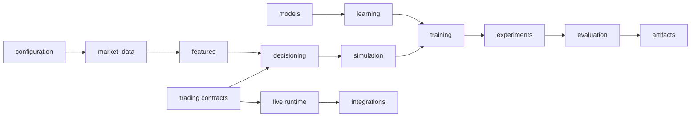

# Architecture

This repository builds an end-to-end framework for quantitative reinforcement
learning research. Market data and configuration feed causal features and a
broker-neutral trading model. The simulator provides training and historical
evaluation environments; model and learning packages implement policy
architectures and training algorithms. Experiments resolve configurations and
record provenance, while evaluation writes reports and artifacts. Optional
live execution uses broker adapters behind the trading contracts.

The detailed system map, dependency direction, runtime flows, and domain
boundaries are maintained in the [architecture guide](docs/architecture/README.md).
Package ownership and implementation entry points are listed in the
[module guide](docs/modules/README.md). Exact observation and action contracts
are documented in the [reference section](docs/reference/README.md).

The main dependency direction is:

Runtime settings belong in `config/`; Python packages own implementation.
Serialized observation and action schemas, causal feature alignment,
train-only normalization, and chronological evaluation are architectural
contracts. See [repository invariants](AGENTS.md) and the
[validation protocol](docs/research/validation_protocol.md) before changing
these boundaries.
