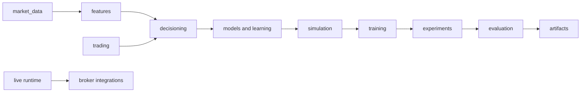

# Quantitative RL Trading System

A research framework for building, training, replaying, and inspecting
reinforcement-learning trading policies. It includes timestamped market-data
pipelines, causal multi-timeframe features, broker-neutral trading contracts,
simulated execution, PPO/SAC learning, evaluation, experiment management, and
optional MetaTrader integration.

The framework supports historical research; it does not guarantee profitable
trading or broker-equivalent fills.

## Start here

- [Documentation website](https://nntk072.github.io/Quantitative-RL-Trading-System/)
- [Documentation index](docs/README.md)
- [System architecture](docs/architecture/README.md)
- [Research workflow](docs/research/workflow.md)
- [Research and evidence](docs/research/README.md)
- [Operations](docs/operations/README.md)

## Runtime path



Configuration controls data, features, model, action schema, account risk,
execution assumptions, training, and evaluation. Research experiment variants
are registered separately from historical run records.

## Setup

The project targets Python 3.12+. Install with `uv sync`. Architecture-specific
virtual environments and Triton storage guidance are in
[operations](docs/operations/triton.md).

Primary commands:

```bash
uv run qrl-data --help
uv run qrl-train --help
uv run qrl-evaluate --help
uv run qrl-experiment --help
uv run qrl-experiment research catalog
```

## Quality checks

Before a commit, run the repository checks appropriate to the change. The same
checks are used by CI:

```bash
./tools/check quality
./tools/check architecture
./tools/check contracts
./tools/check unit
./tools/check integration
```

The optional agent-support environment under `.agents/`, `.claude/`, and
`.codex/` can be used by contributors to improve the repository; it is not a
source of runtime or scientific settings.

The research catalog supports reusable component implementations and named
combinations of variants across experiments. Execution manifests are consolidated
as source-bound observations in `results.json`, `results.csv`, and long-form
`metrics.csv`. See [research workflow](docs/research/workflow.md) for the
configuration and command interface.

## Research limits

Training reward, checkpoint creation, and throughput are engineering
diagnostics. Economic claims require chronological evaluation with matched
execution rules, trade/equity ledgers, risk outcomes, and appropriate
uncertainty. The exposed 2026 report interval is not selectable under the
prospective protocol.

## License

Original project source code and developer-authored documentation are available
under the [MIT License](LICENSE). Market data, model artifacts, experiment
evidence, and third-party dependencies may have separate terms.

## Support and security

See [support guidance](SUPPORT.md) and [security policy](SECURITY.md).
