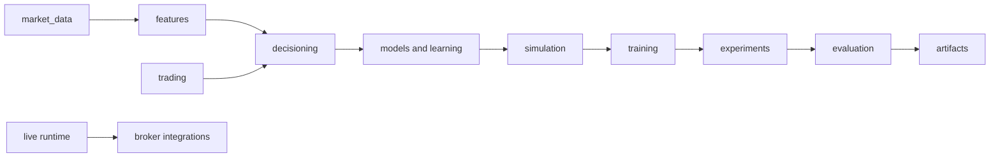

# Quantitative RL Trading System

A research framework for building, training, replaying, and inspecting reinforcement-learning trading policies. It includes timestamped market-data pipelines, causal multi-timeframe features, broker-neutral trading contracts, simulated execution, PPO/SAC learning, evaluation, experiment management, and an optional MetaTrader integration.

The framework supports historical research; it does not guarantee profitable trading or broker-equivalent fills.

## Start here

- [Documentation index](docs/README.md)
- [System architecture](docs/architecture/README.md)
- [Module guides](docs/modules/README.md)
- [Concepts](docs/concepts/README.md)
- [Reference contracts](docs/reference/README.md)
- [Research and evidence](docs/research/README.md)
- [Operations](docs/operations/triton.md)

## Runtime path



Configuration controls selected data, features, model, action schema, account risk, execution assumptions, training, and evaluation. Package boundaries and runtime contracts are described in the linked documentation; settings remain in YAML files and run manifests.

## Setup

The project targets Python 3.12+. Install with `uv sync`; architecture-specific virtual environments and Triton storage guidance are in [operations](docs/operations/triton.md). On Triton use `.venv` on ARM/GH200 and `.venv-x86` on x86_64 nodes; do not run a venv executable on the other CPU architecture.

The current user-facing commands are exposed by the project installation:

```bash
uv run qrl-data --help
uv run qrl-train --help
uv run qrl-evaluate --help
uv run qrl-experiment --help
```

These command names are retained for compatibility during the project identity migration. Use `--help` before invoking a potentially long-running operation. For a reproducible workflow, start with the [training how-to](docs/how-to/run_training.md) and follow the repository's resource rules.

## Quality checks

For a scoped code change, run relevant quality checks. Before a commit, follow [CI verification](.agents/rules/ci-verification.md) and the [commit rules](.agents/rules/git-commit-rules.md). Documentation consistency is checked with:

```bash
./tools/check docs
```

## Research limits

Training reward, checkpoint creation, and throughput are engineering diagnostics. Economic claims require chronological evaluation with matched execution rules, trade and equity ledgers, risk outcomes, and appropriate uncertainty. Previously exposed test periods are exploratory unless a genuinely untouched period is documented.
