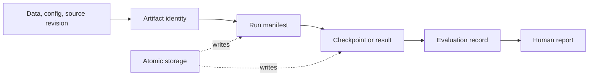

# Artifacts

`artifacts/` defines durable identity and storage contracts for configurations,
checkpoints, evaluations, reports, and run manifests. It separates what an
artifact means from which workflow created it.

| Component | Responsibility |
|---|---|
| `identity.py`, `contracts.py` | Stable artifact identity and typed references. |
| `manifest.py`, `config_snapshot.py` | Provenance and resolved configuration metadata. |
| `atomic.py` | Safe write/replace behavior. |
| `layout.py`, `retention.py` | Directory conventions and retention policy. |
| `promotion.py` | Explicit handling of artifacts selected for downstream use. |

Runs should record enough information to recover data, configuration, source,
checkpoint, and evaluation identity. A manifest establishes provenance; it
does not establish scientific validity. Keep run-specific evidence separate
from generated caches and transient logs.

See the [artifact guide](../docs/modules/artifacts.md) and
[artifact reference](../docs/reference/README.md).

## Lifecycle and ownership

The producing workflow owns the meaning of an artifact; this package owns
shared identity, manifest, path, and safe-write contracts. Consumers should
use typed artifact references rather than infer identity from a folder's
display name. Retention helpers express policy inputs; they do not authorize
deleting research evidence without checking its lineage.

## Extension and verification

When adding a manifest field, define its schema/version behavior and test old
and new readers. Keep fingerprints deterministic and distinguish identity
fields from incidental runtime metadata. Atomic replacement protects against
partially written metadata but does not make a multi-file experiment
transactional. Tests are under `tests/unit/artifacts/`; workflow-specific
manifest tests live with training, evaluation, and experiment runs.
