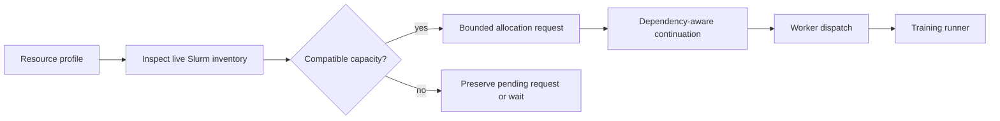
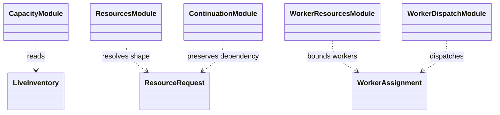

# Slurm resource adapters

`compute/slurm/` turns a declared resource request into scheduler-facing
capacity checks, allocation continuation, and worker-dispatch inputs. It is an
adapter for the compute package; policy training and experiment semantics
remain in their owning packages.

## Resource lifecycle

The capacity and resource helpers inspect scheduler inventory and form a
resource request. Continuation helpers preserve job dependencies. Worker
dispatch maps an approved allocation to configured worker capacity. The
operator-facing allocation sequence and safety rules are in the
[Triton runbook](../../docs/operations/triton.md).

## Contracts and limits

Availability is time-dependent; a resource profile is a request, not proof of
an allocation. A running Slurm job is not proof that its GPUs are utilized.
Do not create one scheduler step per worker or variant. Keep dependency and
resource-shape metadata with the run record so a resumed run is distinguishable
from a fresh run.

## Extension and verification

Keep node-family details and scheduler command syntax inside this adapter.
Test parsing and request shaping against explicit inventory fixtures; inspect
live scheduler state only through the operator workflow. Relevant coverage is
under `tests/unit/compute/` and `tests/architecture/`. See the
[compute module guide](../../docs/modules/compute.md).

## UML module view

