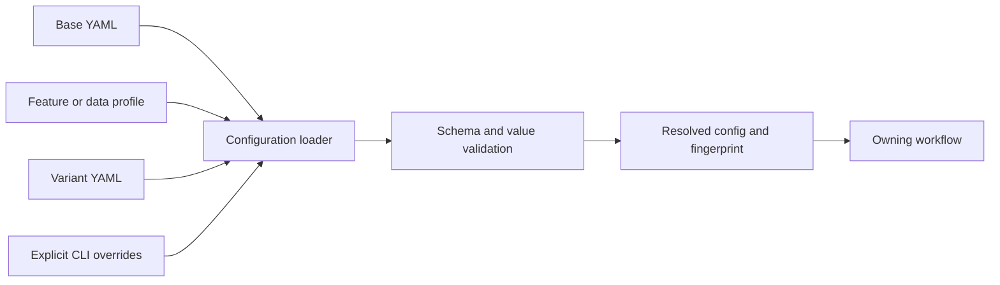

# Configuration

`configuration/` loads, merges, validates, and fingerprints resolved settings.
It is the boundary between human-authored YAML and the typed configuration
consumed by data, training, simulation, and evaluation.

| Component | Responsibility |
|---|---|
| `configuration_loader.py` | Load layered YAML and apply the repository's resolution rules. |
| `schema.py` | Validate recognized configuration sections and values. |
| `paths.py` | Resolve repository-relative and configured filesystem paths. |
| `hashing.py` | Produce stable identities for configuration content. |

The main defaults live under `config/base/`; feature, variant, run, and
experiment inputs remain separate files. Configuration is not a second
implementation of trading behavior: consumers own the semantics of the keys
they read. When adding a setting, define and validate it here, document its
owner, and test both defaults and overrides.

See the [configuration guide](../docs/modules/configuration.md),
[configuration reference](../docs/config.md), and
[system architecture](../docs/architecture/README.md).

## Resolution flow

Layering is an input to resolution, not permission for each consumer to invent
its own merge order. The resolved configuration is the effective contract for
one run; an individual YAML file is only one contribution to it.

## Adding or changing a setting

Find every reader before changing a key. State whether it changes data,
features, observation layout, policy behavior, execution, risk, reporting, or
only operations. Add validation and tests at the configuration boundary, then
update the owning package guide. For serialized settings, preserve old reads or
provide an explicit migration while historical runs still require them.

Focused tests are under `tests/unit/configuration/`. Variant resolution also
has coverage under training and experiment tests. Do not copy full effective
configurations into this page; inspect the resolver output for the selected
run.
