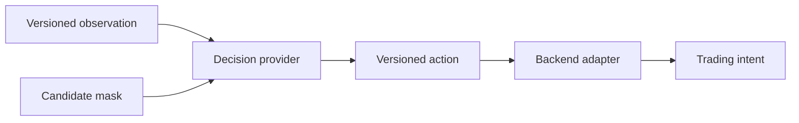

# Decisioning

`decisioning/` defines versioned observation and action meaning independently
of PPO, SAC, the simulator, or broker libraries. It is the contract boundary
between information available to a policy and the intent that downstream
systems interpret.

| Component | Responsibility |
|---|---|
| `observations.py`, `regime_observations.py` | Named account-state and regime input schemas. |
| `actions.py`, `trade_setup.py` | Ordered discrete/continuous action layouts and the canonical setup-category contract. |
| `thesis.py` | Deprecated compatibility imports for historical checkpoint and source names. |
| `contracts.py` | Backend-neutral decision inputs, outputs, and provider protocol. |
| `adapters/` | Translate framework-specific models to the common contract. |

Schema version, field order, category order, and mask meaning are serialized
compatibility requirements. Do not rename or reinterpret them in place. The
current `thesis*` wire names are historical identifiers for trade setups;
they remain unchanged in serialized data. New source code uses the
`decisioning.trade_setup` API. Reader-facing meaning is documented in the
[trade-setup concept](../docs/concepts/trade_setups.md).

## Contract flow

An observation schema names and orders information available to a policy. An
action schema assigns meaning to each output. Adapters bridge a learner or
baseline to the backend-neutral provider contract. The environment remains
responsible for execution and final risk validation.

## Compatibility and extension

Change serialized meaning only under a new schema identity. Preserve category
IDs, mask polarity, coordinate order, and no-trade behavior in parity tests.
Legacy checkpoint class paths may need explicit import aliases, but those are
compatibility surfaces rather than canonical domain vocabulary. Focused schema
compatibility tests live in `tests/unit/decisioning/`; simulation, model,
learner, and evaluation suites test downstream use.

See [observation schemas](../docs/reference/observation_schemas.md),
[action schemas](../docs/reference/action_schemas.md), and the
[decisioning guide](../docs/modules/decisioning.md).
