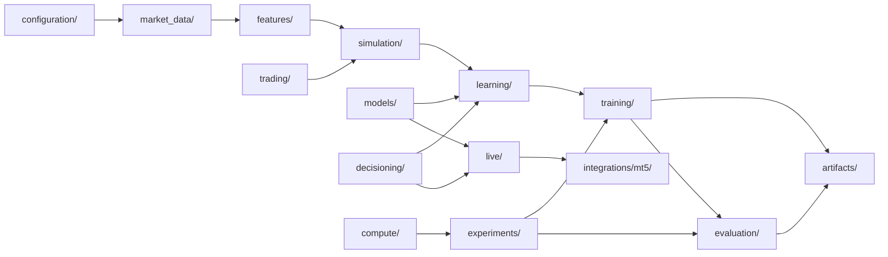

# Repository Architecture

This page describes the current root-package layout. Reusable implementation
lives in the domain packages below; `scripts/` provides research, maintenance,
and compute entry points. There is no active `quant_rl/` package. The checkpoint
loader retains narrow legacy module aliases for old saved models, and dated
audit scripts can retain their original imports; neither defines current
application entry points. Use the current package paths when adding code or
fixing imports.

For repository-wide agent rules and scientific invariants, see
[`AGENTS.md`](../AGENTS.md) and [`.agents/architecture.md`](../.agents/architecture.md).
The [research reference](research_reference.md) documents concrete action,
data, reward, and risk contracts; the [thesis validation protocol](thesis/validation_protocol.md)
defines the calendar roles for thesis evaluation.

## End-to-end flow

Training and evaluation use the simulation contracts and broker-neutral
trading domain. The MT5 integration is a separate live boundary; it does not
own training or simulation behavior. Campaign orchestration coordinates
training, evaluation, provenance, and compute resources without replacing
their domain implementations.

## Package ownership

| Package | Responsibility | Common entry points |
|---|---|---|
| `configuration/` | Load, merge, validate, hash, and locate configuration | Configuration services |
| `market_data/` | Load bars and ticks; clean, align, transform, split, and cache inputs | `market_data.loading`, `market_data.transforms`, `market_data.splits`, `market_data.cache` |
| `features/` | Build causal feature matrices and their cache identity | `features/pipeline/feature_matrix_builder.py`, `features/pipeline/feature_cache_identity.py` |
| `trading/` | Broker-neutral account, order, position, cost, risk, and strategy domain | `trading/execution/`, `trading/risk/`, `trading/strategies/` |
| `simulation/` | Environment transitions, Gymnasium environment, and event-driven backtest | `simulation/contracts/`, `simulation/environment/env.py`, `simulation/backtest/` |
| `models/` | Reusable neural encoders, encoder registry, and model runtime helpers | `models/encoders/`, `models/factory/`, `models/runtime/` |
| `learning/` | SB3 policy adapters, PPO/SAC construction and fitting, checkpoint loading, and learner contracts | `learning/rl/`, `learning/contracts.py` |
| `decisioning/` | Versioned observation and semantic action contracts and model adapters | `decisioning/contracts.py`, `decisioning/observations.py` |
| `training/` | Training setup, execution, callbacks, and run reporting | `training/cli.py`, `training/runner/` |
| `evaluation/` | Rollouts, metrics, reanalysis, provenance validation, reporting, and plots | `evaluation/cli.py`, `evaluation/rollout/`, `evaluation/reanalysis/` |
| `experiments/` | Variant and campaign definitions, orchestration, lineage, and status | `experiments/cli.py`, `experiments/campaigns/campaign_execution.py`, `experiments/variants/` |
| `artifacts/` | Shared artifact identity, validated manifests, layout, atomic writes, retention, and baseline promotion | `artifacts/` |
| `compute/` | Device/environment capabilities and Slurm resource, worker, and allocation-continuation mechanics | `compute/cli.py`, `compute/slurm/` |
| `live/` | Broker-neutral live and paper strategy runtime | `live/runtime/strategy.py` |
| `integrations/mt5/` | MetaTrader-specific data, broker, robot, and risk adapters | `integrations/mt5/` |
| `orchestra/` | Multi-model repository task orchestration and CI workflow | `orchestra/cli.py` |

`models/` contains reusable architectures. `learning/` contains backend and
optimization mechanics. `training/` composes configuration, data, features,
simulation, and learning into runs. `evaluation/` reloads saved runs through
the supported rollout/reporting interfaces. `experiments/` coordinates
multiple runs and records their lineage.

Campaign workflow ownership is in `experiments/campaigns/campaign_execution.py`;
the former `execution.py` entry point remains a compatibility adapter for
existing launchers. Campaign cache-failure recovery is owned by
`experiments/campaigns/cache_failure_recovery.py`. Generic worker resource
sampling and dispatch mechanics are owned by `compute/slurm/`; the historical
`experiments/campaigns/resources.py` path forwards to the compute owner. The
`compute/slurm/resume.py` command/API adapter forwards recovery requests to the
experiment owner without creating a static package dependency in the reverse
direction. Campaign artifact locations and atomic writes use `artifacts/`.

The `integrations.mt5` package exposes concrete adapters lazily, so importing
the package surface does not require the MetaTrader5 vendor module. Live RL
risk values are parsed and validated in `integrations/mt5/risk_configuration.py`;
failed sizing produces no order, and MT5 close fills use bid to close longs and
ask to close shorts.

Evaluation output assembly lives in `evaluation/reporting/run_artifact_writer.py`.
Its `evaluation_manifest.json` links numerical split artifacts to parent
training or reanalysis manifests. Rollout, checkpoint replay, fill/position
tables, and chart geometry/rendering have separate named owners. Training
progress plots live under `training/reporting/`; proven historical evaluation
paths remain compatibility wrappers. The former training-plot path was retired
to preserve the evaluation-to-training dependency direction.

## Data and timeframe boundaries

`market_data.loading.run_pipeline()` builds configured bar datasets and can
consume native timeframe files or derive explicitly configured timeframes.
`market_data.loading.build_tick_books()` assembles configured tick partitions.
Cache paths and identities are owned by `market_data.cache`; session labels and
the date-specific session-close calendar are owned by `market_data.transforms`.
Do not assume that all timeframes are derived from M1 or that configured
timeframe files are ignored; the active source and derivation rules come from
the resolved dataset configuration.

`features/pipeline/feature_matrix_builder.py` builds the feature matrix. It accepts primary
and optional secondary series, train scope, and configured timeframe bars.
Input resolution is handled by `features/pipeline/feature_build_inputs.py`;
alignment, normalization, and cache identity live under `features/pipeline/`.
Strategies and simulation consume the resulting features; session eligibility
is represented as state/masks rather than deleting market bars.

Thesis date boundaries and the exposed 2026 interval are specified in
[`thesis/validation_protocol.md`](thesis/validation_protocol.md) and the
operational [master execution plan](thesis/master_project_execution_plan.md).
Do not infer a new data split from a cache name or historical document.

## Commands

The supported installed command surfaces are registered in `pyproject.toml`:

| Command | Implementation | Purpose |
|---|---|---|
| `thesis-data` | `market_data.cli:main` | Dataset preparation and inspection |
| `thesis-train` | `training.cli:main` | Training workflows |
| `thesis-evaluate` | `evaluation.cli:main` | Evaluation workflows |
| `thesis-campaign` | `experiments.cli:main` | Variant and campaign operations |
| `thesis-compute` | `compute.cli:main` | Compute capability and scheduler workflows |
| `orchestra` | `orchestra.cli:main` | Repository task and verification orchestration |

Use package APIs for reusable logic. Keep scripts thin; put shared behavior in
the owning domain package.

## Scientific and execution invariants

- Features must be causal. Higher-timeframe values are aligned only after
  their source bars close.
- Fit normalization on training data only and preserve the fitted statistics
  for later partitions.
- Keep calendar partitions chronological; use purged, non-overlapping
  walk-forward folds where configured.
- Keep all supplied market bars, including bars from shortened sessions;
  session eligibility must not remove observations from the feature dataset.
- Include configuration, source, data, feature/cache, checkpoint, seed, and
  runtime identities in evidence used to support a result.
- Keep simulation/training execution and risk semantics aligned. Keep
  broker-specific behavior inside `integrations/`.
- Follow `.agents/rules/triton-slurm.md` for allocations, campaign continuity,
  and worker dispatch. Never cancel a job with `scancel`.

These are navigation-level summaries. The source implementation, resolved
configuration, and current thesis plan are authoritative when they differ from
older examples or historical research notes.
