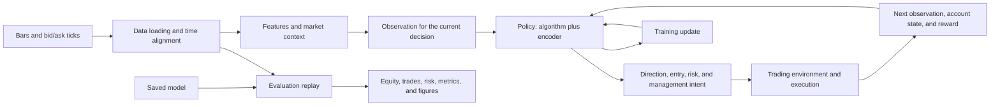

# How the trading system fits together

This repository turns historical market data into trading decisions, trains a
policy to make those decisions, and replays the saved policy against market
data to measure what happened. The same market history supports more than one
purpose: learning the policy, checking software behavior, and evaluating a
trained policy are separate activities.

The guides below explain each area in plain language. They describe the
system’s purpose, the information it receives, the work it performs, and its
limitations. Source code is linked only as an implementation reference.

## System flow

In training, the environment applies a decision to its simulated account and
returns the resulting state and reward. The learner uses many such transitions
to update the policy. In evaluation, the saved policy is replayed over a chosen
time range and the resulting account path and trades are reported. A test of
software behavior is a third activity; passing software tests does not show
that a policy is profitable.

## System areas

| Area | What it answers | Guide |
|---|---|---|
| Configuration | How settings select consistent behavior across a run | [Configuration](modules/configuration.md) |
| Market data | How timestamped bars and bid/ask ticks enter the system | [Market data](modules/market_data.md) |
| Features | How market observations become causal model inputs | [Features](modules/features.md) |
| Trading | How accounts, orders, execution, and risk rules are represented | [Trading](modules/trading.md) |
| Decisioning | How a model output becomes a defined trading intent | [Decisioning](modules/decisioning.md) |
| Simulation and environment | How an action changes the simulated account | [Simulation](modules/simulation.md) |
| Models and learning | How the policy represents observations and learns from experience | [Models](modules/models.md), [Learning](modules/learning.md) |
| Training | How a recoverable training run is assembled | [Training](modules/training.md) |
| Testing | What automated checks establish and what they do not | [Testing](modules/testing.md) |
| Evaluation | How a saved policy is replayed and reported | [Evaluation](modules/evaluation.md) |
| Experiments | How controlled research comparisons are organized | [Experiments](modules/experiments.md) |
| Artifacts and compute | How results are retained and workloads are resourced | [Artifacts](modules/artifacts.md), [Compute](modules/compute.md) |
| Live and external systems | How policies cross into live or vendor-specific boundaries | [Live runtime](modules/live.md), [Integrations](modules/integrations.md) |
| Engineering workflow | How repository changes are coordinated and verified | [Orchestra](modules/orchestra.md) |
| Research | How comparisons are designed and findings are interpreted | [Research guide](research/README.md) |

## Important limits

- The simulator is a research tool. A historical replay cannot guarantee live
  execution quality, future returns, or account survival.
- Training reward is an optimization signal, not a trading-performance result.
- An observed test interval is exploratory once it has influenced model or
  design choices; it is not a fresh confirmatory sample.
- Market-data, feature, execution, and account assumptions affect every result.
  Reports should state those assumptions in words and explain their effect.

For configuration concepts, see [Configuration](config.md). For machine and
Slurm operations, see [Triton operations](operations/triton.md). Research
results are organized separately from these system guides so that a reader can
learn the design before reading individual findings.
