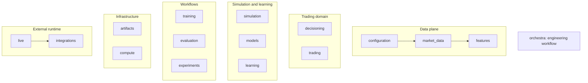

# Building blocks

The production system is organized by ownership, not by the order in which a
researcher happens to run commands.

This is a responsibility view, not a dependency graph. See the generated
[package dependency model](dependency_model.md) for actual Python imports.

| Building block | Responsibility | Deliberate boundary |
|---|---|---|
| `configuration/` | Load, merge, validate, and resolve runtime settings | Does not construct training workers or models |
| `market_data/` | Load bars and ticks, transform timeframes, define splits, and manage data caches | Does not assign strategy meaning to raw prices |
| `features/` | Build causal technical and market-context measurements | Does not place orders or depend on trading execution |
| `decisioning/` | Define versioned observations, actions, and backend-neutral decision providers | Does not implement PPO, simulation, or broker execution |
| `trading/` | Own account, order, position, risk, execution, policy, and strategy contracts | Does not own the RL environment or learning algorithm |
| `simulation/` | Apply decisions to a market/account simulation and produce transitions | Does not own reusable neural models or policy optimization |
| `models/` | Provide reusable encoders and auxiliary neural components | Does not depend on Gymnasium, simulation, or SB3 policies |
| `learning/` | Compose learning algorithms, policy distributions, buffers, and checkpoint loading | Does not own the market-data or account domain |
| `training/` | Compose configuration, inputs, features, environments, learners, and checkpoint output | Workflow composition root |
| `evaluation/` | Replay providers/checkpoints and calculate metrics, reports, and plots | Remains backend-neutral except isolated compatibility adapters |
| `experiments/` | Resolve variants and coordinate reproducible experiment runs | Does not define low-level simulator behavior |
| `artifacts/` | Own identities, manifests, atomic storage, and artifact lifecycle primitives | Shared infrastructure used by workflows |
| `compute/` | Discover devices/resources and adapt to Slurm execution | Does not choose research hypotheses or training settings |
| `live/` and `integrations/` | Keep broker-neutral runtime separate from MetaTrader-specific adapters | Vendor dependencies stay outside core trading contracts |
| `orchestra/` | Coordinate repository engineering and CI workflows | Does not participate in model inference or trading |

## Composition roots

`training/` assembles the learning path. `experiments/` resolves and runs
comparisons. `evaluation/` composes a provider with a simulator for replay.
`live/` composes market data, observations, decisions, and a broker-neutral
runtime. The package dependency tests constrain these workflow roots so
domain and reusable component packages remain independently usable.
