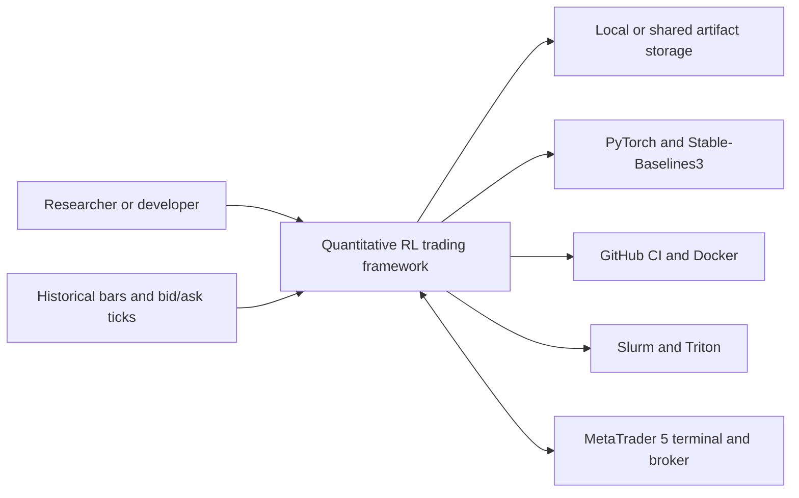

# System context

The framework is used to build, train, inspect, and evaluate quantitative
trading policies. Its boundary includes historical-data processing, simulated
trading, model training, artifact production, and optional live or paper
integration. External providers and runtimes remain outside the core domain.

## External participants and systems

| Participant/system | Relationship to the framework | Boundary |
|---|---|---|
| Researcher or developer | Selects configuration, data partitions, model, and evaluation protocol | Human workflow and repository interfaces |
| Historical market data | Supplies timestamped bars, tick quotes, and session metadata | Input files and dataset contracts |
| PyTorch and Stable-Baselines3 | Provide tensor operations and established PPO/SAC implementations | Learning implementation dependencies |
| Slurm and Triton | Allocate CPU, RAM, and accelerator resources for bounded work | Compute adapters and operator procedures |
| Local/shared filesystem | Stores caches, checkpoints, reports, and provenance | Artifact and cache layouts |
| GitHub CI and Docker | Build and validate supported software surfaces | CI workflows and container definitions |
| MetaTrader 5 | Optional market/broker connection for paper or live execution | Vendor-specific integration package |

The core packages do not own the market-data provider, cluster scheduler,
filesystem durability guarantees, or broker. Adapters translate those
external contracts into repository-owned data, compute, artifact, and trading
interfaces.

## Evidence boundary

Software tests establish code behavior and contract consistency. Historical
evaluation describes behavior on a specified dataset and execution model. It
does not establish future profitability or guarantee that a live broker will
produce identical fills.
