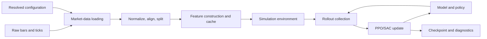
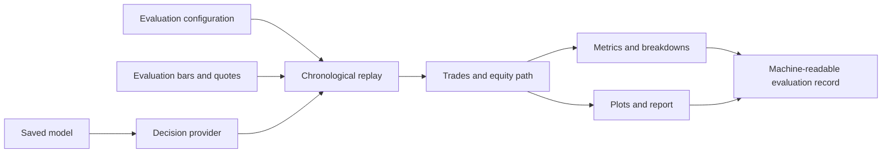

# Data flow and runtime composition

This page follows the repository's information flow from historical inputs to
research results. It complements the package dependency graph: data flow
shows runtime sequence, while the graph shows Python import relationships.

## Prepare and train

Configuration selects inputs and behavior; it is resolved before the run and
recorded with the resulting artifacts. Feature caches are reusable inputs and
must be keyed by their relevant data and feature configuration. Training
consumes observations and produces policy updates plus diagnostics; it does
not establish held-out economic validity.

## Evaluate and report

The evaluation ledger is the common evidence source for metrics, plots, and
trade-level examples. Where those outputs disagree, resolve the discrepancy
from ledger events and fill/accounting semantics before interpreting the
result.

## Experiment composition

An experiment resolves a set of named variants, data identity, seed, and
training budget, then routes those runs through training and evaluation. The
experiment layer coordinates run identity and recovery; it should not redefine
the simulator's execution semantics.

## Important boundary

Market data and features must be causal. Evaluation is chronological and uses
the declared split. Previously exposed test periods are exploratory unless a
separate untouched period is identified. A generated cache or completed
checkpoint is an artifact, not proof that the experiment's scientific
comparison is valid.
