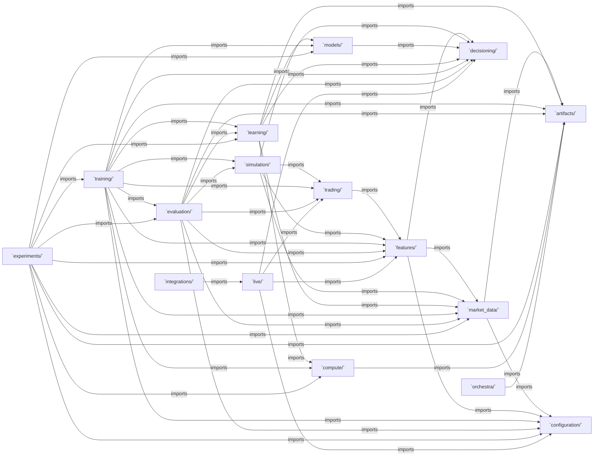

# Package dependency model

This graph is generated from direct Python imports among the production
packages. An arrow means the package at the tail imports the package at the
head. External libraries and imports within a package are omitted. The
analysis follows the same AST-based import rule as the architecture tests;
dynamic imports assembled from strings are not represented.

The graph is factual, not a complete design prescription. The architecture
tests separately enforce prohibited edges, public cross-package imports,
backend boundaries, and acyclicity. Regenerate with
`python tools/documentation/package_dependency_model.py --write`; check with
`--check`.

<!-- GENERATED PACKAGE IMPORT GRAPH: START -->

| Package | Imports production packages |
|---|---|
| `configuration` | None |
| `artifacts` | None |
| `market_data` | `artifacts`, `configuration` |
| `features` | `configuration`, `decisioning`, `market_data` |
| `trading` | `features` |
| `decisioning` | None |
| `simulation` | `decisioning`, `features`, `market_data`, `trading` |
| `models` | `decisioning` |
| `learning` | `artifacts`, `compute`, `decisioning`, `market_data`, `models` |
| `training` | `artifacts`, `compute`, `configuration`, `decisioning`, `evaluation`, `features`, `learning`, `market_data`, `models`, `simulation`, `trading` |
| `evaluation` | `artifacts`, `configuration`, `decisioning`, `features`, `learning`, `market_data`, `simulation`, `trading` |
| `experiments` | `artifacts`, `compute`, `configuration`, `evaluation`, `features`, `learning`, `market_data`, `models`, `training` |
| `live` | `configuration`, `decisioning`, `features`, `trading` |
| `integrations` | `live` |
| `compute` | `artifacts` |
| `orchestra` | `artifacts` |

<!-- GENERATED PACKAGE IMPORT GRAPH: END -->

## Directional constraints

The dependency graph must remain acyclic. In particular, reusable feature,
trading, model, decision, and simulation packages must not acquire reverse
dependencies on workflow or backend internals. Evaluation and live runtime
consume backend-neutral decision interfaces; the legacy checkpoint adapter is
isolated as a compatibility composition root.

See [`tests/architecture/test_dependency_rules.py`](../../tests/architecture/test_dependency_rules.py)
for executable import constraints. The tests are authoritative when this
generated graph or explanatory text becomes stale.
