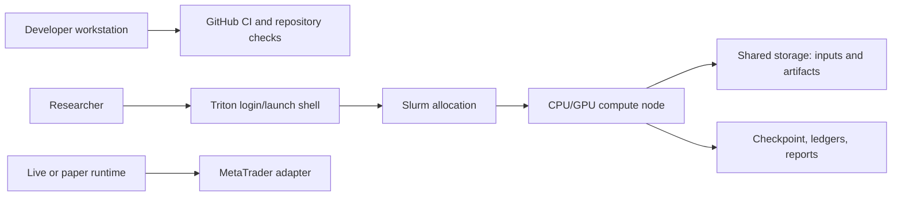

# Deployment view

Local development, cluster training, and live execution are separate
deployment contexts. Training/evaluation workloads run within appropriate
compute allocations; the login shell launches and observes resource work.
Shared storage can hold durable inputs and artifacts, while node-local storage
may be used for temporary compute data when the operation's recovery contract
allows it.

Live execution is an optional integration, not a direct continuation of a
historical replay. Broker risk controls, feed health, action-schema parity, and
paper-trial behavior need independent operational validation. Follow
[Triton operations](../operations/triton.md) and the
[deployment protocol](../operations/DEPLOYMENT.md).
