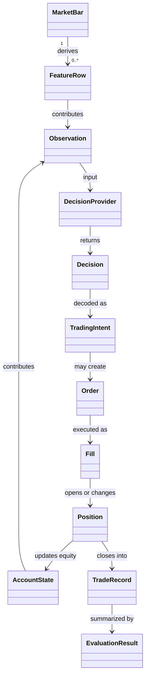

# Domain model

The core domain describes market evidence, a policy decision, a proposed trade,
execution, and resulting account state. This diagram shows the relationships
needed to understand the data path; it is not a class-by-class UML inventory.

`DecisionProvider` is backend-neutral: a PPO model, a baseline, or a live
adapter can satisfy the decision contract. `TradingIntent` remains distinct
from an `Order`; risk and execution can reject or alter a proposed intent.
`Fill` and `Position` update the account, while evaluation summarizes the
recorded path.

Ownership is split across the [building blocks](building_blocks.md):
`market_data` and `features` prepare inputs; `decisioning` defines schemas;
`trading` owns domain state; `simulation` applies historical transitions;
`evaluation` derives outcome summaries.
