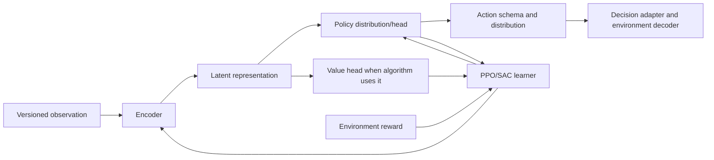

# Model and policy architecture

An agent is assembled from several independent decisions. Keeping them
separate prevents an encoder name from being mistaken for an algorithm or an
experiment arm.

| Choice | Answers | Examples |
|---|---|---|
| Algorithm | How parameters are updated from transitions | PPO, SAC |
| Encoder | How input sequences/context become latent features | TCN, GRU, transformer, MTF encoders |
| Policy/distribution | How output values or categories are represented | Diagonal Gaussian, categorical setup head, hybrid policy |
| Action schema | What ordered outputs mean to trading logic | Discrete menu, overlay coordinates, setup-conditioned overlay |
| Experiment variant | Which declared settings are compared | A resolved configuration in the experiment matrix |

Current registered encoder identifiers are declared in
`models/architecture_ids.py` and resolved against the model factory. The
repository registers `tcn`, `tcn_regime`, `lite_tcn`, `gru`, `transformer`,
`mtf`, `mtf_reasoning`, `mtf_shared_tcn_reasoning`,
`mtf_m1_tcn_htf_lite_reasoning`, and
`mtf_m1_tcn_htf_snapshot_reasoning`. Registration alone does not mean every
algorithm/encoder/action combination is selectable. The generated
[variant catalog](../model_variants.md) lists only combinations present in
configured variants.

## Runtime responsibilities

The encoder consumes only keys expected by its declared observation schema.
The policy produces a distribution over that run's action schema. PPO stores
and evaluates sampled actions against the same distribution contract; masks
that remove invalid categorical choices must remain identical between
selection and `evaluate_actions`. Checkpoints must retain policy class,
encoder identity, observation metadata, action metadata, and relevant
constructor settings.

## Comparison rule

To attribute an outcome to an encoder, algorithm, reward, or action change,
change one comparison factor at a time where feasible. Keep data, execution,
account limits, seeds, and training geometry matched or document the mismatch.
The catalog describes comparison roles; resolved YAML remains the settings
source.
