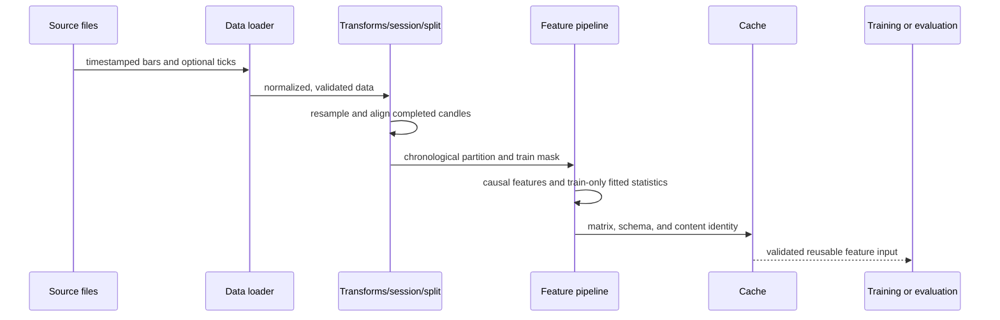

# Data and feature preparation

Data transformation must preserve timestamp ordering and source identity.
Feature calculation must not expose incomplete higher-timeframe candles or
future rows. Fitted normalization uses training rows only. Session labels are
eligibility/context flags; they are not permission to silently discard data.

See [`market_data/README.md`](../../../market_data/README.md),
[`features/README.md`](../../../features/README.md), and the
[validation protocol](../../thesis/validation_protocol.md).
