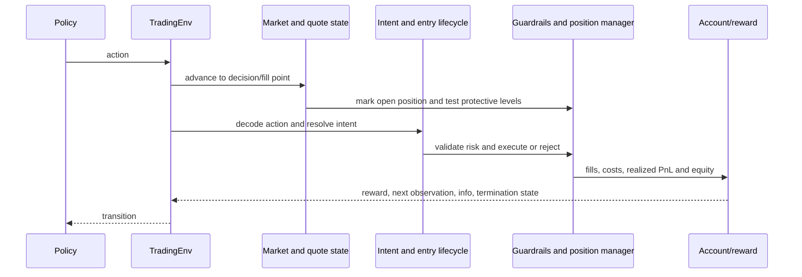

# Environment step

One environment decision consumes the current observation and action,
advances the simulated market/account, and emits the next observation plus
reward and diagnostics. The detailed lifecycle and component map are in the
[environment package guide](../../../simulation/environment/README.md).

The current order matters: market advancement and protective processing occur
before a new action is executed. A new position is therefore not exposed to
price movement that happened before its fill. Exact bar/tick ordering and
execution assumptions are part of the run configuration.
