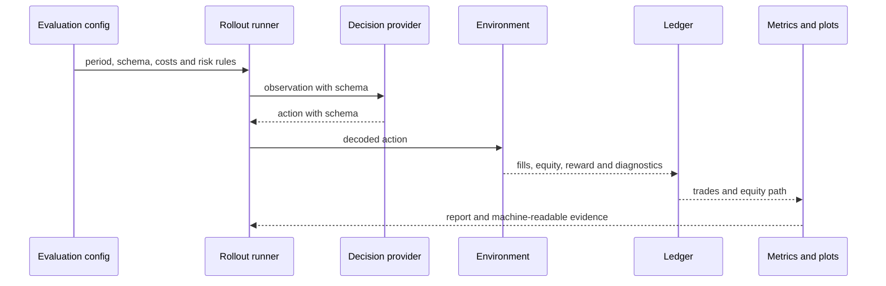

# Evaluation runtime

Evaluation freezes a saved provider, presents chronological observations,
replays the configured execution model, and derives all report outputs from
the resulting ledger. See the [evaluation module guide](../../modules/evaluation.md).

The checkpoint and environment must agree on observation/action schemas. Train,
validation, exploratory test, and untouched test roles are distinct. A period
used to make design decisions is not an untouched confirmation period.
