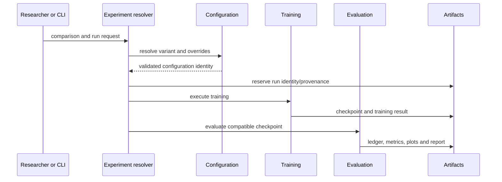

# Experiment run

An experiment coordinates declared variants and run identities while leaving
data, model, learning, and execution semantics to their owning packages.

The generated [variant catalog](../../model_variants.md) explains what each
configured arm represents. It is not a runtime settings source. Frozen run
records preserve the settings and identity actually used.
