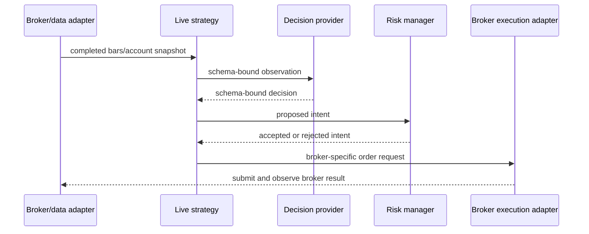

# Live and paper execution

The live path adapts broker events to broker-neutral strategy and risk
contracts, obtains a schema-validated decision, and translates an intent to
broker operations. Broker behavior, order rejection, partial fill, and
connection state must be recorded explicitly.

The current live and historical training paths are not automatically
execution-equivalent. Keep paper mode as the default and consult the
[deployment protocol](../../operations/DEPLOYMENT.md) before any live
promotion.
