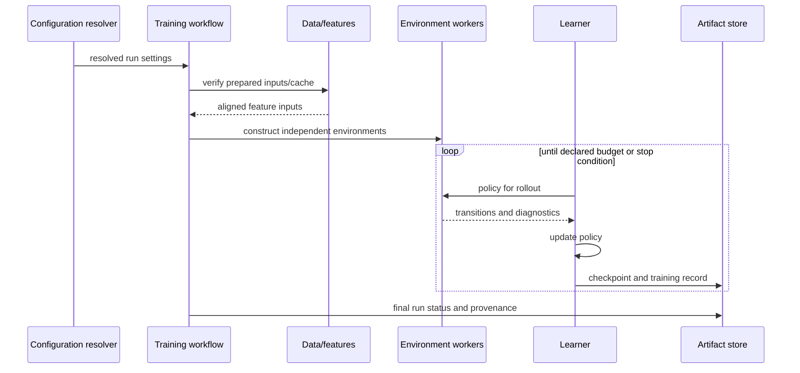

# Training runtime

Training resolves configuration and input identity, builds environment
workers, then alternates policy rollout collection with learner updates. It
records optimization diagnostics, account behavior, checkpoint state, and run
provenance. See the [training module guide](../../modules/training.md) and
[local package guide](../../../training/README.md).

Worker concurrency, rollout size, update geometry, and resume behavior are
algorithm- and run-specific. A smoke or throughput probe must be labeled as
such; it is not a full training result.
