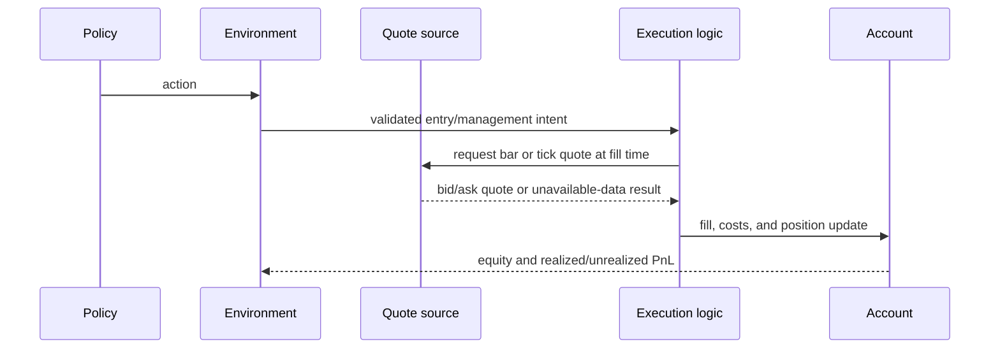

# Execution and costs

Execution converts a proposed trade intent into simulated orders and fills.
The result depends on the selected quote source, timing, spread, slippage,
commission, and protective-level rules. A backtest result is meaningful only
when those assumptions are recorded with the run.

## Execution stages

Entry, market exit, stop, and target fills may follow different configured
paths. Tick fills can use actual bid/ask quotes. Bar-based paths rely on candle
prices and ambiguity rules. Do not describe them as equivalent without replay
parity evidence.

Costs should be applied once at the execution/accounting boundary. Reward
calculation should consume the resulting account change rather than subtract
the same spread or slippage again. Evaluation reports should distinguish
gross/mid-price outcomes from realized outcomes after configured costs.

## Limits

Historical quote availability, timestamp conversion, latency assumptions,
spread models, and within-bar event ordering can all affect fills. These are
simulator assumptions, not guarantees about a broker. See the
[simulation guide](../modules/simulation.md) and the
[operations guide](../operations/triton.md) for reproducible runs.
