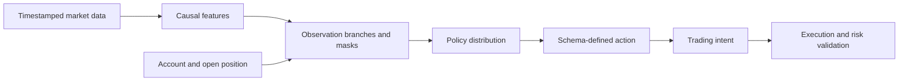

# Observations and actions

The policy receives a causal snapshot of market and account state, then
returns a schema-defined action. The observation describes what was available
at the decision point; the action describes a proposed intent. The simulator
still applies eligibility, execution, and risk checks before changing the
account.

Observations may combine a current M1 sequence, completed multi-timeframe
sequences, account state, and optional regime or setup-eligibility branches.
Masks distinguish valid data from padding and ineligible choices from
eligible ones. Their ordering and meaning are part of checkpoint identity.

Actions may use a discrete menu, a continuous scalar, or named overlay
coordinates. Coordinate meaning is configured and versioned. Changing only
the policy's output width is insufficient evidence of compatibility.

See the exact [observation schema](../reference/observation_schemas.md) and
[action schema](../reference/action_schemas.md).
