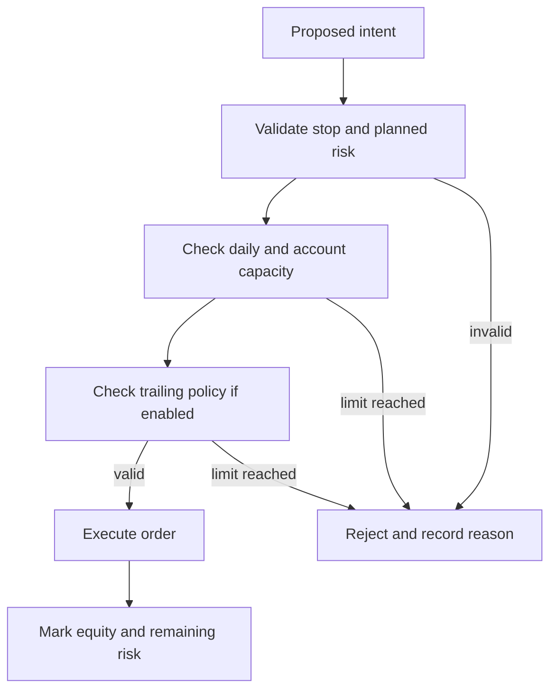

# Risk and account limits

Risk management has two layers. The policy can choose or react to position
risk, while the environment enforces hard account and order guardrails. A
learned penalty or observation feature is not a substitute for those hard
checks.

## Main quantities

- **Planned trade risk:** modeled loss at the proposed protective stop, before
  any later stop movement.
- **Daily loss:** policy-specific loss measured against the current session
  anchor. Its accounting semantics are selected by account policy.
- **Maximum loss:** loss relative to initial account capital or the configured
  account floor.
- **Trailing drawdown:** decline from a high-water mark, if enabled.
- **Exposure and remaining size:** current open position after partial exits.

The account observation exposes normalized ratios where the selected schema
supports them. The guardrail implementation remains authoritative for
accept/reject and termination decisions.

## Decision flow

Configured values, units, fixed-versus-equity-relative interpretation, and
whether a rule is a hard stop or a learned cost must be read from the resolved
run configuration. Do not infer semantics from a YAML key name alone.

## Research interpretation

Survival and profitability are separate outcomes. A candidate that avoids
breach but remains flat or loses money is not a successful sustainable-growth
policy. Reports should show breaches, drawdown, return, trade expectancy,
exposure, and sample size together.
