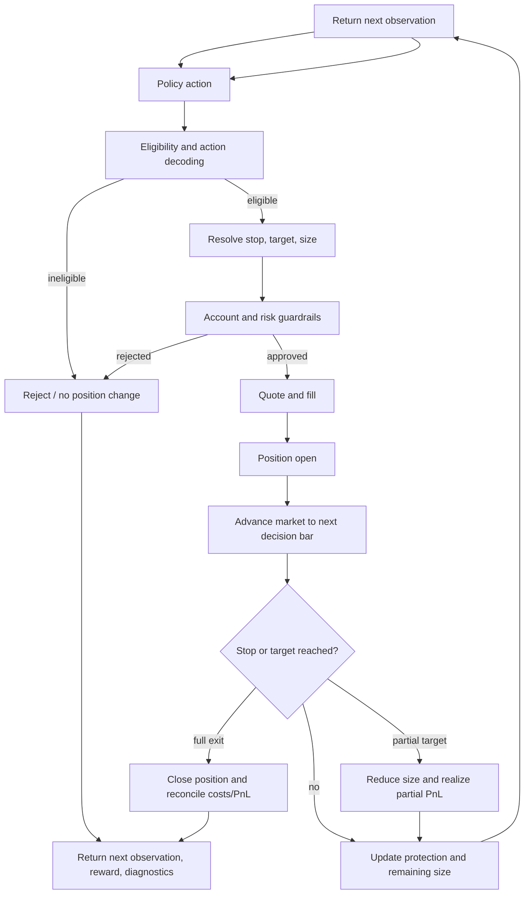

# Trade lifecycle: from policy output to account state

A policy action is an intent proposal. The simulator processes it through
eligibility, strategy references, risk sizing, order construction, fills, and
position management. The path is intentionally explicit so a recorded action
is not confused with an accepted or filled order.

At each step, the environment advances market state and processes protective
conditions before executing the newly supplied action. This prevents a new
position from being hit by price movement that occurred before its fill. For
bar data, intrabar ordering has limits; tick execution, latency, quote choice,
and ambiguous high/low hits are configuration-specific.

## Entry and risk

The configured strategy supplies candidate structural references. The action
may choose among stop, risk, target, or management coordinates. The environment
resolves levels and position size, accounts for execution reserve where
configured, and checks account guardrails. A risk rejection or eligibility
rejection is still a meaningful transition: inspect rejection diagnostics and
the `info` payload rather than counting only fills.

## Open-position management

Positions retain entry, side, size, stop/target levels, and management state.
Configured stop logic can update protection; target execution can partially
close exposure; costs and realized PnL are reconciled to account state. The
current environment supports fixed, breakeven, and trailing TP modes in its
management path, but exact availability depends on action/config and the
versioned schema. Reordering remaining targets after partial fills preserves
position accounting invariants.

## Debug by stage

| Symptom | Inspect first |
|---|---|
| No entries | Eligibility masks, session/blackout state, setup candidates, entry rejection counters. |
| Entry rejected | `entry_rejection_reason`, stop/target candidates, account limits, execution reserve. |
| Fill differs from expected | Quote mode, spread, tick path, latency, and stop/target fill helpers. |
| Stop or target fires unexpectedly | Completed-bar timing, intrabar ordering, position update order, tick source. |
| Equity does not reconcile | Fill ledger, costs, partial size, account mark-to-market and realized PnL. |

See the [environment step map](../architecture/runtime/environment_step.md),
[risk reference](../reference/risk_and_execution.md),
[trade setup catalog](../reference/trade_setup_catalog.md), and
[troubleshooting guide](../how-to/troubleshooting.md).
