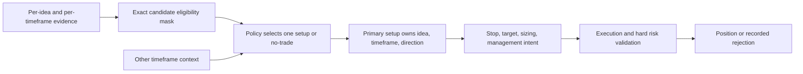

# Trade setups

A trade setup is one candidate explanation for why a position may be opened.
It identifies the entry idea, its setup timeframe, and direction. The policy
may inspect correlated evidence from other ideas and timeframes, while one
selected setup owns the trade's primary semantics.

## Setup identity

The current serialized categorical contract enumerates six ideas across nine
timeframes and two directions, plus no-trade. The current implementation uses
the historical word `thesis` in category and observation identifiers. In
reader-facing prose, “trade setup” is the domain concept; old serialized
identifiers must remain recognizable until migrated with an explicit
compatibility layer.

The six ideas are:

| Idea | Entry evidence at a high level |
|---|---|
| PO3 | A configured manipulation/distribution context and associated structural evidence. |
| Order-block reaction | Price reaction to a valid order-block region. |
| Standard-deviation retracement | Retracement to a configured deviation level measured from a selected swing and timeframe. |
| FVG retest | A retest of a valid fair-value-gap region. |
| IFVG retest | A retest of a valid inverted fair-value-gap region. |
| IFVG unretested | A directional body confirmation beyond the configured IFVG boundary and buffer, without requiring a retest. |

These names describe candidate families, not proof of a profitable signal.
Actual feature definitions and validity rules come from the resolved feature
configuration and current implementation.

## Ownership and cross-timeframe context

Exactly one primary setup is selected per position. It owns the setup
timeframe and direction used to interpret structural stop references. A
structural stop may use the setup timeframe or a higher timeframe; lower
timeframe evidence must not silently redefine the setup floor. Targets may
come from any valid timeframe. For a standard-deviation setup, the selected
setup timeframe also identifies the swing/deviation levels used by that
entry.

Other timeframes remain useful context. They can support or contradict the
primary setup, but pooled signals must not make an ineligible exact
idea/timeframe/direction candidate eligible.

## Eligibility and abstention

Candidate eligibility is represented as a mask. A value of one means the
candidate can be selected at the current decision point; zero means it is
invalid or unavailable. The no-trade candidate remains available. Policies
must mask invalid choices before sampling or choosing an argmax and use the
same mask when evaluating PPO actions.

An eligible setup is not a guaranteed trade: execution, sizing, stop/target
validation, and account guardrails still apply. A rejected entry should be
reported separately from a deliberate no-trade decision.

## Diagram

## Compatibility note

The category IDs and their ordered Box encoding are part of historical
checkpoints. Renaming `thesis` to `trade_setup` in prose does not authorize
changing the serialized action coordinate, observation key, schema version,
or category order. See [action schemas](../reference/action_schemas.md) and
[observation schemas](../reference/observation_schemas.md) and the exact
[trade-setup candidate catalog](../reference/trade_setup_catalog.md).
