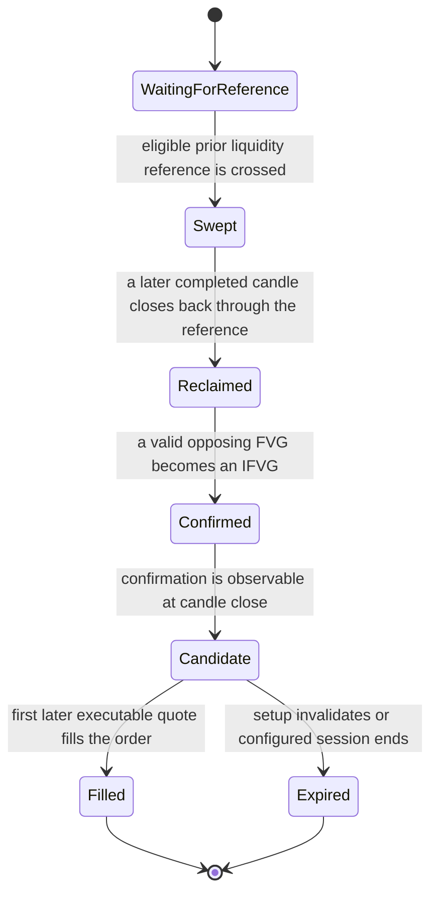

# PO3 and fair-value-gap entry behavior

This page records the current entry and confirmation rules for PO3, fair-value-gap (FVG), and inverse fair-value-gap (IFVG) setups. It describes intended behavior; it does not claim that every rule has passed market-data validation or produced profitable trades.

For the system boundaries, read [Features](../modules/features.md), [Decisioning](../modules/decisioning.md), and [Trading](../modules/trading.md). Exact runtime settings belong in configuration. Run-specific provenance belongs in machine-readable run records.

## Setup sequence

A liquidity sweep is a price event against a previously established reference, such as a qualifying session extreme or confirmed higher-timeframe swing. A line drawn on a chart is not sufficient evidence of a sweep: the reference must come from an observable prior candle or session, and the crossing candle must be identifiable.

## PO3 setup

1. **Reference and sweep:** select a permitted prior liquidity reference. A lower-timeframe candle may trigger the crossing, but an unconfirmed local pivot alone is not promoted to a higher-timeframe reference.
2. **Reclaim:** for a long setup, a completed candle must close back above the swept low; for a short setup, it must close back below the swept high. The sweep candle can also qualify if its close meets the condition.
3. **Displacement and gap:** after reclaim, wait for a directionally opposing FVG to form and then be invalidated by a close through its far edge. Reclaim and IFVG confirmation are separate events; the waiting interval between them is valid.
4. **Eligibility:** the confirmed setup becomes an entry candidate only after its confirmation close. The signal may be recorded at that close, but execution must use a later eligible quote. It must never be filled retrospectively inside the confirming candle.

The selected entry mode is confirmation-first. Retest and pre-confirmation behaviors are separate configured alternatives, not implicit parts of the primary setup.

## Distribution and session context

The distribution setup uses the most recently completed labeled session. Its reference midpoint is the average of that session's high and low. The active unfinished session is excluded. Session labels, timezone boundaries, and daylight-saving behavior come from the configured calendar.

For each proposed entry, a long is eligible only when the latest completed decision candle is below the prior-session midpoint; a short is eligible only when it is above. Equality or a missing reference blocks that proposed entry with an explicit reason. This gate applies to new entries and does not retroactively cancel an open position.

## Stops, targets, and invalidation

- A structural stop for a selected setup uses a reference from the setup timeframe or a higher timeframe. The policy-selected setup timeframe defines the floor; another active context does not silently change it.
- A target may use any valid timeframe and any valid opposite-side reference. The setup-timeframe stop floor does not apply to targets.
- The configured minimum stop distance is the greater of the symbol-specific point floor and the configured short-window ATR fraction. Report the effective distance and units.
- Structural targets prefer the configured reward-to-risk range. If no preferred level exists, the system records the fallback reason and enforces the configured minimum reward-to-risk. Partial target sizes must sum to the intended position size.
- A confirmed swing, FVG, IFVG, or order block stops being an active reference once its configured invalidation condition is met. Cached existence alone does not make a level tradable.
- EMA-21 runner logic applies only to the remaining position after at least one structural partial target has filled. It is not the first target or a replacement for the initial target plan.

## Observable records

A trade report should distinguish the setup signal, order submission, and actual fill. It should name the selected idea, direction, setup timeframe, signal time, fill time and price, position size, stop and target reasons, partial-fill PnL, and any later stop movement. Rejected candidates should state the specific failed condition, such as missing reference, invalidated level, wrong-side midpoint, or unavailable executable quote.

## Scope and limitations

These definitions specify causal event ordering and reference selection. They do not establish that the patterns predict returns. Data gaps, incomplete calendars, spread, quote latency, market impact, and broker-specific execution can change observed outcomes. Validation must check both event timing and the plotted candle/reference geometry before these rules are used for a thesis claim.
