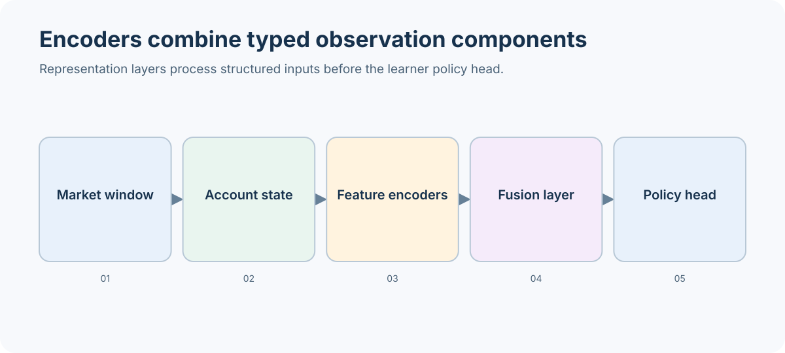

# Models and learning

A model turns the environment's observation into a policy distribution. The learning domain builds and trains that policy; the model domain supplies reusable encoders; decisioning defines the versioned observation and action contracts shared with evaluation and live runtimes.

## Data path and ownership

1. `simulation/environment` constructs a structured observation from the current market window and account state.
2. `decisioning/contracts.py` defines the observation/action envelope and provider contract. The schema version is part of compatibility; a shape-compatible vector with different semantics is still a different policy input.
3. `models/encoders/` combines modality-specific representations. Encoders own representation only; they do not own order validation, position sizing, fills, or reward.
4. `learning/rl/agent.py` adapts PPO/SAC construction and checkpoint loading to the supported backend. The adapter owns algorithm-specific policy construction, not market semantics.
5. Training persists the resolved configuration and artifact identity; evaluation loads a policy through the same declared schema.

## Contract and compatibility

Treat observation keys, dimensions, normalization, action meanings, and schema version as a single compatibility boundary. When changing one, update the contract and its tests, then assess checkpoint compatibility before claiming an old checkpoint remains usable. Keep encoder modules independent of SB3-specific classes so architecture code can be inspected and tested without coupling the public representation to one trainer.

The exact constructor fields are intentionally owned by the generated contract reference; use the declared schema object rather than recreating its wire format in application code.

## Extension workflow

Start with the [custom encoder tutorial](../learn/tutorials/advanced/custom_encoder.ipynb). Define the input contract first, implement the encoder against that contract, then register and exercise it through the learner adapter. Compare parameter counts and tensor shapes before training. A smoke run verifies construction and forward flow only; it does not demonstrate learning quality.

See [model and policy architecture](../architecture/model_and_policy_architecture), [observation and action concepts](../concepts/observations_and_actions), [model architecture reference](../reference/model_architectures), and the curated [Models API guide](../api/domains/models), which links to generated model and learning references.
