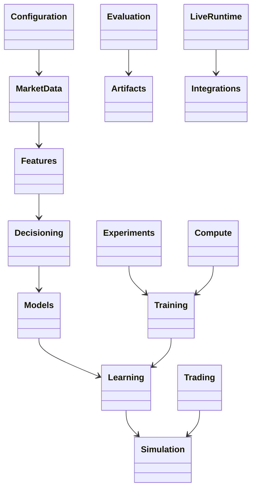

# Module guide

This directory documents the repository in the same order and boundaries as
the Python modules. Each page explains the module’s role, the information that
flows through it, the decisions it owns, and its limitations. A reader should
be able to understand the module before opening its implementation.

## Modules

| Module | Responsibility | Guide |
|---|---|---|
| `configuration/` | Load and validate settings for data, models, training, and evaluation | [Configuration](configuration.md) |
| `market_data/` | Load bars and ticks, align timeframes, split periods, and prepare caches | [Market data](market_data.md) |
| `features/` | Convert market observations into causal model inputs | [Features](features.md) |
| `trading/` | Represent accounts, positions, orders, execution, risk, and strategy rules | [Trading](trading.md) |
| `decisioning/` | Define what a model observes and how its output becomes a trading intent | [Decisioning](decisioning.md) |
| `simulation/` | Advance the account through simulated market events | [Simulation and environment](simulation.md) |
| `models/` | Provide reusable encoders and neural components | [Models](models.md) |
| `learning/` | Define and update RL policies such as PPO and SAC | [Learning](learning.md) |
| `training/` | Assemble data, features, simulation, and learning into training runs | [Training](training.md) |
| `evaluation/` | Replay saved policies and produce trading results | [Evaluation](evaluation.md) |
| `experiments/` | Define model comparisons and manage their run lifecycle | [Experiments](experiments.md) |
| `artifacts/` | Store results, reports, and machine-readable run records safely | [Artifacts](artifacts.md) |
| `compute/` | Detect compute capabilities and manage scheduled resources | [Compute](compute.md) |
| `live/` | Apply broker-neutral strategy decisions in a live or paper runtime | [Live runtime](live.md) |
| `integrations/` | Connect broker-specific APIs to the broker-neutral system | [Integrations](integrations.md) |
| `orchestra/` | Coordinate repository engineering workflows and verification | [Orchestra](orchestra.md) |
| `tests/` | Check contracts and behavior across all modules | [Testing](testing.md) |

Non-package folders such as `config/`, `data/`, `cache/`, `outputs/`,
`scripts/`, and `tools/` are described in [Repository layout](repository_layout.md).

## UML

The package-level diagram is a navigation map. Detailed UML for each domain
is embedded in its module guide below.

## Reading order

For the full learning path, read configuration, market data, features,
decisioning, trading, simulation, models, learning, training, evaluation, and
experiments. Read artifacts, compute, live runtime, integrations, Orchestra,
and testing when working in those areas.

The system diagram is in [Architecture](../architecture/README.md). Domain
terms are explained in [Concepts](../concepts/README.md), and exact schemas
are in [Reference](../reference/README.md). Human research findings are in
[Research](../research/README.md). Operating instructions are in
[Operations](../operations/triton.md).

## Documentation rules

- Explain purpose, concepts, inputs, outputs, and assumptions before naming
  implementation files.
- Use diagrams to show relationships and decision flow. Keep code paths as
  optional navigation references near the end of a page.
- Keep internal run and file identities out of conceptual explanations.
  Generated manifests retain exact identities for automated verification.
- Explain research results with the question, comparison, observed outcome,
  and limitations. Link to machine evidence only when it helps reproduce or
  verify a specific result.
- State what a module does not establish. Passing a software test is not
  evidence of trading profitability; a historical replay is not a promise of
  future performance.
