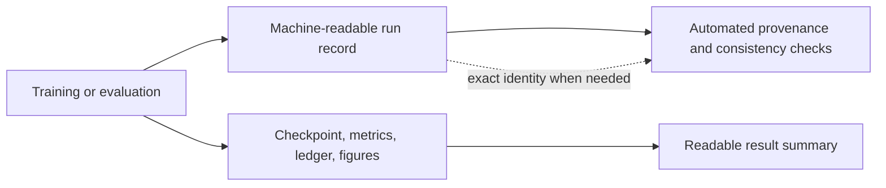

# Artifacts module

## Purpose

Artifacts preserve the outputs needed to understand and reproduce a software
run: model checkpoints, configuration snapshots, metrics, ledgers, figures,
and machine-readable manifests.

## Inputs and outputs

| Receives | Produces |
|---|---|
| Training/evaluation outputs and run context | Safely stored checkpoints, reports, ledgers, plots, and machine-readable records |

## Human report and machine record

The human report explains the question, setup, observed result, and caveats in
readable terms. The machine record stores exact settings and file identities
needed for automated verification. These serve different audiences: internal
identifiers belong in machine records, not conceptual guides or ordinary
report prose.

## Retention

Keep the source needed to support a reported conclusion. Remove only artifacts
shown to be redundant or outside the agreed retention scope. A file’s size or
age alone is not enough reason to delete research evidence.

## Limitations

A manifest can prove which files a run declared; it cannot prove that the
underlying data or execution assumptions are realistic. A checkpoint without
its compatible model schema, configuration, and data context may not be
reproducible.

## Implementation reference

The `artifacts/` module owns layouts, manifests, identities, safe writes, and
retention helpers. Exact machine identities are verified by automated tools.
