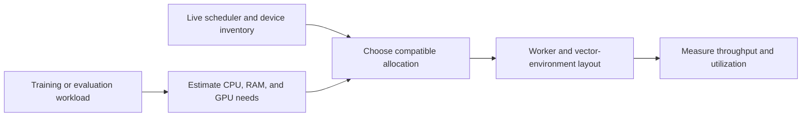
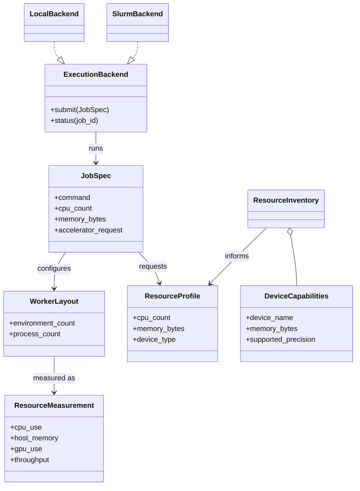

# Compute module

## Purpose

Compute support describes the available execution device and resources so
training and evaluation can run on a suitable machine. It also provides
resource-aware worker dispatch and scheduler integration.

## Inputs and outputs

| Receives | Produces |
|---|---|
| Workload resource needs, compatible device capabilities, and live scheduler state | Resource choice, worker layout, allocation operations, and measured utilization/throughput |

## Resource flow

An allocated GPU is not the same as a GPU in active use. Performance reports
should distinguish allocated resources, measured utilization, CPU/RAM use,
and end-to-end learning throughput. More workers can reduce throughput when
CPU, memory bandwidth, interprocess communication, or GPU inference becomes
the bottleneck.

## Limitations

Resource availability changes over time. A throughput result belongs to its
measured hardware, software environment, model geometry, and workload; it is
not a general device guarantee.

## UML

This UML shows workload needs, hardware capability, scheduling, execution, and
measured resource outcomes as separate concepts.

## Implementation reference

The `compute/` module owns device discovery, resource profiles, and scheduler
adapters. Cluster operation rules are in [Triton operations](../operations/triton.md).
