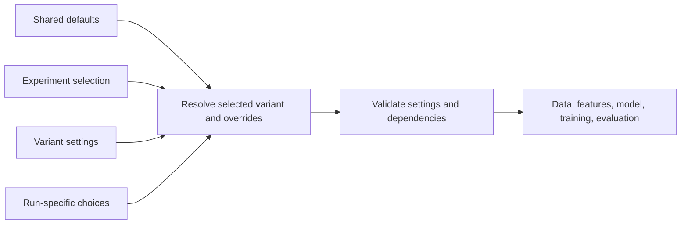

# Configuration module

## Purpose

Configuration selects the data, features, account rules, model, training
procedure, and evaluation behavior for a run. The same setting must not be
silently interpreted differently by training and evaluation.

## Inputs and outputs

| Receives | Produces |
|---|---|
| Defaults, selected variant, run options, and explicit overrides | Validated effective settings consumed by the rest of a run |

## How settings are organized

- `config/base/default.yaml` supplies common defaults.
- `config/experiments.yaml` describes the selectable experiment matrix.
- `config/variants/` contains named model or strategy settings.
- `config/experiment_runs/` contains frozen inputs for a specific comparison
  or bounded run.

The resolved configuration is the effective input after defaults, experiment
selection, and explicit overrides have been combined. Reports should describe
the effective behavior in normal language; the YAML remains the editable
configuration source.

## Configuration flow

## Design rules

- A feature or behavior should have one declared setting with one documented
  default.
- Missing optional settings use the documented default. Invalid explicit
  settings should fail early with a useful message.
- Training and evaluation must resolve the same action, reward, risk, and
  execution semantics unless a comparison intentionally changes one of them.
- A research comparison changes one declared factor at a time where possible.
- A named configuration is not proof that a run used it; reports must state
  the resolved behavior, and machine records retain the exact inputs.

## Limitations

Configuration cannot establish that a data feed, fill model, or strategy is
realistic. It describes what the software is asked to do; data checks and
evaluation determine what actually happened.

## Implementation reference

The configuration package loads, merges, resolves, and validates settings.
The user-facing configuration reference is [Configuration](../config.md).
