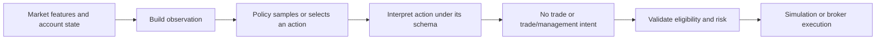

# Decisioning module

## Purpose

Decisioning defines the boundary between a learned policy and trading
behavior. It specifies what state is presented to a model and how model output
is interpreted as a trading intent. This contract lets training, evaluation,
and live adapters use the same meaning for an action.

## Inputs and outputs

| Receives | Produces |
|---|---|
| Causal market features, account state, and eligibility context | Versioned observation; a model action decoded as no-trade, entry, or position-management intent |

## Decision flow

The policy may choose whether to act, the direction, and configured trade or
management parameters. In thesis-conditioned mode, the selected primary thesis
is one exact idea, setup timeframe, and direction. The observation supplies an
eligibility mask, and the policy applies it before choosing a thesis and again
when evaluating the saved action during PPO learning. Invalid choices must
have zero probability. Other timeframe and idea contexts may correlate with
the selected thesis, but they do not replace it.

The selected thesis owns structural stop-timeframe rules: a structural stop
must come from the setup timeframe or a higher timeframe, and a
standard-deviation entry uses level 1 from its selected setup timeframe.
Targets may use any timeframe. A higher-timeframe context does not silently
raise the chosen setup timeframe, and a lower-timeframe confirmation does not
lower it.

## Compatibility

Observations and actions are versioned because a saved checkpoint depends on
their shape and meaning. A new action interpretation must not silently change
the behavior of an older model. Training and evaluation must use compatible
schemas and the same decoder semantics.

## Limitations

A valid action is not necessarily a good trade. The decision contract ensures
that an action has a defined interpretation; profitability and generalization
are determined by evaluation, not by schema validity.

## Implementation reference

The `decisioning/` module owns observation and action contracts. Trading and
simulation consume the resulting intent.
