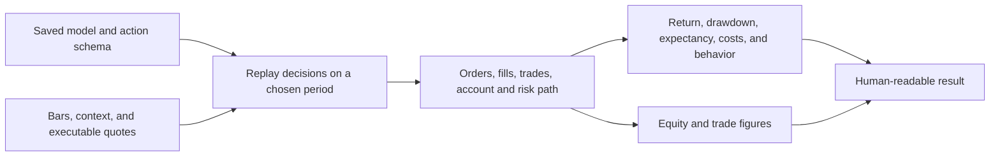
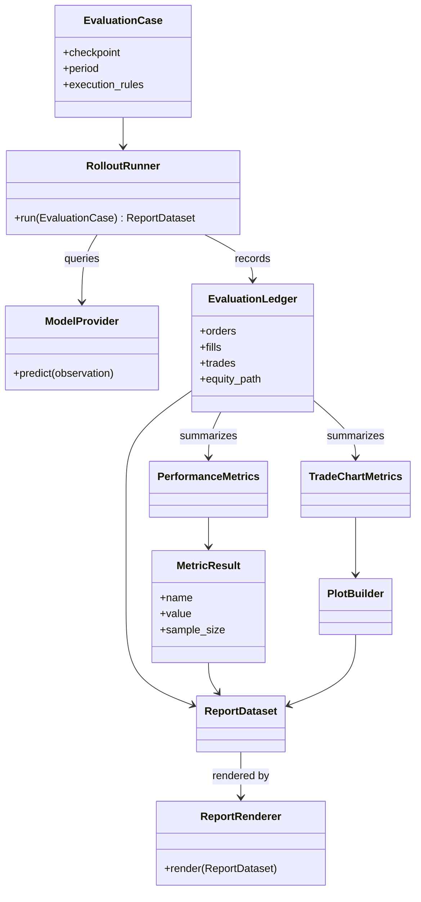

# Evaluation module

## Purpose

Evaluation replays a saved model on a declared period and records what the
simulated account and policy did. It answers a different question from model
training: what results did this frozen model produce under the selected replay
rules?

## Inputs and outputs

| Receives | Produces |
|---|---|
| Saved model, compatible action schema, chosen period, market data, and replay rules | Equity path, trade/fill ledger, risk outcomes, metrics, plots, and a readable result report |

## Evaluation flow

Reports should cover both trading outcomes and how the policy produced them:
equity path, drawdown, survival, trade count, action behavior, entry ideas,
stop/target behavior, execution costs, and meaningful winning and losing
examples. Report unavailable plots or missing data as a failed report
requirement, not as if the figure existed.

## Period roles

Training data is used to fit model parameters. A validation period may support
predeclared selection. A final test is confirmatory only if it has not already
influenced architecture, configuration, or analysis decisions. Previously
inspected periods must be labeled exploratory/report-only.

## Limitations

Backtests are conditional on data quality, quote coverage, fill assumptions,
fees, risk rules, and action interpretation. A strong result on one interval or
seed does not establish robust performance. Use uncertainty estimates and
matched comparisons for claims that go beyond description.

## UML

This UML connects a frozen model and evaluation case to replay outputs, metrics,
plots, and the human report.

## Implementation reference

The `evaluation/` module owns rollouts, metrics, report assembly, and plots.
Training, validation, exploratory, and confirmatory period roles are defined
in the [validation protocol](../thesis/validation_protocol.md).
