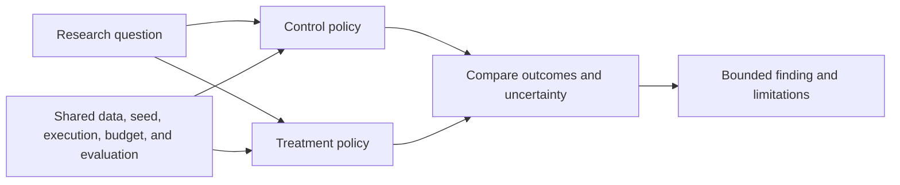

# Experiments module

## Purpose

Experiments organize model comparisons so that a result answers a clear
research question. A variant is a configured model or policy choice; an
experiment defines the arms, shared conditions, training budget, and
evaluation procedure used to compare them.

## Inputs and outputs

| Receives | Produces |
|---|---|
| Research question, comparison arms, shared conditions, and budget | Named run definitions, comparable results, and a bounded finding with caveats |

## Comparison design

The [model and experiment catalog](../model_variants.md) identifies selectable
models and their comparison roles. It does not create settings or declare a
variant successful. Results belong to the report and evidence for the actual
run.

## Comparison discipline

- State the question and expected contrast before interpreting outcomes.
- Match unrelated settings so that a result can be attributed to the declared
  change.
- Preserve failed, low-trade, and incomplete runs as evidence; do not silently
  discard unfavorable arms.
- Distinguish a smoke check, throughput benchmark, pilot, full training run,
  and final evaluation.
- Do not tune on a period already described as final test data.

## Limitations

One seed or one market interval is weak evidence for generalization. A catalog
entry means the system can select the configuration, not that it has been
trained, evaluated, or independently validated.

## Implementation reference

The `experiments/` module owns variant selection and run lifecycle. Result
storage and report output are handled by `artifacts/` and `evaluation/`.
