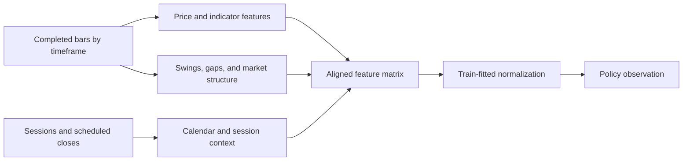

# Features module

## Purpose

Features turn raw prices, quotes, and calendar information into the numerical
observations a policy can use. This module describes the market state; it does
not decide whether a trade should be placed.

## Inputs and outputs

| Receives | Produces |
|---|---|
| Aligned bars, quotes, session/calendar context, and feature settings | Causal feature matrix and the metadata needed to reuse or rebuild its cache |

## Feature construction

The available feature families include price and volatility measures,
technical indicators, session information, and structural context such as
swings, fair-value gaps, inverse gaps, liquidity references, and order blocks
when enabled by configuration. Their presence in the feature set does not mean
that the policy must trade from them.

Indicators and structural context are calculated on their source timeframe
and aligned to the M1 decision timeline only when the source candle is
complete. In the default setup the available streams are M1, M3, M5, M10,
M15, M30, H1, H4, and D1.

## Causality rules

- A feature at a decision time may use only information observable by that
  time.
- A higher-timeframe candle is not complete until its interval closes. Its
  final high, low, and close must not appear earlier.
- Normalization statistics are fitted using training observations only and
  then reused on later periods.
- Session eligibility is context for a decision; it must not silently delete
  market bars from the feature history.
- Historical levels need validity and invalidation rules. A broken or expired
  level must not remain an active reference merely because it is in a cache.

## Feature cache

Feature caches allow different model variants to reuse the same prepared
observations when their feature inputs and definitions match. A changed data
source, feature option, timeframe input, or normalization scope requires a
cache miss or rebuild. Cache identity is an internal correctness mechanism,
not part of the human explanation of a feature.

## Limitations

Features expose measurements and candidate context; they do not prove that a
pattern predicts future returns. More timeframes and feature families increase
input size and may increase computation without improving the policy.

## Implementation reference

Feature building and cache preparation live in the `features/` and
`market_data/` modules. The model receives the aligned matrix through the
observation contract.
