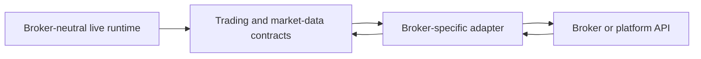

# Integrations module

## Purpose

Integrations connect the repository’s broker-neutral data and trading
contracts to external systems. The current MetaTrader integration handles
broker-specific market data, account state, orders, and robot startup.

## Inputs and outputs

| Receives | Produces |
|---|---|
| Broker-neutral market/trading contracts and external platform responses | Vendor-specific requests, normalized market/account data, and normalized order/fill responses |

## Boundary

The adapter translates concepts such as a requested position, stop, target,
price quote, or fill into the vendor’s API. Broker-specific behavior should not
leak into feature construction or the historical learning environment.

## Limitations

An adapter may depend on a vendor library, terminal, account setting, and
network connection. A passing mock-based integration test cannot prove that a
real account will accept or fill an order as expected.

## Implementation reference

The `integrations/` package contains external-system adapters. The current
broker-specific boundary is under `integrations/mt5/`.
