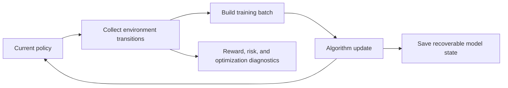

# Learning module

## Purpose

Learning updates a policy from experience generated by the simulation
environment. The algorithm determines how observations, actions, rewards, and
value estimates are used to change the policy.

## Inputs and outputs

| Receives | Produces |
|---|---|
| Environment transitions, rewards, termination state, and algorithm settings | Updated policy, learning diagnostics, and recoverable checkpoint state |

## Learning loop

PPO is an on-policy method: it learns from data collected by the current or a
recent policy and periodically refreshes its experience. SAC is off-policy: it
reuses a replay of earlier experience. Those differences affect memory,
throughput, and sample use; they do not determine which algorithm will perform
better on the trading task.

The reward gives the optimizer a learning signal. The evaluation ledger and
equity curve remain the measures of trading outcomes. If an objective changes,
it should be evaluated against the same execution and account rules as its
control.

## Limitations

Finite training can produce unstable or collapsed behavior. A stable loss
curve, high reward, or successful checkpoint save is not evidence of positive
net trading performance. Risk penalties are learned preferences unless backed
by hard environment guardrails.

## Implementation reference

The `learning/` module builds and updates supported RL agents and handles
checkpoint loading. Reusable encoders are provided by `models/`.
