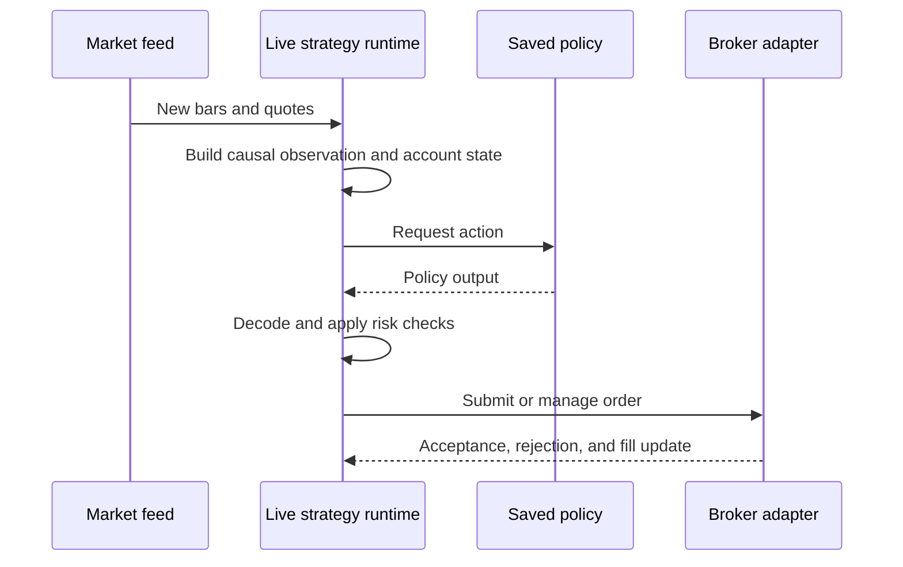

# Live runtime module

## Purpose

The live runtime adapts a saved policy and broker-neutral trading intent to
streaming or paper-trading use. It is separate from historical training and
backtesting.

## Inputs and outputs

| Receives | Produces |
|---|---|
| Current market updates, account state, saved policy, and broker-neutral settings | A validated trading intent and the corresponding broker-adapter request/result |

## Live decision flow

Paper mode and live mode must be visibly distinguished. Live order submission
requires broker-specific prices, sizing, minimum distances, order state, and
failure handling. A model prediction alone is never an executed trade.

## Limitations

Historical evaluation does not validate network reliability, broker rejections,
partial fills, clock drift, or live slippage. Live risk must be checked against
the broker’s actual contract and account values.

## Implementation reference

The `live/` module owns broker-neutral runtime behavior. Broker-specific
translation belongs to `integrations/`.
