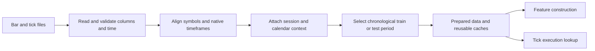
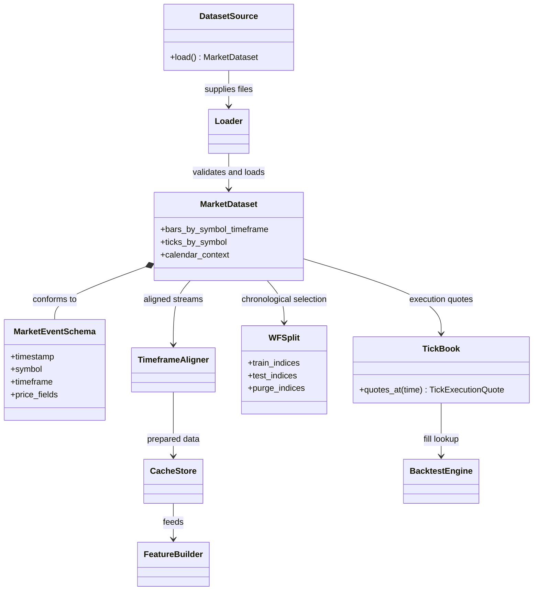

# Market data module

## Purpose

Market data supplies the observations used to build features and simulate
trades. The repository works with time-stamped OHLC bars and tick-level bid/ask
quotes. Bar data describes market movement at a chosen interval; ticks provide
the executable price history used by the fill model when available.

## Inputs and outputs

| Receives | Produces |
|---|---|
| Time-stamped bar/tick files, symbol settings, calendar, and split rules | Validated and aligned datasets, chronological period selections, and reusable data caches |

## Data flow

## Time and timeframe model

The active configuration selects the symbols, the available timeframes, the
timestamp convention, and any explicitly allowed derived timeframe. A bar
timestamp may mark the start of its interval; code must not treat it as the
time at which the completed bar became observable. Higher-timeframe values are
usable only after that bar has closed.

The current default timeframe set is M1, M3, M5, M10, M15, M30, H1, H4, and
D1, with US100.cash as the primary instrument and US500.cash as auxiliary
market context. Each timeframe has its own input series unless the resolved
configuration explicitly declares a derived fallback.

The dataset retains available bars from short sessions. A known shortened
session can be represented by calendar context before the session starts; it
does not need to be inferred from a day ending early. Weekends and market
closures remain gaps in the timeline rather than being filled with invented
price observations.

## Train and test periods

Raw files and cache folders are storage locations, not the definition of a
scientific split. The configured chronological boundaries determine which
rows may train the policy and which rows are reserved for evaluation. Earlier
rows may be retained for feature warm-up while still excluded from policy
training.

The current default split trains from 2024-12-30 through 2025-12-31 and
evaluates from 2026-01-01 onward. The 2026 period has already been inspected in
prior work; treat it as exploratory/report-only rather than a fresh
confirmatory holdout.

## Data assumptions and limitations

- Bar prices summarize an interval and cannot reveal every within-bar price
  path.
- Tick records may have gaps, stale quotes, or broker-specific timestamps.
- Different symbols and timeframes can have different missing intervals.
- A cache is a derived convenience; it must be rebuilt when its source data or
  feature contract changes.
- File coverage alone does not prove feed identity, permission to redistribute,
  or realistic live execution.

## UML

This domain UML shows the public data concepts and the pipeline boundaries.
It omits private parsing helpers and individual file formats.

## Implementation reference

The market-data module owns file loading, timeframe alignment, split handling,
and cache preparation. Reusable bar/tick cache identity and completion checks
are described in the local [cache guide](../../market_data/cache/README.md).
Data files and split settings are selected by the configuration module.
