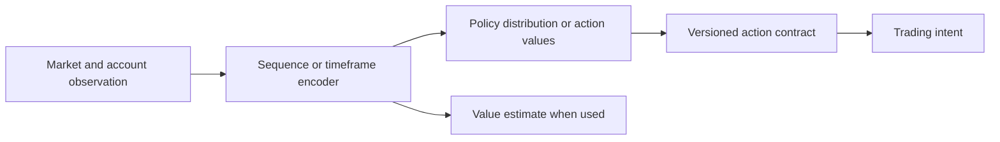
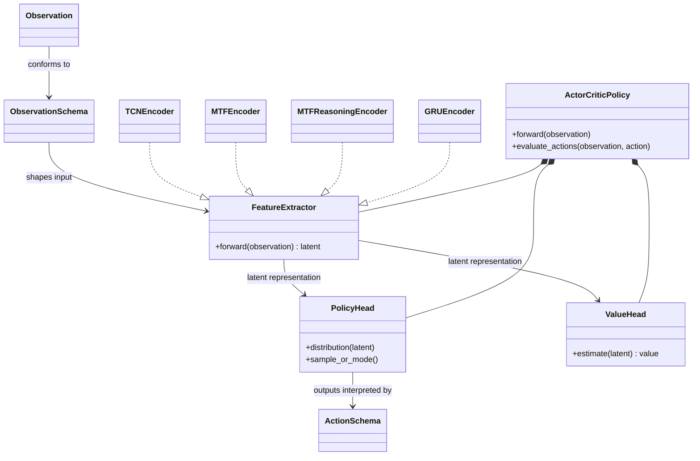

# Models module

## Purpose

Models transform the observation into the policy outputs used by the learning
algorithm. An encoder summarizes market history; a policy head produces
decision distributions; a value head estimates future learning return where
the algorithm requires it.

## Inputs and outputs

| Receives | Produces |
|---|---|
| Versioned observation and, where applicable, candidate-eligibility mask | Encoded market state, policy distribution/action values, and a value estimate when used |

## Architecture vocabulary

- **Algorithm** describes how policy parameters are learned, for example PPO
  or SAC.
- **Encoder** describes how the observation is represented, for example a
  temporal convolution, recurrent network, transformer, or multi-timeframe
  encoder.
- **Action schema** describes what the output means to the trading system.

These are separate choices. A model name should say which research question it
tests; it should not imply support for an algorithm/encoder/action combination
that the configuration and factory do not actually implement.

## Model flow

## Model comparison

The generated [model and experiment catalog](../model_variants.md) lists
selectable algorithm/encoder combinations and research arms. It is an index,
not a second settings file: actual parameters stay in configuration.

## Limitations

An encoder can learn a representation without learning profitable decisions.
Model capacity, input length, and number of timeframes affect speed and memory.
Architecture comparisons are meaningful only when their data, action meaning,
training budget, and evaluation rules are adequately matched.

## UML

The model UML separates observation representation, policy/value outputs, and
the action contract. Encoder families are alternatives implemented by the
model factory, not an assertion that every algorithm/encoder pairing exists.

## Implementation reference

Reusable neural components live in `models/`; PPO/SAC policy construction and
checkpoint compatibility live in `learning/`.
