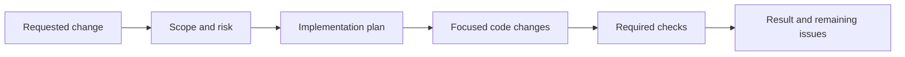

# Orchestra module

## Purpose

Orchestra coordinates repository engineering tasks through defined stages
such as triage, planning, implementation, and verification. It is a developer
workflow tool; it is not part of the trading policy or execution path.

## Inputs and outputs

| Receives | Produces |
|---|---|
| Repository task, applicable instructions, and working-tree state | Scoped changes, verification results, and a handoff describing completed work and remaining issues |

## Workflow

The workflow should preserve the same repository rules as a human contributor:
inspect existing state, keep changes scoped, use the correct environment, run
appropriate checks, and report what was and was not verified.

## Limitations

Automated agents can miss context or misread evidence. Orchestration does not
replace source review, scientific judgment, or the repository’s required
verification gate.

## Implementation reference

The `orchestra/` module owns the task pipeline and its CI integration. Shared
agent instructions live outside the runtime package.
