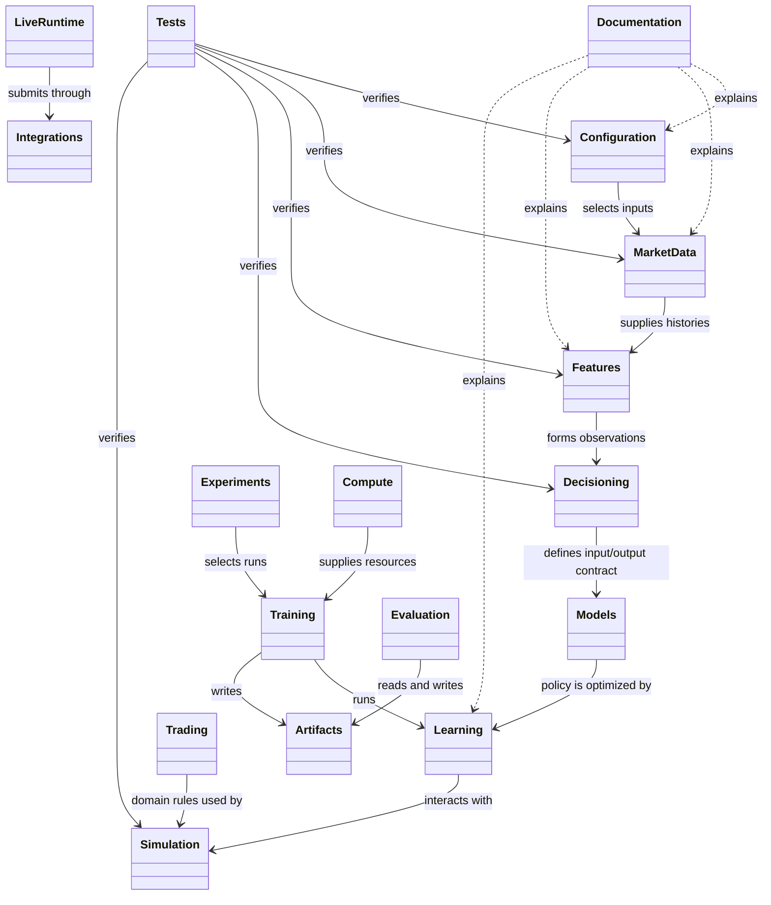

# Repository layout

The repository contains Python modules, configuration, source data, generated
artifacts, and developer tools. These folders have different owners and
retention rules; a folder name should not be mistaken for a Python package.

| Folder | Role | Lifecycle |
|---|---|---|
| `config/` | Shared defaults, variants, experiment definitions, and run selections | Source-controlled inputs; review changes like code |
| `data/` | Raw or prepared market inputs | Preserve original inputs; large files may be managed outside Git |
| `cache/` | Rebuildable data and feature intermediates | Reuse when inputs and feature rules match; otherwise rebuild |
| `outputs/` | Training and evaluation products such as checkpoints, ledgers, and plots | Retain according to research value and storage policy |
| `logs/` | Runtime and worker diagnostics | Useful for diagnosis; not a substitute for a run report |
| `scripts/` | Bounded command-line entrypoints for research, maintenance, and operations | Keep orchestration thin and put reusable behavior in its owning module |
| `tools/` | Repository engineering and verification helpers | Developer tooling, not part of trading behavior |
| `.agents/` | Architecture maps and instructions for coding agents | Engineering guidance; not runtime configuration |
| `.github/` | Automated checks and repository integration | CI and repository automation |
| `baseline/` | Small version-controlled baseline records | Explicit reference inputs; do not use as generated-run storage |

## Data and artifact separation

Raw market data is an input; a cache is a derived intermediate; a checkpoint
is a learned model; and a report is an interpretation of a replay. They should
not be stored or described as interchangeable kinds of output. A deleted cache
can usually be rebuilt; a unique checkpoint, trade ledger, or research result
may not be recoverable.

## Where behavior lives

Settings that change system behavior belong in `config/`. Reusable logic
belongs in the Python module that owns the domain. A script may invoke that
logic but should not become a second implementation of it. Generated result
files belong in the run’s artifact area rather than being copied into unrelated
source folders. See the local [configuration](../../config/README.md),
[scripts](../../scripts/README.md), [tools](../../tools/README.md), and
[baseline](../../baseline/README.md) guides for those non-package areas.

## UML

This package-level UML shows the repository’s stable source and evidence
boundaries. It is a responsibility map, not a deployment diagram.

