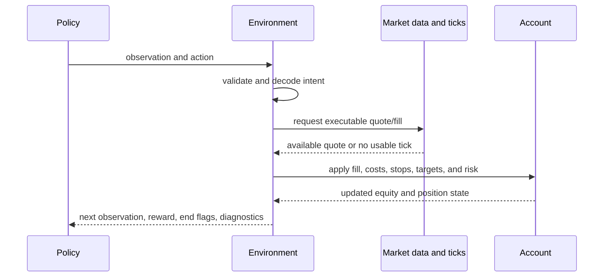
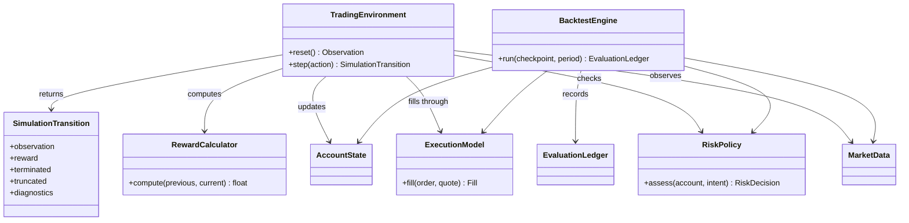

# Simulation and environment module

## Purpose

Simulation advances the account through historical market events. It provides
the interactive environment used for reinforcement learning and a separate
event-driven replay path for backtesting. Both must describe execution and
risk clearly, but they serve different workflows.

## Inputs and outputs

| Receives | Produces |
|---|---|
| Policy action, current market state, account state, and execution/risk settings | Fills and account updates, then the next observation, reward, termination flags, and diagnostics |

## Reinforcement-learning step

The environment’s transition includes the account update and any configured
costs. The reward is a training signal calculated from that transition; it is
not a substitute for realized equity or trade results. Hard daily and account
loss limits belong to the environment/account guardrail, even when the policy
also receives a learned risk penalty.

## Environment and backtest are not interchangeable

The learning environment is designed to generate transitions efficiently for
the learner. The event-driven backtest is designed to replay orders, fills,
position changes, and account rules as a result. A benchmark or smoke run of
the learning environment is not a full backtest result. Differences between
the two paths must be investigated before their results are compared.

## Limitations

Historical simulation depends on the granularity and quality of its inputs.
Bar-only execution cannot recover exact within-bar order. Tick-level execution
is still limited by missing quotes, modeled latency, and assumptions about
broker behavior. Environment termination rules affect what the learner
experiences and must be stated when interpreting a result.

## UML

The simulation UML distinguishes the learning environment transition from the
event-driven replay engine, while showing their shared account/execution rules.

## Implementation reference

The `simulation/` module owns environment transitions and backtesting. Trading
contracts define account and order meaning; market data supplies bars and
quotes.
