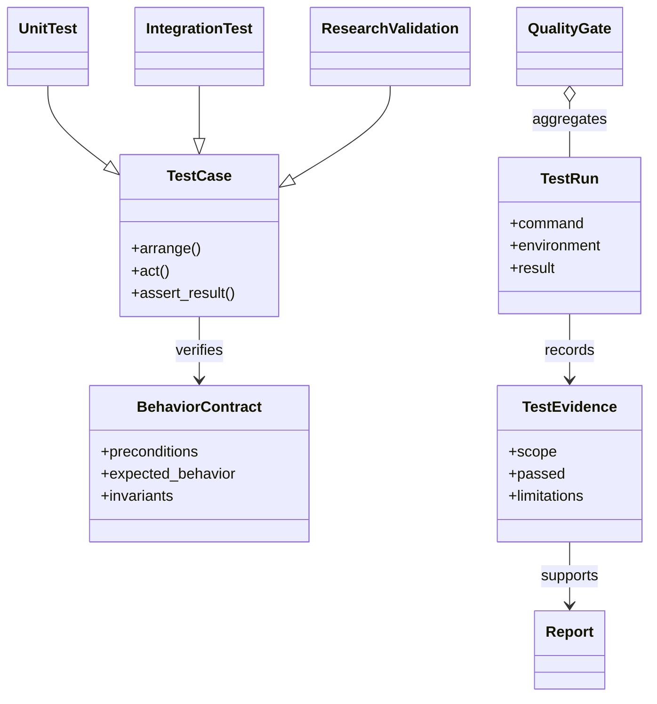

# Testing module

## Purpose

Software tests check whether code contracts and behaviors work as intended.
They help catch defects in data handling, feature causality, action decoding,
accounting, training, checkpoint recovery, and reporting.

## Inputs and outputs

| Receives | Produces |
|---|---|
| Code or configuration changes plus representative cases | Pass/fail evidence about the behaviors that the tests actually exercise |

## Test layers

| Layer | Main question | Typical scope |
|---|---|---|
| Unit | Does a small rule or component behave correctly? | Parsers, reward formulas, masks, metrics, risk calculations |
| Integration | Do connected modules preserve their contracts? | Data-to-feature, policy-to-environment, training and report flows |
| Research validation | Does a declared scientific check support its stated claim? | Causality audits, parity checks, replay verifiers |
| CI gate | Do required repository checks pass together? | Formatting, lint, typing, and selected automated tests |

## How to interpret test results

- A test can validate implementation behavior only within the inputs and cases
  it exercises.
- Passing tests do not establish that a trading policy makes money or
  generalizes to unseen periods.
- A failed test must be traced to the behavior it checks; it is not resolved
  by excluding the case without a documented reason.
- Full-repository verification and a full market-data evaluation answer
  different questions and must not be conflated.

## Running tests

Use the Python environment matching the current machine architecture. For a
focused change, run the directly affected test modules and required static
checks. The repository’s [agent guide](../../AGENTS.md) and
[verification rule](../../.agents/rules/ci-verification.md) define the current
commit gate. Full-suite execution is reserved for the configured CI workflow.

For a local change, use the focused test path that covers its contract, for
example `uv run pytest tests/unit/market_data -q` for a data-loading change or
`uv run pytest tests/unit/simulation -q` for environment behavior. Keep the
test result paired with the change it verifies; do not quote an old green run
as evidence for later code.

## Test ownership

Tests are organized by behavior and domain under `tests/`. A module guide
should link the most relevant tests when readers need to see which contract is
covered; there is no need to duplicate test code in documentation.

## UML

This UML maps a behavior contract to its test layers and reports. A passing
result supports only the contract and cases that were actually exercised.

