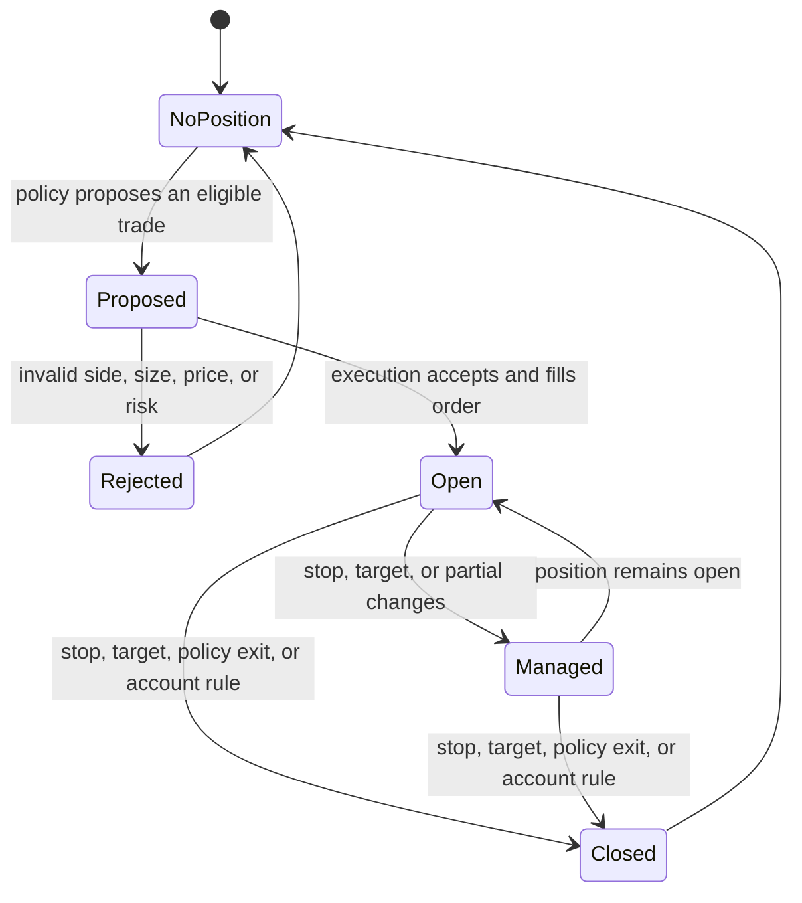

# Trading module

## Purpose

The trading module defines the broker-neutral concepts used by simulation and
live execution: an account, positions, orders, prices, costs, risk rules, and
strategy intent. It separates the meaning of a trade from the details of a
particular broker API.

## Inputs and outputs

| Receives | Produces |
|---|---|
| Account state, market prices, proposed trading intent, and configured rules | Accepted or rejected orders, positions, fills, risk decisions, and account changes |

## Trade lifecycle

An entry proposal, an accepted order, and a filled position are different
events. Reports should make the distinction clear. Account balance, unrealized
profit/loss, transaction costs, and available risk capacity all affect what the
account can do next.

## Risk and execution

Risk checks constrain proposed exposure using the active account rules.
Execution converts an accepted order into a fill under the selected simulation
or broker behavior. Stops, targets, partial exits, spread, slippage, and
commissions affect realized results. The policy can learn a preference, but
hard account limits are enforced by the environment or broker-risk boundary.

For a thesis-conditioned entry, structural stop choices use the selected setup
timeframe or a higher one; the stop is not automatically taken from the highest
available timeframe. Targets can use any valid timeframe. If the
standard-deviation idea is selected, its level 1 reference comes from that
idea’s chosen swing timeframe. When EMA-21 runner management is enabled,
structural partial targets are taken first and EMA management applies only to
the reserved remainder after a target has filled.

## Limitations

Broker-neutral rules do not guarantee broker equivalence. Market hours,
contract sizes, margin, order rejection, quote availability, and fill behavior
can differ between historical simulation and a live venue.

## Implementation reference

The `trading/` module contains reusable account, execution, risk, order, and
strategy contracts. `integrations/` adapts those concepts to external brokers.
