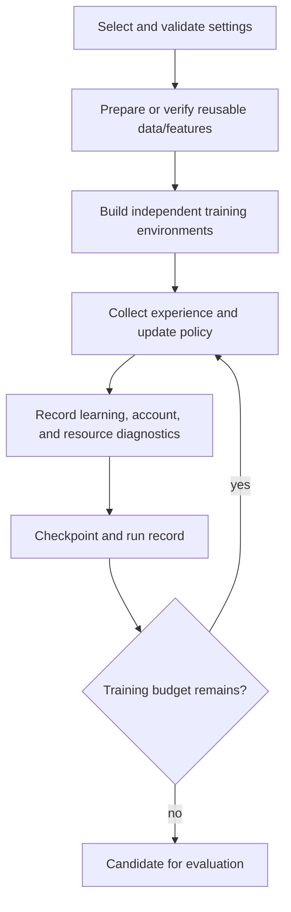
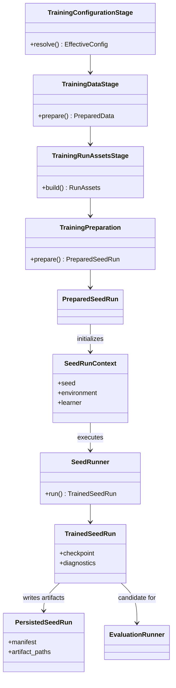

# Training module

## Purpose

Training assembles a declared configuration, prepared market inputs, features,
simulation environments, and a learning algorithm into a recoverable run.

## Inputs and outputs

| Receives | Produces |
|---|---|
| Validated run settings, prepared data/features, simulation environments, and compute resources | Checkpoints, training diagnostics, a run record, and a candidate for evaluation |

## Run lifecycle

Training data and reusable feature caches should be prepared before a long run
when the configuration permits. Workers must share read-only prepared inputs
without creating unnecessary per-variant copies. Each environment still needs
independent account state and a correctly isolated random stream.

## What a training result should include

- The model’s training reward and optimization diagnostics.
- Account equity and risk behavior observed during training.
- Trade count, entry and exit behavior, and action/idea diversity.
- Training budget reached, checkpoint recovery status, and any termination
  reason.
- An explicit statement separating a training smoke, bounded benchmark, and
  completed training run.

## Limitations

Training behavior is not a final performance estimate. In-sample performance
can change across time, and a saved checkpoint can still fail a full-period or
out-of-sample evaluation. Faster training is valuable only when it preserves
the intended learning and execution semantics.

## UML

This UML shows how resolved inputs pass through training stages into a
recoverable seed run and evaluation candidate.

## Implementation reference

The `training/` module composes the run. `experiments/` selects comparisons;
`compute/` supplies device and worker resources.
