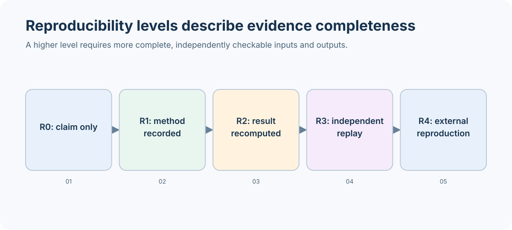

# Research result registry

This registry covers the meaningful findings linked by the
[research index](../research/README.md), the P6 monthly analysis, and the
tracked entry-idea count report. It records the strongest claim supported by
the repository's tracked artifacts. A reproduction level applies only to the
scope stated for that result; it does not silently upgrade the whole campaign.

## Reproducibility levels

| Level | Meaning |
| --- | --- |
| R1 | A saved report, metric table, or figure can be inspected. |
| R2 | Tracked machine-readable evidence can recompute the stated table or figure. |
| R3 | A frozen checkpoint, data, and configuration support policy replay. |
| R4 | Tracked data, source, configuration, seeds, and environment support training again. |

A config file or checkpoint digest alone does not establish R3 or R4. A
software trace is reported separately from a research finding.

## Current counts

These counts are per finding, not per model arm, metric, or generated figure.
The P6 pair is one finding; the three distinct R2 research scopes are
exit-action cohort recomputation, P6 monthly decomposition, and entry-idea
aggregate recomputation.

| Result type | R1 | R2 | R3 | R4 | Total |
| --- | ---: | ---: | ---: | ---: | ---: |
| Research and engineering findings | 7 | 3 | 0 | 0 | 10 |
| Software behavior demonstrations | 0 | 1 | 0 | 0 | 1 |

## Research findings

### R2 recomputations

**Exit-action semantics — selected common-entry cohort.** The notebook
recomputes the tracked 53-row exact-common-entry comparison and monthly figure
from the frozen cohort CSV and summary. It does not reproduce the complete
closed-loop replay: per-arm full ledgers, raw ticks, and checkpoint files are
not tracked. See [finding](../research/exit_action_semantics.md) and
[notebook](exit_action_semantics.ipynb).

**P6 matched pair — monthly entry/exit decomposition.** The notebook
recomputes monthly counts, means, medians, PnL sums, seeded bootstrap intervals,
the March-to-April decomposition, and its plot from the two tracked paired
trade CSVs. It does not independently replay fills from raw ticks or reload
the policies. Both arms failed the account-survival gate. See
[finding](../research/p6_monthly_entry_exit.md) and
[notebook](p6_monthly_exit_decomposition.ipynb).

**Entry-idea opportunity counts — family-level aggregates.** The notebook
recomputes annual episode totals and timeframe aggregates from the tracked
per-idea/per-timeframe CSV and checks the annual summary. The feature cache and
timestamp-level source rows are not tracked; this is not a raw-bar recount.
See [finding](../research/entry_idea_opportunity_counts.md) and
[notebook](entry_idea_opportunity_counts.ipynb).

### R1 inspectable findings

| Finding | What the tracked documentation supports | Why it remains R1 |
| --- | --- | --- |
| [Setup-conditioned replay](../research/setup_conditioned_policy_replay.md) | One-seed, 100k-step negative screen and selected stored metrics/figures. | Per-arm ledgers needed to regenerate the full plots are absent. |
| [Encoder architecture comparison](../research/encoder_architecture_comparison.md) | Bounded throughput measurements and short/full-budget screen interpretation. | Generated run reports, arm summaries, logs, and manifests remain in ignored local outputs. |
| [Regime attribution](../research/regime_attribution.md) | Descriptive tables and stated scope for saved training-split behavior. | The source attribution CSVs and original run artifacts are not tracked in the evidence packet. |
| [Daily regime normalization comparison](../research/regime_context_comparison.md) | One-seed matched comparison with negative/inconclusive interpretation. | Reproduction inputs and full run artifacts are not tracked with the result page. |
| [Sustainable equity growth](../research/sustainable_equity_growth.md) | Reward definition, staged protocol, and reported screening outcomes. | The source per-arm ledgers, run manifests, and machine-readable outcome package are absent. |
| [GH200 throughput audit](../research/gh200_throughput_audit.md) | Measured ranges and bottleneck interpretation for the tested setup. | Original profile samples and attempt notes are in the external archive, not tracked here. |
| [Entry-idea context preview](../research/order_block_and_multitimeframe_context.md) | Two static causal-context previews with source metadata. | The images are inspectable, but source bars and a regenerating plot input bundle are not tracked. |

R1 means inspectable, not independently recomputed. The entries above do not
claim that a result generalizes beyond its documented data period, seed,
hardware, or evaluation protocol.

## Software behavior demonstration

**Deterministic environment trace — R2 software verification, not a research
result.** The CPU notebook runs a fixed synthetic bar/action sequence and
rechecks the asserted fill, stop, equity, and reward behavior against current
source. See [notebook](environment_trace.ipynb).

## Higher reproduction levels

No research finding in this registry meets R3 or R4. R3 is unavailable because
the relevant frozen checkpoints and complete replay inputs are not tracked for
these claim scopes. R4 is unavailable because full training data, artifacts,
and execution identities are not all bundled. The current research execution
plan also records a failed P6 viability gate and explicitly bars an expensive
training run for documentation work. Do not infer that missing levels were
attempted and passed.

The generated [evidence sufficiency audit](evidence_audit.md) lists the exact
tracked and absent artifacts used for these classifications. Research
findings belong with their [methods and limitations](../research/README.md);
this page is the claim and reproduction index.
