# Project, training, and evaluation report

- **Campaign:** `regime_d1_norm_r1_seed50_train2025_20261026_2m_normal_retry1_v1`
- **Fingerprint:** `b19f0f7e941d416d42aa6329559e843710ed5ffd9c0cf1cddaafc664a70979b9`
- **Source revision:** `6bc0697f7072b592dd2b2593911d688d2e1d946c`

Generated from saved run artifacts. This report did not load a checkpoint or replay a market.
Break-even means an explicit break-even exit or absolute net PnL no greater than 1.000 account-currency units.
Training and testing sections are kept separate; interpretation should follow the saved split configuration.

## How the repository produced these results

This section connects recorded input files and caches to the model, training run, evaluation, and plots. It is generated from source paths and saved manifests; missing settings stay visible as Not recorded.

### Pipeline architecture

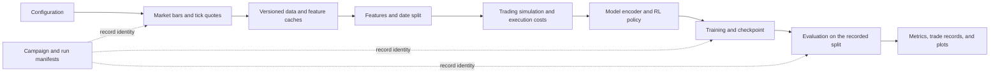

Standalone architecture diagram: [r1_project_results_report_pipeline_architecture.mmd](r1_project_results_report_pipeline_architecture.mmd).

| Stage | What it does | Source code |
|---|---|---|
| Configuration | Defines data, date splits, features, trading rules, and learner settings. | [config/base/default.yaml](../../../config/base/default.yaml), [configuration/loader.py](../../../configuration/loader.py) |
| Market data | Loads bars and tick quotes; prepares timeframes and saved data caches. | [market_data/loading/pipeline.py](../../../market_data/loading/pipeline.py), [market_data/loading/ticks.py](../../../market_data/loading/ticks.py) |
| Features and split | Builds model inputs and assigns observations to configured date periods. | [features/pipeline/builder.py](../../../features/pipeline/builder.py), [market_data/splits/definitions.py](../../../market_data/splits/definitions.py) |
| Trading simulation | Applies policy actions, simulated orders, costs, fills, and account updates. | [simulation/environment/env.py](../../../simulation/environment/env.py), [trading/execution/costs.py](../../../trading/execution/costs.py) |
| Model and learner | Encodes feature history and fits a PPO or SAC policy. | [models/encoders/](../../../models/encoders), [learning/rl/agent.py](../../../learning/rl/agent.py) |
| Training workflow | Prepares runs, learns, saves checkpoints, and records run artifacts. | [training/runner/training.py](../../../training/runner/training.py), [training/runner/seed_runtime.py](../../../training/runner/seed_runtime.py) |
| Evaluation and plots | Replays policies, calculates metrics, creates diagnostic plots and reports. | [evaluation/rollout/runner.py](../../../evaluation/rollout/runner.py), [evaluation/metrics/performance.py](../../../evaluation/metrics/performance.py), [evaluation/plotting/](../../../evaluation/plotting), [scripts/research/thesis/evaluation/report_variant_details.py](../../../scripts/research/thesis/evaluation/report_variant_details.py) |
| Campaign identity | Records variant state, source/data identity, checkpoints, and output paths. | [experiments/campaigns/](../../../experiments/campaigns), [evaluation/reporting/run_manifest.py](../../../evaluation/reporting/run_manifest.py) |

### Recorded source and data

Report-generator checkout: `/scratch/work/nguyenl37/Quantitative-RL-Trading-System` at `6bc0697f7072b592dd2b2593911d688d2e1d946c`.
Working tree when generated: 80 tracked changes and 1 untracked files.
Campaign source revision: `6bc0697f7072b592dd2b2593911d688d2e1d946c`. Each run source is listed below; revisions are not assumed to match.
Campaign source snapshot: `source_snapshot.zip`; present; archive SHA-256 `f18350406740d12ac0ba3642ac8ae39c837212a1b2b0350c16219461b337fda8`; 642 files; file-hash manifest SHA-256 `8e2704d775bfd2adaabaa08f30ad8d9db7719b6b43d8404c31f9567044f42aa9`; 642 source hashes in the campaign manifest.
Report generator source digests:
- `scripts/research/thesis/evaluation/report_variant_details.py`: `98ad018bde9090bd0e2d706c17ac669002e733c5c1f5affa148b41863df80a3f`
- `scripts/research/thesis/evaluation/project_report_context.py`: `3665f81f60faab6a05712e5ab576f346edc0b89750b6743c6ec026b7ad890455`
- `scripts/research/thesis/evaluation/project_report_markdown.py`: `1152372b51ba58bc35b6a9e52c5ffd838d1d27e0f5da6d93a6e12b25a59d9772`

#### Campaign input files

Hashes are the values captured in the campaign manifest. File presence is checked separately at report time.

| Split/source role | File | Timeframe in filename | Present now | SHA-256 prefix |
|---|---|---|---|---|
| calendar | `config/ny_session_schedule.csv` | unsuffixed | Yes | `7e9f5def33851859` |
| testing | `data/normal/testing/US100.cash_202412300105_202610162349.csv` | unsuffixed | Yes | `01730f3c2adb2087` |
| testing | `data/normal/testing/US100.cash_H1_202412300100_202610162300.csv` | H1 | Yes | `cd469d110a8ac47f` |
| testing | `data/normal/testing/US100.cash_H4_202412300000_202610162000.csv` | H4 | Yes | `7497a0660038382f` |
| testing | `data/normal/testing/US100.cash_M10_202412300100_202610162340.csv` | M10 | Yes | `cf22ac27950d54b9` |
| testing | `data/normal/testing/US100.cash_M15_202412300100_202610162345.csv` | M15 | Yes | `d9c89e63e62ba085` |
| testing | `data/normal/testing/US100.cash_M1_202412300105_202610162349.csv` | M1 | Yes | `0a8268734f6b6564` |
| testing | `data/normal/testing/US100.cash_M30_202412300100_202610162330.csv` | M30 | Yes | `c4957b803c200b2d` |
| testing | `data/normal/testing/US100.cash_M3_202412300103_202610162348.csv` | M3 | Yes | `0c8f3ec400b9159d` |
| testing | `data/normal/testing/US100.cash_M5_202412300105_202610162345.csv` | M5 | Yes | `1749a005fac4fbdd` |
| testing | `data/normal/testing/US500.cash_202412300105_202610162349.csv` | unsuffixed | Yes | `da1c930e200e4776` |
| testing | `data/normal/testing/US500.cash_D1_202412300000_202610160000.csv` | D1 | Yes | `e09e1a4a26e8b37b` |
| testing | `data/normal/testing/US500.cash_H1_202412300100_202610162300.csv` | H1 | Yes | `e72435cc1af1353a` |
| testing | `data/normal/testing/US500.cash_H4_202412300000_202610162000.csv` | H4 | Yes | `48dabafb91081ced` |
| testing | `data/normal/testing/US500.cash_M10_202412300100_202610162340.csv` | M10 | Yes | `f94830a18f1794ba` |
| testing | `data/normal/testing/US500.cash_M15_202412300100_202610162345.csv` | M15 | Yes | `3f5d0f9e60d008a5` |
| testing | `data/normal/testing/US500.cash_M1_202412300105_202610162349.csv` | M1 | Yes | `94f3674d303bd843` |
| testing | `data/normal/testing/US500.cash_M30_202412300100_202610162330.csv` | M30 | Yes | `1615c15e45d610ff` |
| testing | `data/normal/testing/US500.cash_M3_202412300103_202610162348.csv` | M3 | Yes | `496ede59d30e19b6` |
| testing | `data/normal/testing/US500.cash_M5_202412300105_202610162345.csv` | M5 | Yes | `e73ddc12d5663b8b` |
| training | `data/normal/training/US100.cash_202412300105_202610162349.csv` | unsuffixed | Yes | `631dbc13f17e6a97` |
| training | `data/normal/training/US100.cash_H1_202412300100_202610162300.csv` | H1 | Yes | `693e9b3df53e522b` |
| training | `data/normal/training/US100.cash_H4_202412300000_202610162000.csv` | H4 | Yes | `83855aed1db0517f` |
| training | `data/normal/training/US100.cash_M10_202412300100_202610162340.csv` | M10 | Yes | `a13bdee2606d3bed` |
| training | `data/normal/training/US100.cash_M15_202412300100_202610162345.csv` | M15 | Yes | `1eb96fafbdbcfa14` |
| training | `data/normal/training/US100.cash_M1_202412300105_202610162349.csv` | M1 | Yes | `c0ad7d79a8769fa9` |
| training | `data/normal/training/US100.cash_M30_202412300100_202610162330.csv` | M30 | Yes | `256a8fb8c959a61f` |
| training | `data/normal/training/US100.cash_M3_202412300103_202610162348.csv` | M3 | Yes | `217c2f8bfdd1ff30` |
| training | `data/normal/training/US100.cash_M5_202412300105_202610162345.csv` | M5 | Yes | `07e162ade037e3da` |
| training | `data/normal/training/US500.cash_202412300105_202610162349.csv` | unsuffixed | Yes | `36e59a0d20c06bf0` |
| training | `data/normal/training/US500.cash_D1_202412300000_202610160000.csv` | D1 | Yes | `8eccb7d28f99e403` |
| training | `data/normal/training/US500.cash_H1_202412300100_202610162300.csv` | H1 | Yes | `bb19f7ef3f8fdf37` |
| training | `data/normal/training/US500.cash_H4_202412300000_202610162000.csv` | H4 | Yes | `d34786fb2fd9f551` |
| training | `data/normal/training/US500.cash_M10_202412300100_202610162340.csv` | M10 | Yes | `3326e4e0063ca941` |
| training | `data/normal/training/US500.cash_M15_202412300100_202610162345.csv` | M15 | Yes | `a7785b7005bf7dd8` |
| training | `data/normal/training/US500.cash_M1_202412300105_202610162349.csv` | M1 | Yes | `8ee4ef65d952974d` |
| training | `data/normal/training/US500.cash_M30_202412300100_202610162330.csv` | M30 | Yes | `afcf8b1928c3a6a7` |
| training | `data/normal/training/US500.cash_M3_202412300103_202610162348.csv` | M3 | Yes | `076fbc56d6488173` |
| training | `data/normal/training/US500.cash_M5_202412300105_202610162345.csv` | M5 | Yes | `7940ffbc5b304106` |

#### Prepared data/cache inventory

No split_cache_ready.json inventory was saved with this campaign.

#### Run data actually recorded

Date boundaries are from each run manifest. Observed row timestamps can start later than the configured boundary when no bar is available at that instant.

##### sustainable_growth_ppo_dsr (seed 50)

Training dates: `2024-12-30` to `2025-12-31`; configured test boundary: `2026-01-01`.
Run source revision: `6bc0697f7072b592dd2b2593911d688d2e1d946c`; checkout path: `not recorded`; it matches the report-generator checkout.
Recorded dirty files at training time: `campaign_worker_dispatch.log` (SHA-256 `edadcce3f43e1e91`).

| Saved dataset | Observed start | Observed end | Rows | Columns | SHA-256 prefix |
|---|---|---|---:|---:|---|
| primary_ticks | 2024-12-29 22:05:00.196000+00:00 | 2026-10-16 20:49:58.664000+00:00 | 135043551 | 3 | `0fdc211dbe2fcbfa` |
| test_bars | 2026-01-02 01:05:00+03:00 | 2026-10-16 23:49:00+03:00 | 279355 | 10 | `8e394641b9734209` |
| test_features | 2026-01-02 01:05:00+03:00 | 2026-10-16 23:49:00+03:00 | 279355 | 945 | `5be508788dcab764` |
| test_secondary | 2026-01-02 01:05:00+03:00 | 2026-10-16 23:49:00+03:00 | 278956 | 10 | `d43b2da8cbe72a66` |
| train_bars | 2024-12-30 01:05:00+03:00 | 2025-12-31 23:49:00+03:00 | 351432 | 10 | `ddb03dd3494803df` |
| train_features | 2024-12-30 01:05:00+03:00 | 2025-12-31 23:49:00+03:00 | 351432 | 945 | `35d6e794dbc2a6ab` |
| train_secondary | 2024-12-30 01:05:00+03:00 | 2025-12-31 23:49:00+03:00 | 349973 | 10 | `61257aac7bfbdfb9` |
Feature cache: `US100.cash_features_v24-native-source-timeframes_15a7206755fde49b.parquet`; cache key `15a7206755fde49b`; file digest `66fbe9afa0db50fb18bad777fff7b0ef9c8099f3903669e177b9cf347646ddc5`; fit scope `train_mask_only`.

### Model and training setup

#### sustainable_growth_ppo_dsr (seed 50)

The recorded learner is **PPO** with encoder `TCNEncoder`. The encoder converts ordered feature history into a compact representation; the policy head uses it to choose actions.

| Setting | Recorded value |
|---|---|
| Encoder channels / dilation levels | 128, 128, 256, 256 / 1, 2, 4, 8 |
| Kernel / encoded dimension | 3 / 128 |
| Policy head / parameter count | 256, 128 / 1454303 |
| Action schema | `overlay-action-v2`, 12 coordinates |
| Observation schema | `account-state-v1`, 6 account coordinates |
| Requested / completed steps | 2000000 / 2007040 |
| Environments × rollout bars each | 8 × 1024 |
| Batch / epochs / learning rate | 4096 / 15 / 0.0003 |
| Action distribution during training | `clamped_diagonal_gaussian` |
| Configuration SHA-256 | `6947eaaac658747d5d3cfbd64b14952d54561e792d7e76c43968b4c10f5c7c8d` |
| Checkpoint SHA-256 | `16bb9b026fce412474a3a0eb0907912f1321ad6d07dae2ab139936e2f0c3f84e` |
| Reward settings | dsr eta: 0.01; equity log growth scale: 100.0; fixed risk usd: 0.0; mode: dsr |
| Risk settings | eod peak trailing dd limit usd: 0.0; ftmo: daily loss limit: 5000.0; daily loss limit pct: 0.05; limit value mode: fixed_usd; max loss limit: 10000.0; max loss limit initial pct: 0.1; profit target: 10000.0; risk per trade limit: 1000.0; risk per trade limit pct: 0.01; risk sizing limit usd: 900.0; soft daily loss limit: 5000.0; soft daily loss limit pct: 0.05; soft max loss limit: 10000.0; soft max loss limit initial pct: 0.1; soft trailing dd limit: 0.0; trailing dd limit: 0.0; mode: dollar_band; risk band budget includes execution reserve: Yes; risk band hold below usd: 100.0; risk band max usd: 900.0; risk per trade limit: 1000.0 |

### Evaluation and result figures

Core dataset hashes match across the saved variants: **Not comparable from available manifests**.
Each variant section below contains saved training/testing metrics, trade exit, stop, target, and risk tables, learner diagnostics, and generated figures.
A test period labeled previously inspected is historical evidence; it is not an untouched final holdout.

| Variant | Test period role | Training action mode | Evaluation action mode | Modes match | Tick execution | Random fill latency | Evaluation seed |
|---|---|---|---|---|---|---:|---:|
| sustainable_growth_ppo_dsr | previously_inspected_holdout | stochastic | stochastic | Yes | Yes | 0.0 ms | 50 |
Recorded schedule-aware context: `ny_scheduled_short`, `ny_scheduled_close_fraction`, `ny_minutes_to_scheduled_close`, `tick_bid_offset_atr`, `tick_ask_offset_atr`, `tick_spread_atr`, `tick_quote_age_fraction`, `tick_quote_activity`, `tick_quote_available`; schedule SHA-256 `7e9f5def3385185905f7265f946a0835ccb43c53f1351c057aa23f00480e6cbc`.

### Plain-language guide

- **Bar:** A time-bucketed price record, such as one M1 candle.
- **Tick quote:** A time-stamped bid/ask quote used as a detailed input and for fill pricing.
- **Feature:** A number calculated from market history and supplied to the policy.
- **Cache:** A saved intermediate dataset or feature matrix used to avoid rebuilding it.
- **Checkpoint:** The saved neural-network policy that can be loaded for later evaluation.
- **Net PnL:** Profit or loss after the costs represented in the saved simulation outputs.
- **Maximum drawdown:** The largest measured fall from an earlier account-equity peak.
- **Seed:** The recorded random seed for one run; one seed does not measure across-seed uncertainty.

## Variant summary

| Variant | Seed | Optimizer | Controller | Peak-DD policy | Peak-DD fit | Hard risk | Train return | Train max DD | Train trades | Test return | Test max DD | Test trades |
|---|---:|---|---|---|---|---|---:|---:|---:|---:|---:|---:|
| sustainable_growth_ppo_dsr | 50 | COMPLETED | failed | Disabled during training; measured drawdown is report-only | DISABLED | FAIL | -9.98% | 31.13% | 879 | -10.07% | 21.59% | 583 |

## sustainable_growth_ppo_dsr

### Training and testing comparison figures

Training is the in-sample split; testing is report-only. Dates come from the saved equity timelines. For equity, the paired panels use the same vertical account-balance range, so values can be compared directly.

#### Train Test Equity

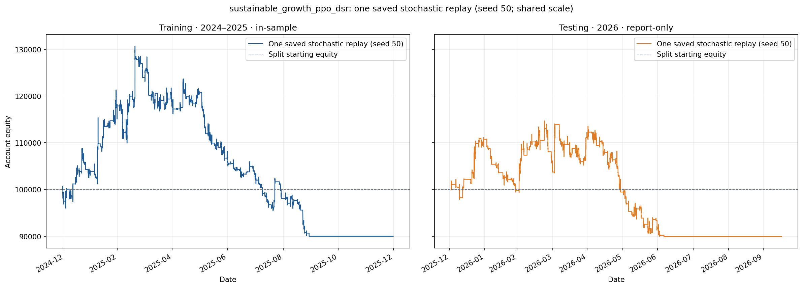

#### Train Test Drawdown

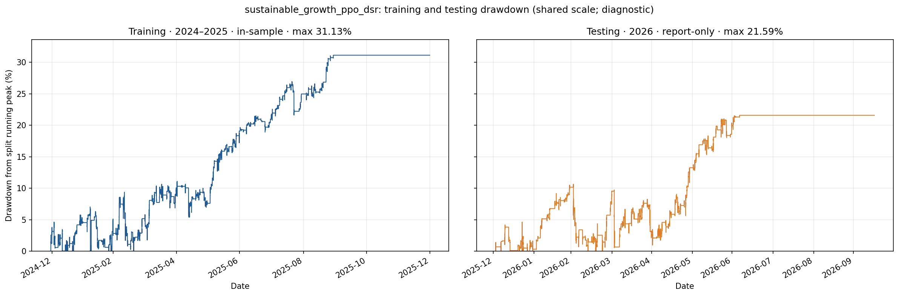

#### Train Test Monthly Pnl

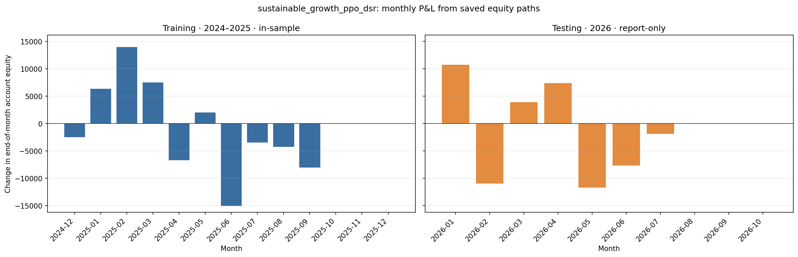

#### Train Test Metrics

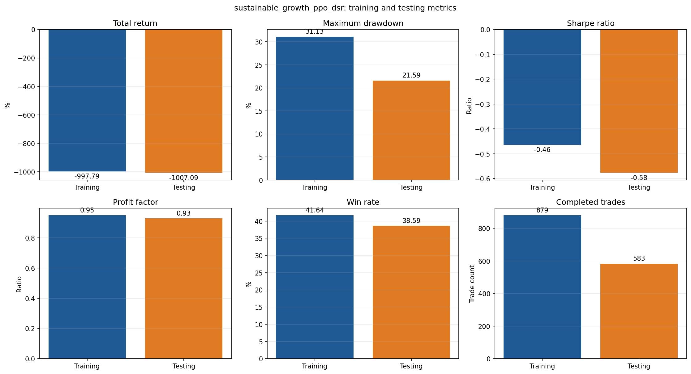

#### Train Test Outcomes

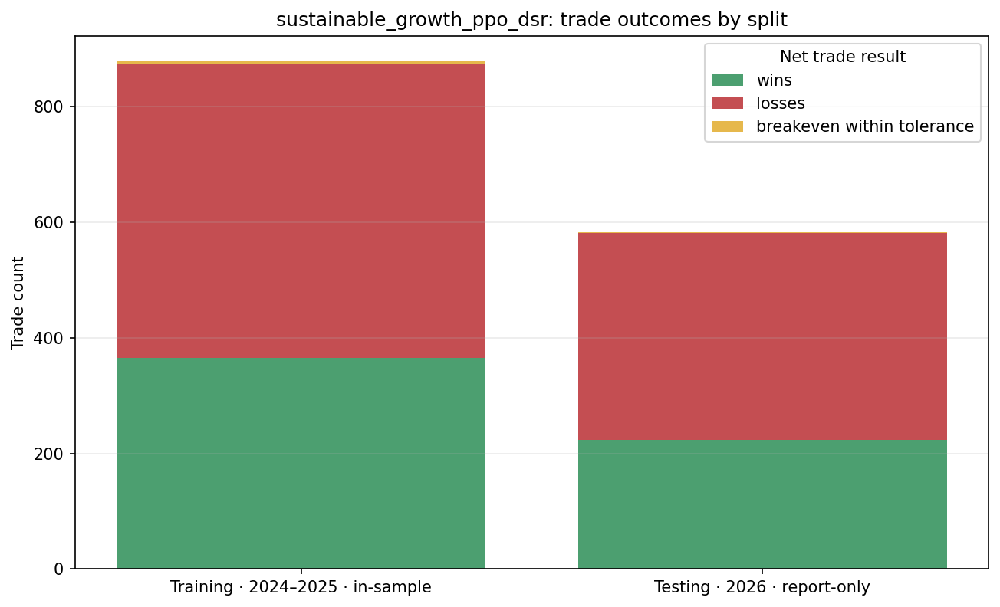

#### Train Test Exit Reasons By Outcome

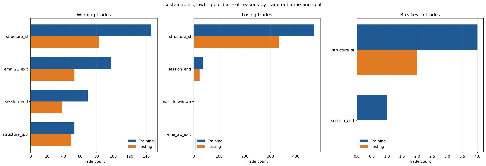

#### Train Test Approved Risk Distribution

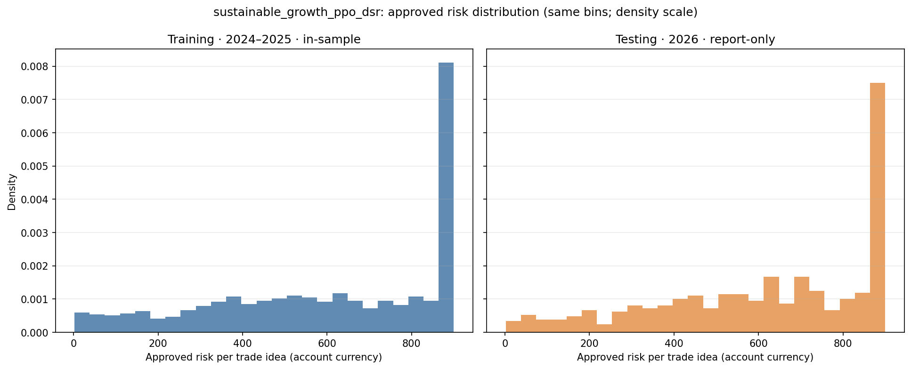

#### Train Test Setup Mix

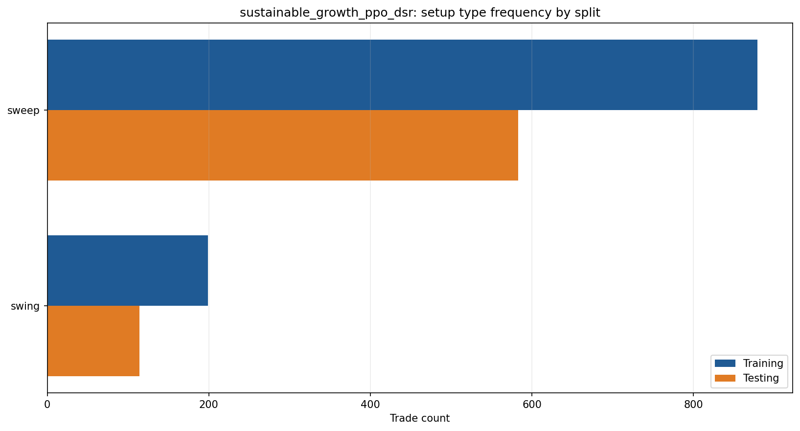

#### Train Test Sl Tp References

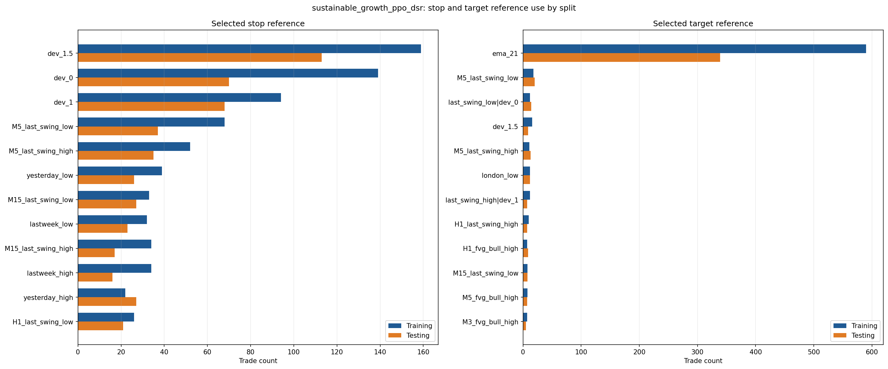

### Run and training configuration

| Run setting | Result |
|---|---|
| Optimizer execution | COMPLETED |
| Campaign controller status | failed |
| Seed | 50 |
| Attempt | 1 |
| Completed timesteps | 2007040 |
| Training peak-drawdown policy | Disabled during training; measured drawdown is report-only |
| Peak-drawdown policy fit | DISABLED |
| Hard account-risk result | FAIL |
| Training activity result / ok | Yes |
| Training activity result / n trades | 879 |
| Training activity result / minimum trades | 1 |
| Training activity result / status | ACTIVE |
| Training activity result / warning | No |
| Training activity result / reason |  |
| Drawdown policy evidence | The saved training gate records the same limit as the training environment. |

#### Effective model and environment parameters

| Parameter | Result |
|---|---|
| strategy / name | baseline |
| strategy / manipulation filter | against |
| strategy / session / timezone | Etc/GMT-3 |
| strategy / liquidity / swing period | 5 |
| strategy / liquidity / require reclaim | Yes |
| strategy / liquidity / max age bars | 120 |
| strategy / po3 / require manipulation sweep | Yes |
| strategy / po3 / require distribution confirmation | Yes |
| strategy / ifvg / enabled | Yes |
| strategy / ifvg / max age bars | 50 |
| strategy / ifvg / require price retest | Yes |
| strategy / ifvg / close through threshold | 0.500 |
| strategy / ifvg / require opposing fvg | No |
| strategy / risk / sl mode | fixed |
| strategy / risk / tp mode | fixed |
| strategy / risk / tp reference | structural |
| strategy / risk / sl buffer pts | 1.000 |
| strategy / risk / risk frac range | 0.00%, 1.00% |
| strategy / risk / rr range | 1.500, 5.000 |
| strategy / tp / mode | agent |
| strategy / tp / allowed targets | rr, buyside_liquidity, sellside_liquidity, previous_day_high_low |
| strategy / tp / invalid target policy | rr_fallback |
| strategy / entry / mode | legacy |
| strategy / entry / enforce gate | No |
| strategy / reward / entry bonus | 0.010 |
| strategy / reward / manipulation penalty | 0.020 |
| strategy / reward / invalid ifvg penalty | 0.010 |
| strategy / reward / distribution bonus | 0.005 |
| strategy / reward / strategy weight | 0.010 |
| strategy / batch windows | 256 |
| ppo / actor arch | shared |
| ppo / policy distribution | clamped_diagonal_gaussian |
| ppo / semantic head width | 64 |
| ppo / n steps | 8192 |
| ppo / batch size | 4096 |
| ppo / n epochs | 15 |
| ppo / rollout buffer on device | Yes |
| ppo / learning rate | 0.0003 |
| ppo / gamma | 0.990 |
| ppo / gae lambda | 0.950 |
| ppo / clip range | 0.200 |
| ppo / ent coef | 0.010 |
| ppo / ent coef continuous | 0.001 |
| ppo / log std init | 0.000 |
| ppo / log std min | -0.700 |
| ppo / log std max | 0.000 |
| ppo / mode prior coef | 0.001 |
| ppo / checkpoint freq | 1000000 |
| ppo / total timesteps | 2000000 |
| risk / target timeframes | M3, M5, M10, M15, M30, H1, H4, D1 |
| risk / min lot | 0.010 |
| risk / max lot | 100.000 |
| risk / default risk frac | 1.00% |
| risk / sl mode | fixed |
| risk / tp mode | fixed |
| risk / tp reference | structural |
| risk / min sl atr mult | 0.500 |
| risk / min sl points | 10.000 |
| risk / swing buffer pts | 1.000 |
| risk / rr ratio default | 2.000 |
| ftmo / limit value mode | fixed_usd |
| ftmo / daily loss limit | 5000.000 |
| ftmo / soft daily loss limit | 5000.000 |
| ftmo / soft max loss limit | 10000.000 |
| ftmo / max loss limit | 10000.000 |
| ftmo / trailing dd limit | 0.000 |
| ftmo / soft trailing dd limit | 0.000 |
| ftmo / risk per trade limit | 1000.000 |
| ftmo / risk sizing limit usd | 900.000 |
| ftmo / risk per trade limit pct | 0.01% |
| ftmo / daily loss limit pct | 0.05% |
| ftmo / soft daily loss limit pct | 0.05% |
| ftmo / max loss limit initial pct | 0.10% |
| ftmo / soft max loss limit initial pct | 0.10% |
| ftmo / profit target | 10000.000 |
| env / obs window | 60 |
| env / observation schema version | account-state-v1 |
| env / observation age scale bars | 60 |
| env / data source | bundle |
| env / n envs | 8 |
| env / vector backend | subproc |
| env / vector shards | 0 |
| env / action type | discrete |
| env / max episode steps | Not recorded in run artifacts |
| env / reward dsr eta | 0.010 |
| env / strategy actions | Yes |
| env / entry state machine | Yes |
| env / candidate max age bars | 5 |
| env / arm requires retest | No |
| env / entry state observation | No |
| env / strict research eligibility | No |
| env / entry intensity threshold | 0.000 |
| env / reward mode | dsr |
| env / equity log growth scale | 100.000 |
| env / fixed risk usd | 0 |
| env / risk band max usd | 900.000 |
| env / risk band hold below usd | 100.000 |
| env / risk mode | dollar_band |
| env / risk floor | 0.00% |
| env / allow ema exit | Yes |
| env / allow agent sl mode | Yes |
| env / sl mode defer threshold | 0.100 |
| env / allow agent tp mode | Yes |
| env / tp mode defer threshold | 0.100 |
| env / allow multi tp | Yes |
| env / allow simplex | Yes |
| env / tp breakeven alpha | 0.500 |
| env / peak trailing dd limit | 0.00% |
| env / max entries per session | 0 |
| env / open manipulation bars | 0 |
| env / entry cooldown bars | 15 |
| env / sl buffer pts | 0.000 |
| env / block overnight | Yes |
| env / eod risk / max loss usd | 1100.000 |
| env / eod risk / respect planned risk | Yes |
| env / eod risk / planned risk mult | 1.100 |
| env / eod risk / max age hours | 8 |
| env / eod risk / stale bars | 60 |
| env / eod risk / progress threshold atr | 0.250 |
| env / eod risk / peak trailing dd limit usd | 0.000 |
| env / eod risk / breakeven trigger r | 1.000 |
| env / eod risk / breakeven buffer pts | 2.000 |
| env / agent direction control | Yes |
| env / direction override threshold | 0.000 |
| resolved variant / algo | ppo |
| resolved variant / arch | tcn |
| resolved variant / reward | dsr |
| resolved variant / strategy | baseline |
| resolved variant / strategy actions | Yes |
| resolved variant / timesteps | 2000000 |
| resolved variant / seed | 50 |
| resolved variant / action schema / version | overlay-action-v2 |
| resolved variant / action schema / key | 12 |
| resolved variant / action schema / width | 12 |
| resolved variant / action schema / coordinates | direction, intensity, stop, risk, tp1_sel, tp2_sel, tp3_sel, sl_mode, tp_mode, z1, z2, exit |
| resolved variant / action schema / has direction | Yes |
| resolved variant / action schema / has sl mode | Yes |
| resolved variant / action schema / has tp mode | Yes |
| resolved variant / action schema / has multi tp | Yes |
| resolved variant / action schema / has simplex | Yes |
| resolved variant / observation schema / version | account-state-v1 |
| resolved variant / observation schema / observation width | 6 |
| resolved variant / observation schema / observation coordinates | log_equity_over_initial, position_direction, open_pnl_over_initial, unrealized_r_legacy, initial_stop_width_over_price, trailing_drawdown_pct |
| resolved variant / observation schema / entry state visibility | No |

#### PPO or learner diagnostics

| Training series | Samples | First | Last | Mean | Minimum | Maximum |
|---|---:|---:|---:|---:|---:|---:|
| train/loss | 244 | 2.877 | 1.176 | 1.201 | -0.023 | 3.496 |
| train/policy gradient loss | 244 | -0.004 | -0.003 | -0.003 | -0.005 | -0.000846 |
| train/value loss | 244 | 5.979 | 2.325 | 2.429 | 0.0001 | 7.295 |
| train/entropy loss | 244 | -17.014 | -15.970 | -16.351 | -17.014 | -15.946 |
| train/approx kl | 244 | 0.005 | 0.006 | 0.006 | 0.003 | 0.020 |
| train/clip fraction | 244 | 0.063 | 0.061 | 0.064 | 0.019 | 0.205 |
| train/explained variance | 244 | 0.000 | 0.075 | 0.182 | -0.035 | 0.960 |
| train/learning rate | 244 | 0.0003 | 0.0003 | 0.0003 | 0.0003 | 0.0003 |

#### Training figure: dashboard behavior

#### Training figure: dashboard pnl

#### Training figure: dashboard return

#### Training figure: dashboard risk

#### Training figure: dashboard trade count

#### Training figure: entropy explvar

#### Training figure: kl clip

#### Training figure: learning curve

#### Training figure: losses

#### Training figure: lr

#### Training figure: mode means

#### Generated training figure: learner diagnostics

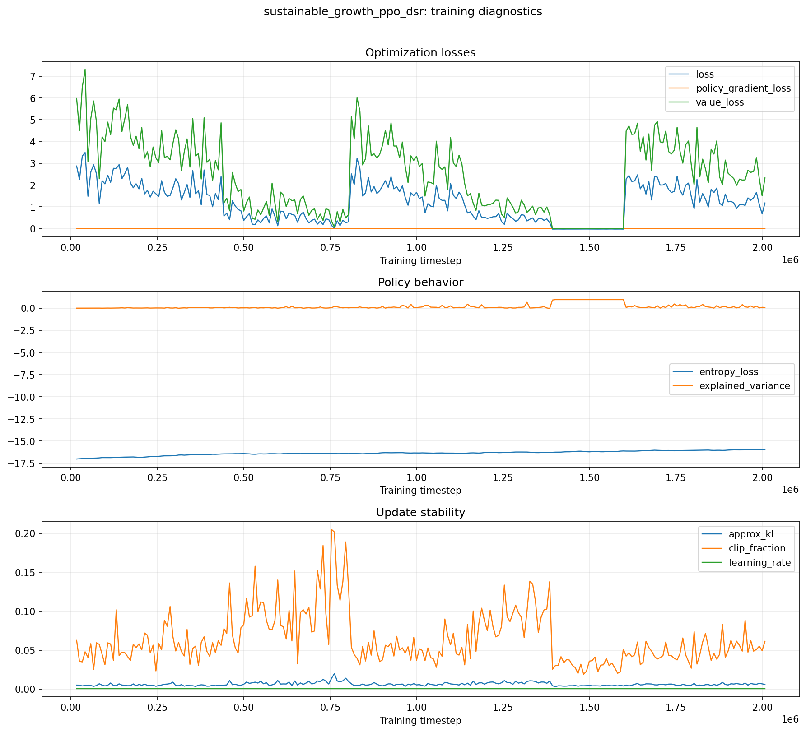

### Training results

This section reports the completed training split or the report-only testing split, as labeled.

#### Performance and trading activity

| Measure | Result |
|---|---|
| sharpe | -0.465 |
| sortino | -0.654 |
| calmar | -0.317 |
| max drawdown | 31.13% |
| total return pct | -9.98% |
| total pnl | -9977.862 |
| profit factor | 0.949 |
| win rate | 41.64% |
| expectancy | -11.351 |
| n trades | 879 |
| breach count | 2 |
| breach rate | 0.008 |
| turnover | 0.009 |
| max consec loss | 11 |
| avg trade | -11.351 |
| extras / fill count | 934.000 |
| extras / incomplete positions | 0.000 |
| extras / entry active | 1.000 |
| activity status | ACTIVE |
| initial balance | 100000.000 |
| final equity | 90022.138 |

#### Trade counts

| Trade count | Result |
|---|---|
| positions | 879 |
| entry fills | 879 |
| exit fills | 934 |
| rejected entries | 57776 |
| wins | 365 |
| losses | 509 |
| breakeven within tolerance | 5 |

Peak-drawdown policy: **Disabled; measured peak drawdown is report-only**. The measured maximum drawdown remains reported in the metrics above.

#### Important Setup

| Measure | Result |
|---|---|
| direction / -1.0 | 448 |
| direction / 1.0 | 431 |
| entry level / unavailable | 245 |
| entry level / asian low | 165 |
| entry level / london high | 163 |
| entry level / london low | 155 |
| entry level / asian high | 151 |
| setup types / sweep | 879 |
| setup types / swing | 199 |
| manipulation / against | 686 |
| manipulation / none | 156 |
| manipulation / done | 37 |
| distribution phase / 0.0 | 686 |
| distribution phase / 1.0 | 193 |
| session / ny | 879 |
| volatility regime / high | 636 |
| volatility regime / mid | 225 |
| volatility regime / low | 18 |
| trend regime / flat | 879 |

#### Exit Breakdown

| Measure | Result |
|---|---|
| position exit reason / structure sl | 622 |
| position exit reason / session end | 105 |
| position exit reason / ema 21 exit | 98 |
| position exit reason / structure tp3 | 53 |
| position exit reason / max drawdown | 100.00% |
| exit reason by net outcome / winning / ema 21 exit | 97 |
| exit reason by net outcome / winning / session end | 69 |
| exit reason by net outcome / winning / structure sl | 146 |
| exit reason by net outcome / winning / structure tp3 | 53 |
| exit reason by net outcome / losing / ema 21 exit | 1 |
| exit reason by net outcome / losing / max drawdown | 100.00% |
| exit reason by net outcome / losing / session end | 35 |
| exit reason by net outcome / losing / structure sl | 472 |
| exit reason by net outcome / breakeven / session end | 1 |
| exit reason by net outcome / breakeven / structure sl | 4 |
| entry selected exit mode / ema 21 | 590 |
| entry selected exit mode / structural | 289 |
| close fill reason / structure sl | 622 |
| close fill reason / session end | 105 |
| close fill reason / ema 21 exit | 98 |
| close fill reason / structure tp3 | 53 |
| close fill reason / structure tp1 | 36 |
| close fill reason / structure tp2 | 19 |
| close fill reason / max drawdown | 100.00% |
| outcome counts / winning | 365 |
| outcome counts / losing | 509 |
| outcome counts / breakeven | 5 |

#### Sl Breakdown

| Measure | Result |
|---|---|
| selected reference / dev 1.5 | 159 |
| selected reference / dev 0 | 139 |
| selected reference / dev 1 | 94 |
| selected reference / M5 last swing low | 68 |
| selected reference / M5 last swing high | 52 |
| selected reference / yesterday low | 39 |
| selected reference / M15 last swing high | 34 |
| selected reference / lastweek high | 34 |
| selected reference / M15 last swing low | 33 |
| selected reference / lastweek low | 32 |
| selected reference / H1 last swing low | 26 |
| selected reference / london low | 26 |
| selected reference / asian low | 25 |
| selected reference / yesterday high | 22 |
| selected reference / H1 last swing high | 18 |
| selected reference / london high | 18 |
| selected reference / asian high | 13 |
| selected reference / H1 last swing low|yesterday low | 10 |
| selected reference / M15 last swing high|london high | 5 |
| selected reference / M5 last swing high|M15 last swing high | 5 |
| selected reference / M5 last swing low|M15 last swing low | 5 |
| selected reference / H1 last swing high|yesterday high | 4 |
| selected reference / M15 last swing low|london low | 4 |
| selected reference / M15 last swing low|H1 last swing low | 2 |
| selected reference / M15 last swing low|asian low | 2 |
| selected reference / M15 last swing low|yesterday low | 2 |
| selected reference / H1 last swing high|lastweek high | 1 |
| selected reference / H1 last swing low|asian low | 1 |
| selected reference / H1 last swing low|london low | 1 |
| selected reference / M5 last swing high|dev 1 | 1 |
| selected reference / M5 last swing high|london high | 1 |
| selected reference / M5 last swing low|dev 0 | 1 |
| selected reference / M5 last swing low|london low | 1 |
| selected reference / yesterday high|lastweek high | 1 |
| exit reason / structure sl | 622 |
| sl reason by net outcome / winning / structure sl | 146 |
| sl reason by net outcome / losing / structure sl | 472 |
| sl reason by net outcome / breakeven / structure sl | 4 |
| modeled stop distance / count | 879 |
| modeled stop distance / min | 10.001 |
| modeled stop distance / median | 32.350 |
| modeled stop distance / mean | 77.227 |
| modeled stop distance / max | 2176.400 |
| initial stop risk usd / count | 879 |
| initial stop risk usd / min | 1.409 |
| initial stop risk usd / median | 546.385 |
| initial stop risk usd / mean | 515.838 |
| initial stop risk usd / max | 897.204 |
| dynamic sl events | None recorded |

#### Tp Breakdown

| Measure | Result |
|---|---|
| selected reference / ema 21 | 590 |
| selected reference / M5 last swing low | 18 |
| selected reference / dev 1.5 | 16 |
| selected reference / last swing high|dev 1 | 12 |
| selected reference / last swing low|dev 0 | 12 |
| selected reference / london low | 12 |
| selected reference / M5 last swing high | 11 |
| selected reference / H1 last swing high | 10 |
| selected reference / M15 last swing low | 8 |
| selected reference / M5 fvg bull high | 8 |
| selected reference / H1 fvg bull high | 7 |
| selected reference / M15 fvg bear low | 7 |
| selected reference / M15 fvg bull high | 7 |
| selected reference / M3 fvg bull high | 7 |
| selected reference / asian low | 7 |
| selected reference / M30 fvg bear low|M30 ifvg bear low | 6 |
| selected reference / london high | 6 |
| selected reference / H4 fvg bear low|H4 ifvg bear low | 5 |
| selected reference / M10 fvg bull high | 5 |
| selected reference / M15 last swing high | 5 |
| selected reference / M30 ifvg bull high | 5 |
| selected reference / H1 fvg bear low | 4 |
| selected reference / H4 fvg bear low | 4 |
| selected reference / H4 fvg bull high | 4 |
| selected reference / M3 fvg bear low | 4 |
| selected reference / M5 fvg bear low|M5 ifvg bear low | 4 |
| selected reference / M5 fvg bull high|M5 ifvg bull high | 4 |
| selected reference / H1 fvg bull high|H1 ifvg bull high | 3 |
| selected reference / H1 last swing low | 3 |
| selected reference / M10 ifvg bull high | 3 |
| selected reference / M15 fvg bull high|M15 ifvg bull high | 3 |
| selected reference / M1 fvg bull high | 3 |
| selected reference / M5 fvg bear low | 3 |
| selected reference / M5 ifvg bull high | 3 |
| selected reference / asian high | 3 |
| selected reference / dev 1 | 3 |
| selected reference / last swing low|M5 last swing low|dev 0 | 3 |
| selected reference / H1 ifvg bull high | 2 |
| selected reference / H4 fvg bull high|H4 ifvg bull high | 2 |
| selected reference / M15 ifvg bear low | 2 |
| selected reference / M1 fvg bear low|ifvg bear low | 2 |
| selected reference / M30 fvg bull high | 2 |
| selected reference / M3 fvg bull high|M3 ifvg bull high | 2 |
| selected reference / M5 ifvg bull high|M10 ifvg bull high | 2 |
| selected reference / asian low|H4 fvg bull high|H4 ifvg bull high | 2 |
| selected reference / D1 fvg bear low|D1 ifvg bear low | 1 |
| selected reference / D1 ifvg bear low | 1 |
| selected reference / H1 fvg bull high|H4 fvg bull high | 1 |
| selected reference / H4 ifvg bear low | 1 |
| selected reference / H4 ifvg bull high | 1 |
| selected reference / M10 fvg bear low|M15 fvg bear low|M15 ifvg bear low | 1 |
| selected reference / M10 fvg bull high|M10 ifvg bull high | 1 |
| selected reference / M10 fvg bull high|M15 fvg bull high | 1 |
| selected reference / M10 fvg bull high|M5 ifvg bull high | 1 |
| selected reference / M15 fvg bear low|M30 fvg bear low|M30 ifvg bear low | 1 |
| selected reference / M15 fvg bull high|M30 fvg bull high | 1 |
| selected reference / M15 fvg bull high|M30 fvg bull high|M10 ifvg bull high|M15 ifvg bull high|M30 ifvg bull high | 1 |
| selected reference / M15 ifvg bull high | 1 |
| selected reference / M15 last swing high|H1 last swing high | 1 |
| selected reference / M15 last swing low|H1 fvg bull high|H1 ifvg bull high | 1 |
| selected reference / M1 fvg bear low | 1 |
| selected reference / M30 fvg bear low | 1 |
| selected reference / M30 fvg bull high|H1 fvg bull high | 1 |
| selected reference / M30 fvg bull high|H1 fvg bull high|M30 ifvg bull high|H1 ifvg bull high | 1 |
| selected reference / M30 fvg bull high|M30 ifvg bull high | 1 |
| selected reference / M3 fvg bear low|M3 ifvg bear low | 1 |
| selected reference / M3 fvg bear low|M5 fvg bear low|M3 ifvg bear low|M5 ifvg bear low | 1 |
| selected reference / M3 ifvg bull high | 1 |
| selected reference / M5 fvg bear low|M10 fvg bear low|M15 fvg bear low|M10 ifvg bear low|M15 ifvg bear low | 1 |
| selected reference / M5 fvg bull high|M10 fvg bull high | 1 |
| selected reference / M5 fvg bull high|M10 fvg bull high|M10 ifvg bull high | 1 |
| selected reference / M5 fvg bull high|M3 ifvg bull high|M5 ifvg bull high | 1 |
| selected reference / M5 last swing high|M15 last swing high | 1 |
| selected reference / M5 last swing low|M15 last swing low | 1 |
| selected reference / M5 last swing low|M30 ifvg bull high|H1 ifvg bull high | 1 |
| selected reference / asian high|H1 last swing high | 1 |
| selected reference / asian low|H1 last swing low | 1 |
| selected reference / dev 0 | 1 |
| selected reference / ifvg bull high | 1 |
| selected reference / last swing high|M5 last swing high|M30 ifvg bear low|dev 1 | 1 |
| selected reference / last swing high|london high|dev 1 | 1 |
| selected reference / last swing low|M5 ifvg bull high|dev 0 | 1 |
| selected reference / last swing low|london low|dev 0 | 1 |
| selected reference / london high|M15 last swing high | 1 |
| selected reference / london high|M3 fvg bear low|M5 fvg bear low | 1 |
| selected reference / london high|M5 fvg bear low | 1 |
| selected reference / london low|H1 fvg bull high|H1 ifvg bull high | 1 |
| selected reference / london low|M15 last swing low | 1 |
| selected reference / london low|M30 fvg bull high|M30 ifvg bull high | 1 |
| selected reference / london low|M5 fvg bull high|M10 fvg bull high | 1 |
| close fill reason / structure tp3 | 53 |
| close fill reason / structure tp1 | 36 |
| close fill reason / structure tp2 | 19 |
| tp reason by net outcome / winning / structure tp3 | 53 |
| tp reason by net outcome / losing | None recorded |
| tp reason by net outcome / breakeven | None recorded |
| planned rr / count | 289 |
| planned rr / min | 1.003 |
| planned rr / median | 1.992 |
| planned rr / mean | 2.283 |
| planned rr / max | 10.615 |
| target legs present | 879 |
| configured tp count distribution / 3.0 | 149 |
| configured tp count distribution / 2.0 | 127 |
| configured tp count distribution / 4.0 | 120 |
| configured tp count distribution / 1.0 | 118 |
| configured tp count distribution / 5.0 | 102 |
| configured tp count distribution / 0.0 | 96 |
| configured tp count distribution / 6.0 | 72 |
| configured tp count distribution / 7.0 | 47 |
| configured tp count distribution / 8.0 | 29 |
| configured tp count distribution / 9.0 | 8 |
| configured tp count distribution / 10.0 | 6 |
| configured tp count distribution / 11.0 | 3 |
| configured tp count distribution / 12.0 | 2 |
| tp slot distribution / unavailable | 826 |
| tp slot distribution / 3.0 | 53 |
| tp slot distribution / 1.0 | 36 |
| tp slot distribution / 2.0 | 19 |

#### Risk Breakdown

| Measure | Result |
|---|---|
| requested usd / count | 879 |
| requested usd / min | 1.963 |
| requested usd / median | 643.965 |
| requested usd / mean | 602.294 |
| requested usd / max | 900.000 |
| approved usd / count | 879 |
| approved usd / min | 1.963 |
| approved usd / median | 643.965 |
| approved usd / mean | 602.294 |
| approved usd / max | 900.000 |
| modeled stop risk usd / count | 879 |
| modeled stop risk usd / min | 1.409 |
| modeled stop risk usd / median | 546.385 |
| modeled stop risk usd / mean | 515.838 |
| modeled stop risk usd / max | 897.204 |
| risk fraction / count | 87900.00% |
| risk fraction / min | 0.00% |
| risk fraction / median | 0.72% |
| risk fraction / mean | 0.67% |
| risk fraction / max | 1.00% |
| execution reserve usd / count | 879 |
| execution reserve usd / min | 0.084 |
| execution reserve usd / median | 69.221 |
| execution reserve usd / mean | 86.456 |
| execution reserve usd / max | 298.029 |
| lots / count | 879 |
| lots / min | 0.017 |
| lots / median | 13.844 |
| lots / mean | 17.291 |
| lots / max | 59.606 |
| requested usd by outcome / winning / count | 365 |
| requested usd by outcome / winning / min | 1.963 |
| requested usd by outcome / winning / median | 619.116 |
| requested usd by outcome / winning / mean | 587.726 |
| requested usd by outcome / winning / max | 900.000 |
| requested usd by outcome / losing / count | 509 |
| requested usd by outcome / losing / min | 6.946 |
| requested usd by outcome / losing / median | 651.510 |
| requested usd by outcome / losing / mean | 616.131 |
| requested usd by outcome / losing / max | 900.000 |
| requested usd by outcome / breakeven / count | 5 |
| requested usd by outcome / breakeven / min | 67.518 |
| requested usd by outcome / breakeven / median | 180.965 |
| requested usd by outcome / breakeven / mean | 257.104 |
| requested usd by outcome / breakeven / max | 494.765 |
| approved usd by outcome / winning / count | 365 |
| approved usd by outcome / winning / min | 1.963 |
| approved usd by outcome / winning / median | 619.116 |
| approved usd by outcome / winning / mean | 587.726 |
| approved usd by outcome / winning / max | 900.000 |
| approved usd by outcome / losing / count | 509 |
| approved usd by outcome / losing / min | 6.946 |
| approved usd by outcome / losing / median | 651.510 |
| approved usd by outcome / losing / mean | 616.131 |
| approved usd by outcome / losing / max | 900.000 |
| approved usd by outcome / breakeven / count | 5 |
| approved usd by outcome / breakeven / min | 67.518 |
| approved usd by outcome / breakeven / median | 180.965 |
| approved usd by outcome / breakeven / mean | 257.104 |
| approved usd by outcome / breakeven / max | 494.765 |
| modeled stop risk usd by outcome / winning / count | 365 |
| modeled stop risk usd by outcome / winning / min | 1.409 |
| modeled stop risk usd by outcome / winning / median | 532.581 |
| modeled stop risk usd by outcome / winning / mean | 507.409 |
| modeled stop risk usd by outcome / winning / max | 897.204 |
| modeled stop risk usd by outcome / losing / count | 509 |
| modeled stop risk usd by outcome / losing / min | 6.142 |
| modeled stop risk usd by outcome / losing / median | 555.095 |
| modeled stop risk usd by outcome / losing / mean | 524.580 |
| modeled stop risk usd by outcome / losing / max | 896.891 |
| modeled stop risk usd by outcome / breakeven / count | 5 |
| modeled stop risk usd by outcome / breakeven / min | 66.943 |
| modeled stop risk usd by outcome / breakeven / median | 179.382 |
| modeled stop risk usd by outcome / breakeven / mean | 241.199 |
| modeled stop risk usd by outcome / breakeven / max | 489.903 |

#### Figure: equity curve

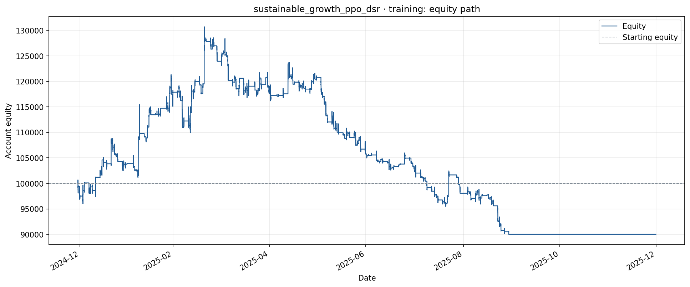

#### Figure: peak drawdown

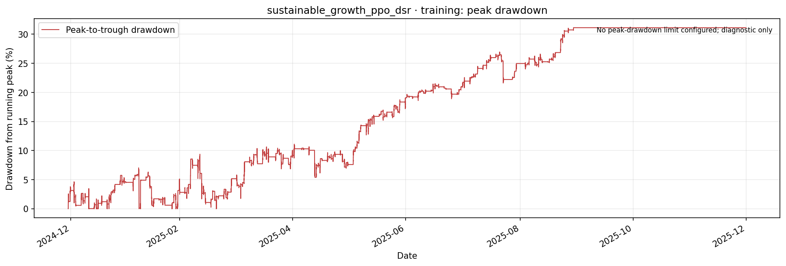

#### Figure: idea level breakdown

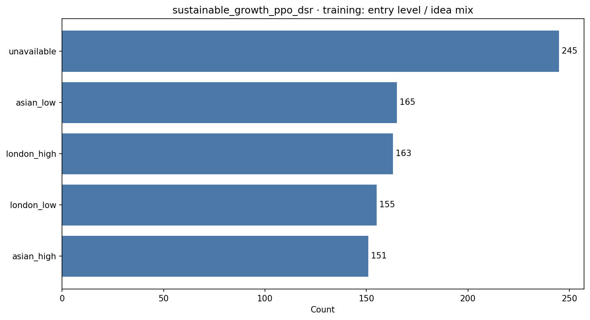

#### Figure: idea setup type breakdown

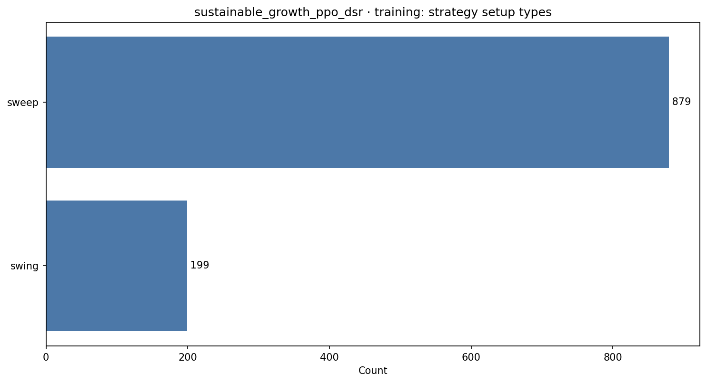

#### Figure: idea outcomes by level

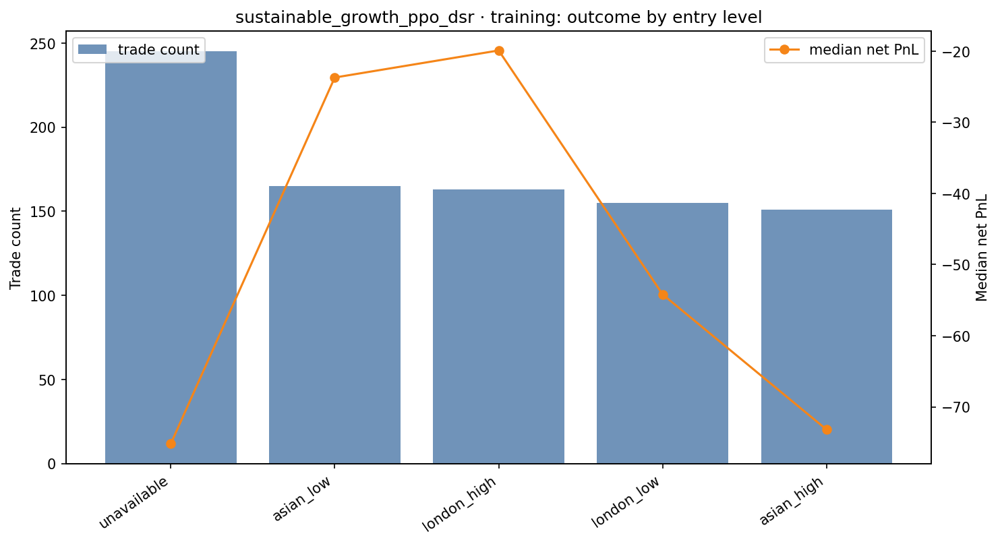

#### Figure: exit breakdown by outcome

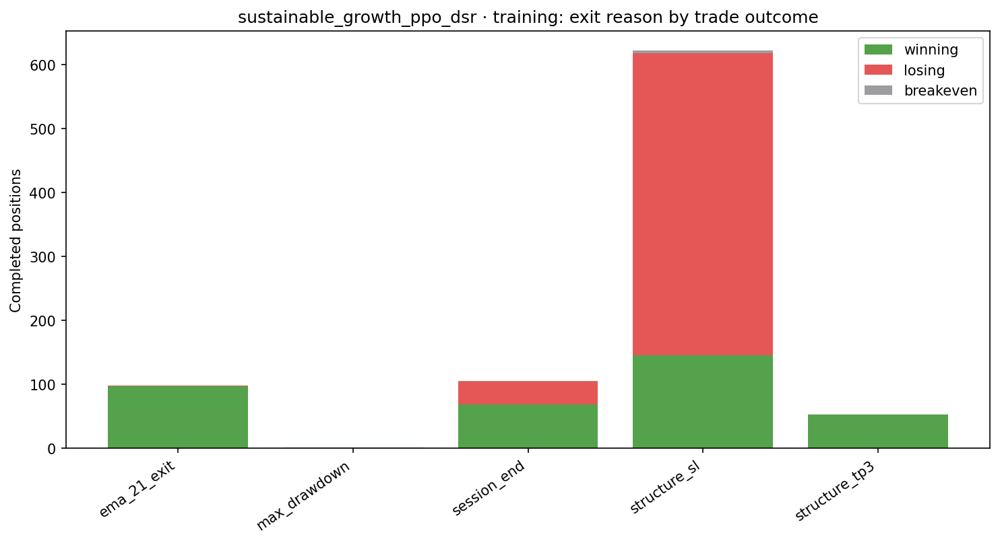

#### Figure: sl reference breakdown

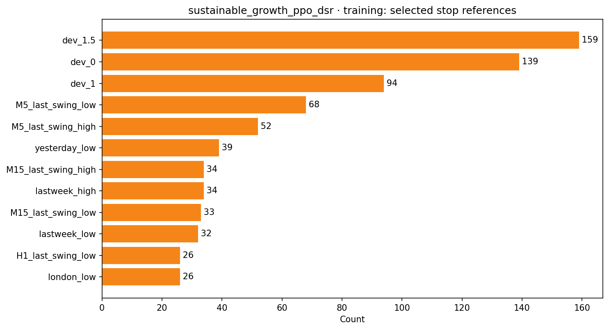

#### Figure: tp reference breakdown

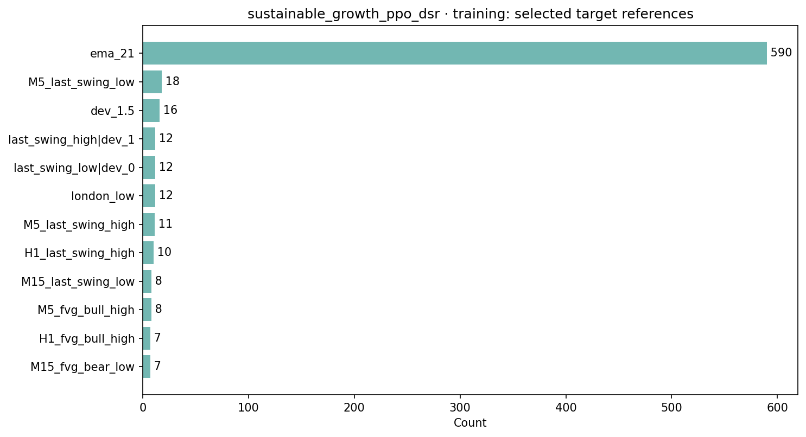

#### Figure: sl tp risk distributions

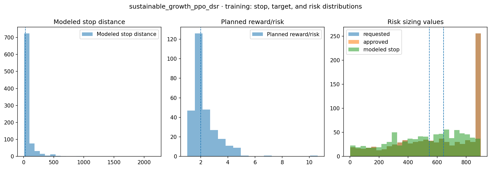

#### Figure: typical trade examples

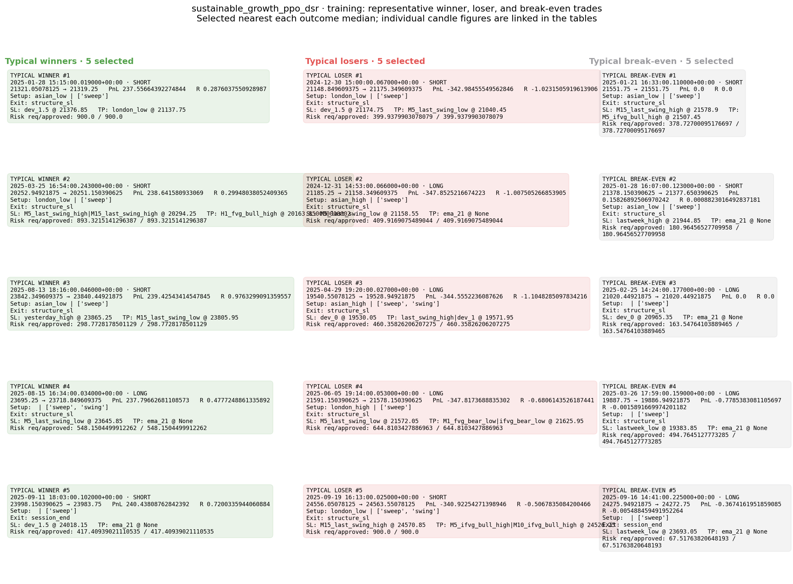

#### Saved evaluation figure: equity figure

#### Saved evaluation figure: drawdown figure

#### Saved evaluation figure: daily pnl figure

#### Saved evaluation figure: sl family figure

#### Saved evaluation figure: tp family figure

#### Saved evaluation figure: stop index figure

#### Saved evaluation figure: target index figure

#### Saved evaluation figure: sl tp rank figure

#### Typical winning trades (5 selected)

| Example | Time | Side | Entry to exit | Net PnL | Realized R | Trading idea | Exit | Stop | Target | Requested / approved risk | Candlestick figure |
|---:|---|---|---:|---:|---:|---|---|---|---|---:|---|
| 1 | 2025-01-28 15:15:00.019000+00:00 | Short | 21321.051 → 21319.250 | 237.557 | 0.288 | level type: asian_low; entry setup types: sweep; manipulation: none; distribution phase: 1.000; session: ny; volatility regime: high; trend regime: flat | structure_sl | dev_1.5 @ 21376.850 | london_low @ 21137.750 | 900.000 / 900.000 | [open chart](r1_project_results_report_figures/sustainable_growth_ppo_dsr__seed50/training/orders/trade_0004_20250128_1515_1540_S_p13.3.png) |
| 2 | 2025-03-25 16:54:00.243000+00:00 | Short | 20252.949 → 20251.150 | 238.642 | 0.299 | level type: london_low; entry setup types: sweep; manipulation: against; distribution phase: 0.000; session: ny; volatility regime: mid; trend regime: flat | structure_sl | M5_last_swing_high\|M15_last_swing_high @ 20294.250 | H1_fvg_bull_high @ 20163.850 | 893.322 / 893.322 | [open chart](r1_project_results_report_figures/sustainable_growth_ppo_dsr__seed50/training/orders/trade_0007_20250325_1654_1820_S_p15.3.png) |
| 3 | 2025-08-13 18:16:00.046000+00:00 | Short | 23842.350 → 23840.449 | 239.425 | 0.976 | level type: asian_low; entry setup types: sweep; manipulation: against; distribution phase: 0.000; session: ny; volatility regime: mid; trend regime: flat | structure_sl | yesterday_high @ 23865.250 | M15_last_swing_low @ 23805.950 | 298.773 / 298.773 | [open chart](r1_project_results_report_figures/sustainable_growth_ppo_dsr__seed50/training/orders/trade_0011_20250813_1816_1856_S_p8.3.png) |
| 4 | 2025-08-15 16:34:00.034000+00:00 | Long | 23695.250 → 23718.850 | 237.797 | 0.478 | level type: ; entry setup types: sweep, swing; manipulation: against; distribution phase: 0.000; session: ny; volatility regime: high; trend regime: flat | structure_sl | M5_last_swing_low @ 23645.850 | ema_21 @ Not recorded in run artifacts | 548.150 / 548.150 | [open chart](r1_project_results_report_figures/sustainable_growth_ppo_dsr__seed50/training/orders/trade_0012_20250815_1634_1710_L_p237.8.png) |
| 5 | 2025-09-11 18:03:00.102000+00:00 | Short | 23998.150 → 23983.750 | 240.438 | 0.720 | level type: ; entry setup types: sweep; manipulation: none; distribution phase: 1.000; session: ny; volatility regime: mid; trend regime: flat | session_end | dev_1.5 @ 24018.150 | ema_21 @ Not recorded in run artifacts | 417.409 / 417.409 | [open chart](r1_project_results_report_figures/sustainable_growth_ppo_dsr__seed50/training/orders/trade_0013_20250911_1803_2300_S_p240.4.png) |

#### Typical losing trades (5 selected)

| Example | Time | Side | Entry to exit | Net PnL | Realized R | Trading idea | Exit | Stop | Target | Requested / approved risk | Candlestick figure |
|---:|---|---|---:|---:|---:|---|---|---|---|---:|---|
| 1 | 2024-12-30 15:00:00.067000+00:00 | Short | 21148.850 → 21175.350 | -342.985 | -1.023 | level type: london_low; entry setup types: sweep; manipulation: against; distribution phase: 0.000; session: ny; volatility regime: high; trend regime: flat | structure_sl | dev_1.5 @ 21174.750 | M5_last_swing_low @ 21040.450 | 399.938 / 399.938 | [open chart](r1_project_results_report_figures/sustainable_growth_ppo_dsr__seed50/training/orders/trade_0001_20241230_1500_1518_S_m343.0.png) |
| 2 | 2024-12-31 14:53:00.066000+00:00 | Long | 21185.250 → 21158.350 | -347.853 | -1.008 | level type: asian_high; entry setup types: sweep; manipulation: none; distribution phase: 1.000; session: ny; volatility regime: high; trend regime: flat | structure_sl | M5_last_swing_low @ 21158.550 | ema_21 @ Not recorded in run artifacts | 409.917 / 409.917 | [open chart](r1_project_results_report_figures/sustainable_growth_ppo_dsr__seed50/training/orders/trade_0002_20241231_1453_1459_L_m347.9.png) |
| 3 | 2025-04-29 19:20:00.027000+00:00 | Long | 19540.551 → 19528.949 | -344.555 | -1.105 | level type: asian_high; entry setup types: sweep, swing; manipulation: against; distribution phase: 0.000; session: ny; volatility regime: high; trend regime: flat | structure_sl | dev_0 @ 19530.050 | last_swing_high\|dev_1 @ 19571.950 | 460.358 / 460.358 | [open chart](r1_project_results_report_figures/sustainable_growth_ppo_dsr__seed50/training/orders/trade_0009_20250429_1920_1938_L_m344.6.png) |
| 4 | 2025-06-05 19:14:00.053000+00:00 | Long | 21591.150 → 21578.150 | -347.817 | -0.681 | level type: london_high; entry setup types: sweep; manipulation: against; distribution phase: 0.000; session: ny; volatility regime: high; trend regime: flat | structure_sl | M5_last_swing_low @ 21572.050 | M1_fvg_bear_low\|ifvg_bear_low @ 21625.950 | 644.810 / 644.810 | [open chart](r1_project_results_report_figures/sustainable_growth_ppo_dsr__seed50/training/orders/trade_0010_20250605_1914_1915_L_m347.8.png) |
| 5 | 2025-09-19 16:13:00.025000+00:00 | Short | 24556.051 → 24563.551 | -340.923 | -0.507 | level type: london_low; entry setup types: sweep, swing; manipulation: against; distribution phase: 0.000; session: ny; volatility regime: mid; trend regime: flat | structure_sl | M15_last_swing_high @ 24570.850 | M5_ifvg_bull_high\|M10_ifvg_bull_high @ 24526.250 | 900.000 / 900.000 | [open chart](r1_project_results_report_figures/sustainable_growth_ppo_dsr__seed50/training/orders/trade_0015_20250919_1613_1614_S_m340.9.png) |

#### Typical break-even trades (5 selected)

| Example | Time | Side | Entry to exit | Net PnL | Realized R | Trading idea | Exit | Stop | Target | Requested / approved risk | Candlestick figure |
|---:|---|---|---:|---:|---:|---|---|---|---|---:|---|
| 1 | 2025-01-21 16:33:00.110000+00:00 | Short | 21551.750 → 21551.750 | 0.000 | 0.000 | level type: asian_low; entry setup types: sweep; manipulation: against; distribution phase: 0.000; session: ny; volatility regime: mid; trend regime: flat | structure_sl | M15_last_swing_high @ 21578.900 | M5_ifvg_bull_high @ 21507.450 | 378.727 / 378.727 | [open chart](r1_project_results_report_figures/sustainable_growth_ppo_dsr__seed50/training/orders/trade_0003_20250121_1633_1634_S_p0.0.png) |
| 2 | 2025-01-28 16:07:00.123000+00:00 | Short | 21378.150 → 21377.650 | 0.158 | 0.000882 | level type: asian_low; entry setup types: sweep; manipulation: against; distribution phase: 0.000; session: ny; volatility regime: high; trend regime: flat | structure_sl | lastweek_high @ 21944.850 | ema_21 @ Not recorded in run artifacts | 180.965 / 180.965 | [open chart](r1_project_results_report_figures/sustainable_growth_ppo_dsr__seed50/training/orders/trade_0005_20250128_1607_1608_S_p0.2.png) |
| 3 | 2025-02-25 14:24:00.177000+00:00 | Long | 21020.449 → 21020.449 | 0.000 | 0.000 | level type: ; entry setup types: sweep; manipulation: against; distribution phase: 0.000; session: ny; volatility regime: high; trend regime: flat | structure_sl | dev_0 @ 20965.350 | ema_21 @ Not recorded in run artifacts | 163.548 / 163.548 | [open chart](r1_project_results_report_figures/sustainable_growth_ppo_dsr__seed50/training/orders/trade_0006_20250225_1424_1444_L_p0.0.png) |
| 4 | 2025-03-26 17:59:00.159000+00:00 | Long | 19887.750 → 19886.949 | -0.779 | -0.002 | level type: ; entry setup types: sweep; manipulation: against; distribution phase: 0.000; session: ny; volatility regime: mid; trend regime: flat | structure_sl | lastweek_low @ 19383.850 | ema_21 @ Not recorded in run artifacts | 494.765 / 494.765 | [open chart](r1_project_results_report_figures/sustainable_growth_ppo_dsr__seed50/training/orders/trade_0008_20250326_1759_1800_L_m0.8.png) |
| 5 | 2025-09-16 14:41:00.225000+00:00 | Long | 24275.949 → 24272.750 | -0.367 | -0.005 | level type: ; entry setup types: sweep; manipulation: against; distribution phase: 0.000; session: ny; volatility regime: high; trend regime: flat | session_end | lastweek_low @ 23693.050 | ema_21 @ Not recorded in run artifacts | 67.518 / 67.518 | [open chart](r1_project_results_report_figures/sustainable_growth_ppo_dsr__seed50/training/orders/trade_0014_20250916_1441_2300_L_m0.4.png) |

#### Winner, loser, and break-even annotations

### Testing results

This section reports the completed training split or the report-only testing split, as labeled.

#### Performance and trading activity

| Measure | Result |
|---|---|
| sharpe | -0.576 |
| sortino | -0.840 |
| calmar | -0.573 |
| max drawdown | 21.59% |
| total return pct | -10.07% |
| total pnl | -10070.908 |
| profit factor | 0.929 |
| win rate | 38.59% |
| expectancy | -17.274 |
| n trades | 583 |
| breach count | 2 |
| breach rate | 0.010 |
| turnover | 0.007 |
| max consec loss | 11 |
| avg trade | -17.274 |
| extras / fill count | 615.000 |
| extras / incomplete positions | 0.000 |
| extras / entry active | 1.000 |
| activity status | ACTIVE |
| initial balance | 100000.000 |
| final equity | 89929.092 |

#### Trade counts

| Trade count | Result |
|---|---|
| positions | 583 |
| entry fills | 583 |
| exit fills | 615 |
| rejected entries | 49503 |
| wins | 223 |
| losses | 358 |
| breakeven within tolerance | 2 |

Peak-drawdown policy: **Disabled; measured peak drawdown is report-only**. The measured maximum drawdown remains reported in the metrics above.

#### Important Setup

| Measure | Result |
|---|---|
| direction / -1.0 | 327 |
| direction / 1.0 | 256 |
| entry level / unavailable | 143 |
| entry level / asian low | 126 |
| entry level / london high | 111 |
| entry level / london low | 102 |
| entry level / asian high | 101 |
| setup types / sweep | 583 |
| setup types / swing | 114 |
| manipulation / against | 456 |
| manipulation / none | 100 |
| manipulation / done | 27 |
| distribution phase / 0.0 | 456 |
| distribution phase / 1.0 | 127 |
| session / ny | 583 |
| volatility regime / high | 462 |
| volatility regime / mid | 109 |
| volatility regime / low | 12 |
| trend regime / flat | 583 |

#### Exit Breakdown

| Measure | Result |
|---|---|
| position exit reason / structure sl | 419 |
| position exit reason / session end | 61 |
| position exit reason / ema 21 exit | 53 |
| position exit reason / structure tp3 | 49 |
| position exit reason / max drawdown | 100.00% |
| exit reason by net outcome / winning / ema 21 exit | 53 |
| exit reason by net outcome / winning / session end | 38 |
| exit reason by net outcome / winning / structure sl | 83 |
| exit reason by net outcome / winning / structure tp3 | 49 |
| exit reason by net outcome / losing / max drawdown | 100.00% |
| exit reason by net outcome / losing / session end | 23 |
| exit reason by net outcome / losing / structure sl | 334 |
| exit reason by net outcome / breakeven / structure sl | 2 |
| entry selected exit mode / ema 21 | 339 |
| entry selected exit mode / structural | 244 |
| close fill reason / structure sl | 419 |
| close fill reason / session end | 61 |
| close fill reason / ema 21 exit | 53 |
| close fill reason / structure tp3 | 49 |
| close fill reason / structure tp1 | 20 |
| close fill reason / structure tp2 | 12 |
| close fill reason / max drawdown | 100.00% |
| outcome counts / winning | 223 |
| outcome counts / losing | 358 |
| outcome counts / breakeven | 2 |

#### Sl Breakdown

| Measure | Result |
|---|---|
| selected reference / dev 1.5 | 113 |
| selected reference / dev 0 | 70 |
| selected reference / dev 1 | 68 |
| selected reference / M5 last swing low | 37 |
| selected reference / M5 last swing high | 35 |
| selected reference / M15 last swing low | 27 |
| selected reference / yesterday high | 27 |
| selected reference / yesterday low | 26 |
| selected reference / lastweek low | 23 |
| selected reference / H1 last swing low | 21 |
| selected reference / asian low | 21 |
| selected reference / M15 last swing high | 17 |
| selected reference / lastweek high | 16 |
| selected reference / asian high | 13 |
| selected reference / london high | 13 |
| selected reference / london low | 13 |
| selected reference / H1 last swing high|yesterday high | 8 |
| selected reference / H1 last swing high | 7 |
| selected reference / M15 last swing high|H1 last swing high | 4 |
| selected reference / M5 last swing low|M15 last swing low | 4 |
| selected reference / yesterday low|lastweek low | 4 |
| selected reference / H1 last swing low|yesterday low | 3 |
| selected reference / M5 last swing high|M15 last swing high | 3 |
| selected reference / M5 last swing high|london high | 3 |
| selected reference / M5 last swing low|london low | 3 |
| selected reference / M15 last swing low|H1 last swing low | 1 |
| selected reference / M15 last swing low|london low | 1 |
| selected reference / M5 last swing high|london high|dev 1 | 1 |
| selected reference / M5 last swing low|dev 0 | 1 |
| exit reason / structure sl | 419 |
| sl reason by net outcome / winning / structure sl | 83 |
| sl reason by net outcome / losing / structure sl | 334 |
| sl reason by net outcome / breakeven / structure sl | 2 |
| modeled stop distance / count | 583 |
| modeled stop distance / min | 10.001 |
| modeled stop distance / median | 38.100 |
| modeled stop distance / mean | 80.025 |
| modeled stop distance / max | 1522.550 |
| initial stop risk usd / count | 583 |
| initial stop risk usd / min | 1.437 |
| initial stop risk usd / median | 580.888 |
| initial stop risk usd / mean | 538.910 |
| initial stop risk usd / max | 893.784 |
| dynamic sl events | None recorded |

#### Tp Breakdown

| Measure | Result |
|---|---|
| selected reference / ema 21 | 339 |
| selected reference / M5 last swing low | 20 |
| selected reference / last swing low|dev 0 | 14 |
| selected reference / M5 last swing high | 13 |
| selected reference / london low | 12 |
| selected reference / H1 fvg bull high | 9 |
| selected reference / dev 1.5 | 9 |
| selected reference / M15 last swing low | 8 |
| selected reference / H1 last swing high | 7 |
| selected reference / M1 fvg bull high | 7 |
| selected reference / M5 fvg bull high | 7 |
| selected reference / last swing high|dev 1 | 7 |
| selected reference / H1 last swing low | 6 |
| selected reference / M3 fvg bull high|M3 ifvg bull high | 6 |
| selected reference / M10 ifvg bull high | 5 |
| selected reference / M3 fvg bull high | 5 |
| selected reference / M5 fvg bear low | 5 |
| selected reference / H4 fvg bull high | 4 |
| selected reference / M15 fvg bull high | 4 |
| selected reference / asian low | 4 |
| selected reference / london high | 4 |
| selected reference / D1 fvg bear low|D1 ifvg bear low | 3 |
| selected reference / H1 fvg bear low | 3 |
| selected reference / M10 fvg bull high|M10 ifvg bull high | 3 |
| selected reference / M15 last swing high | 3 |
| selected reference / M1 fvg bear low | 3 |
| selected reference / M30 fvg bear low | 3 |
| selected reference / M30 fvg bull high | 3 |
| selected reference / M5 fvg bull high|M5 ifvg bull high | 3 |
| selected reference / london low|M15 last swing low | 3 |
| selected reference / D1 fvg bear low | 2 |
| selected reference / D1 fvg bull high | 2 |
| selected reference / H1 fvg bull high|H1 ifvg bull high | 2 |
| selected reference / H1 ifvg bull high | 2 |
| selected reference / H4 fvg bear low | 2 |
| selected reference / M10 fvg bull high | 2 |
| selected reference / M15 fvg bull high|M15 ifvg bull high | 2 |
| selected reference / M30 fvg bull high|H1 fvg bull high|M30 ifvg bull high|H1 ifvg bull high | 2 |
| selected reference / M30 ifvg bull high|H1 ifvg bull high | 2 |
| selected reference / M5 fvg bear low|M10 fvg bear low | 2 |
| selected reference / M5 ifvg bull high | 2 |
| selected reference / asian high | 2 |
| selected reference / D1 ifvg bear low | 1 |
| selected reference / H1 fvg bear low|H1 ifvg bear low | 1 |
| selected reference / H1 last swing high|D1 fvg bear low|D1 ifvg bear low | 1 |
| selected reference / H4 fvg bull high|H4 ifvg bull high | 1 |
| selected reference / M10 fvg bear low | 1 |
| selected reference / M10 fvg bear low|M15 fvg bear low|M10 ifvg bear low|M15 ifvg bear low | 1 |
| selected reference / M10 fvg bull high|M15 fvg bull high|M15 ifvg bull high | 1 |
| selected reference / M10 ifvg bear low | 1 |
| selected reference / M15 fvg bear low | 1 |
| selected reference / M15 fvg bear low|M15 ifvg bear low | 1 |
| selected reference / M1 fvg bear low|ifvg bear low | 1 |
| selected reference / M1 fvg bull high|M10 fvg bull high|M10 ifvg bull high | 1 |
| selected reference / M1 fvg bull high|M3 fvg bull high|M5 fvg bull high|ifvg bull high|M3 ifvg bull high|M5 ifvg bull high | 1 |
| selected reference / M1 fvg bull high|ifvg bull high | 1 |
| selected reference / M30 fvg bear low|M30 ifvg bear low | 1 |
| selected reference / M30 fvg bull high|H1 fvg bull high | 1 |
| selected reference / M3 fvg bear low | 1 |
| selected reference / M3 fvg bear low|M5 fvg bear low|M15 fvg bear low|M3 ifvg bear low|M5 ifvg bear low|M15 ifvg bear low | 1 |
| selected reference / M3 fvg bear low|M5 fvg bear low|M3 ifvg bear low|M5 ifvg bear low | 1 |
| selected reference / M3 fvg bull high|M15 fvg bull high|M15 ifvg bull high | 1 |
| selected reference / M3 fvg bull high|M5 fvg bull high | 1 |
| selected reference / M3 fvg bull high|M5 fvg bull high|M10 fvg bull high|M10 ifvg bull high | 1 |
| selected reference / M3 fvg bull high|M5 fvg bull high|M3 ifvg bull high|M5 ifvg bull high | 1 |
| selected reference / M3 ifvg bull high | 1 |
| selected reference / M5 fvg bear low|M10 ifvg bear low | 1 |
| selected reference / M5 fvg bear low|M15 fvg bear low|M15 ifvg bear low | 1 |
| selected reference / M5 fvg bear low|M5 ifvg bear low | 1 |
| selected reference / M5 fvg bull high|M10 fvg bull high | 1 |
| selected reference / M5 ifvg bear low | 1 |
| selected reference / M5 last swing low|H1 fvg bull high | 1 |
| selected reference / M5 last swing low|M15 last swing low | 1 |
| selected reference / asian low|H1 last swing low | 1 |
| selected reference / asian low|H4 ifvg bull high | 1 |
| selected reference / dev 1 | 1 |
| selected reference / last swing high|M3 fvg bear low|M3 ifvg bear low|M5 ifvg bear low|dev 1 | 1 |
| selected reference / london high|M5 last swing high | 1 |
| selected reference / london high|M5 last swing high|M15 last swing high | 1 |
| close fill reason / structure tp3 | 49 |
| close fill reason / structure tp1 | 20 |
| close fill reason / structure tp2 | 12 |
| tp reason by net outcome / winning / structure tp3 | 49 |
| tp reason by net outcome / losing | None recorded |
| tp reason by net outcome / breakeven | None recorded |
| planned rr / count | 244 |
| planned rr / min | 1.038 |
| planned rr / median | 1.981 |
| planned rr / mean | 2.287 |
| planned rr / max | 9.594 |
| target legs present | 583 |
| configured tp count distribution / 3.0 | 98 |
| configured tp count distribution / 1.0 | 90 |
| configured tp count distribution / 2.0 | 87 |
| configured tp count distribution / 4.0 | 72 |
| configured tp count distribution / 5.0 | 66 |
| configured tp count distribution / 6.0 | 51 |
| configured tp count distribution / 0.0 | 45 |
| configured tp count distribution / 7.0 | 32 |
| configured tp count distribution / 8.0 | 20 |
| configured tp count distribution / 9.0 | 15 |
| configured tp count distribution / 10.0 | 4 |
| configured tp count distribution / 11.0 | 2 |
| configured tp count distribution / 12.0 | 1 |
| tp slot distribution / unavailable | 534 |
| tp slot distribution / 3.0 | 49 |
| tp slot distribution / 1.0 | 20 |
| tp slot distribution / 2.0 | 12 |

#### Risk Breakdown

| Measure | Result |
|---|---|
| requested usd / count | 583 |
| requested usd / min | 1.983 |
| requested usd / median | 663.627 |
| requested usd / mean | 619.235 |
| requested usd / max | 900.000 |
| approved usd / count | 583 |
| approved usd / min | 1.983 |
| approved usd / median | 663.627 |
| approved usd / mean | 619.235 |
| approved usd / max | 900.000 |
| modeled stop risk usd / count | 583 |
| modeled stop risk usd / min | 1.437 |
| modeled stop risk usd / median | 580.888 |
| modeled stop risk usd / mean | 538.910 |
| modeled stop risk usd / max | 893.784 |
| risk fraction / count | 58300.00% |
| risk fraction / min | 0.00% |
| risk fraction / median | 0.74% |
| risk fraction / mean | 0.69% |
| risk fraction / max | 1.00% |
| execution reserve usd / count | 583 |
| execution reserve usd / min | 0.173 |
| execution reserve usd / median | 66.177 |
| execution reserve usd / mean | 80.325 |
| execution reserve usd / max | 299.986 |
| lots / count | 583 |
| lots / min | 0.035 |
| lots / median | 13.235 |
| lots / mean | 16.065 |
| lots / max | 59.997 |
| requested usd by outcome / winning / count | 223 |
| requested usd by outcome / winning / min | 37.675 |
| requested usd by outcome / winning / median | 699.907 |
| requested usd by outcome / winning / mean | 646.207 |
| requested usd by outcome / winning / max | 900.000 |
| requested usd by outcome / losing / count | 358 |
| requested usd by outcome / losing / min | 1.983 |
| requested usd by outcome / losing / median | 633.840 |
| requested usd by outcome / losing / mean | 604.725 |
| requested usd by outcome / losing / max | 900.000 |
| requested usd by outcome / breakeven / count | 2 |
| requested usd by outcome / breakeven / min | 33.784 |
| requested usd by outcome / breakeven / median | 208.976 |
| requested usd by outcome / breakeven / mean | 208.976 |
| requested usd by outcome / breakeven / max | 384.168 |
| approved usd by outcome / winning / count | 223 |
| approved usd by outcome / winning / min | 37.675 |
| approved usd by outcome / winning / median | 699.907 |
| approved usd by outcome / winning / mean | 646.207 |
| approved usd by outcome / winning / max | 900.000 |
| approved usd by outcome / losing / count | 358 |
| approved usd by outcome / losing / min | 1.983 |
| approved usd by outcome / losing / median | 633.840 |
| approved usd by outcome / losing / mean | 604.725 |
| approved usd by outcome / losing / max | 900.000 |
| approved usd by outcome / breakeven / count | 2 |
| approved usd by outcome / breakeven / min | 33.784 |
| approved usd by outcome / breakeven / median | 208.976 |
| approved usd by outcome / breakeven / mean | 208.976 |
| approved usd by outcome / breakeven / max | 384.168 |
| modeled stop risk usd by outcome / winning / count | 223 |
| modeled stop risk usd by outcome / winning / min | 27.173 |
| modeled stop risk usd by outcome / winning / median | 610.981 |
| modeled stop risk usd by outcome / winning / mean | 564.300 |
| modeled stop risk usd by outcome / winning / max | 891.628 |
| modeled stop risk usd by outcome / losing / count | 358 |
| modeled stop risk usd by outcome / losing / min | 1.437 |
| modeled stop risk usd by outcome / losing / median | 559.261 |
| modeled stop risk usd by outcome / losing / mean | 525.000 |
| modeled stop risk usd by outcome / losing / max | 893.784 |
| modeled stop risk usd by outcome / breakeven / count | 2 |
| modeled stop risk usd by outcome / breakeven / min | 32.129 |
| modeled stop risk usd by outcome / breakeven / median | 197.827 |
| modeled stop risk usd by outcome / breakeven / mean | 197.827 |
| modeled stop risk usd by outcome / breakeven / max | 363.525 |

#### Figure: equity curve

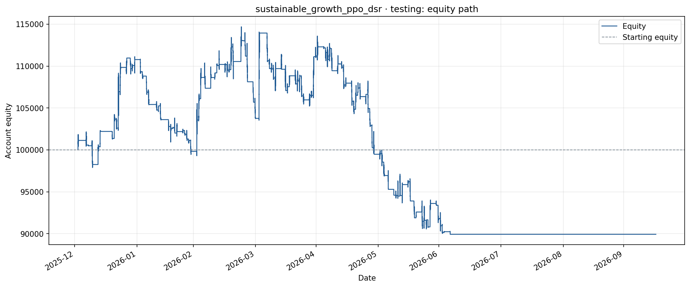

#### Figure: peak drawdown

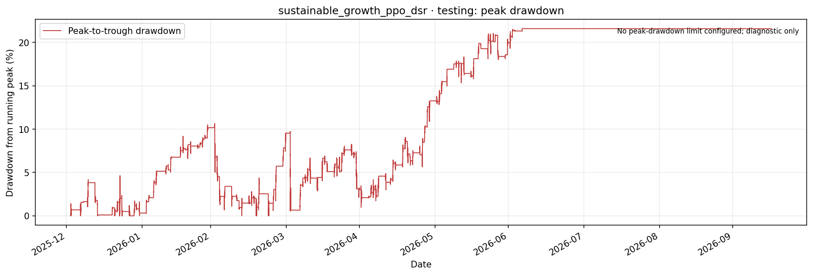

#### Figure: idea level breakdown

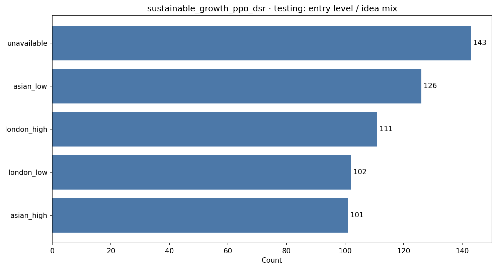

#### Figure: idea setup type breakdown

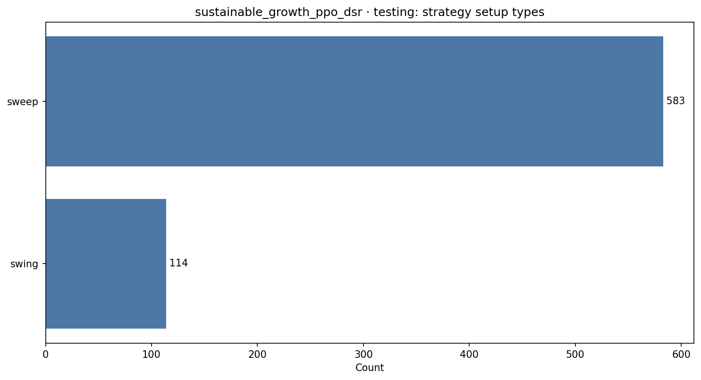

#### Figure: idea outcomes by level

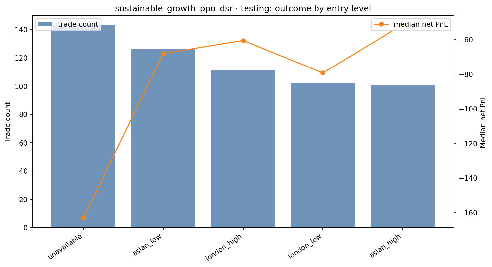

#### Figure: exit breakdown by outcome

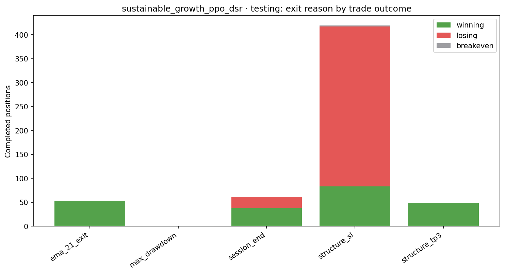

#### Figure: sl reference breakdown

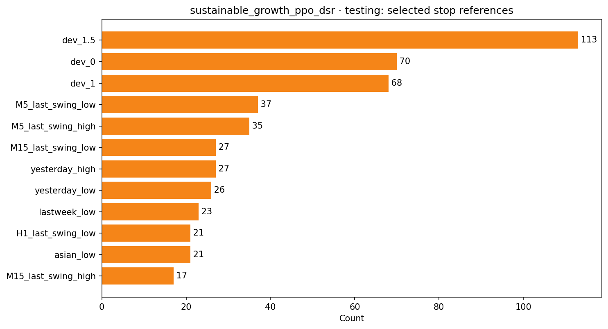

#### Figure: tp reference breakdown

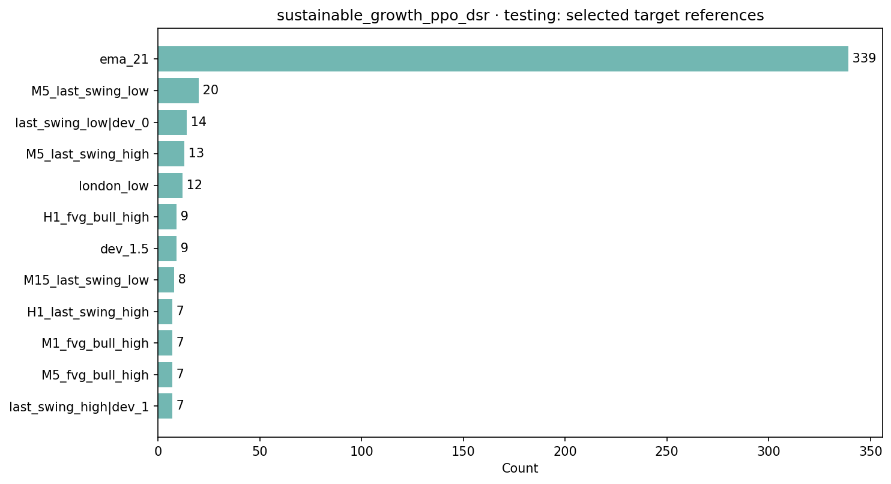

#### Figure: sl tp risk distributions

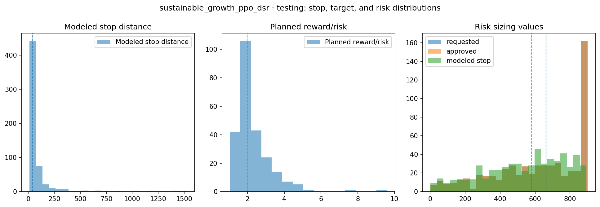

#### Figure: typical trade examples

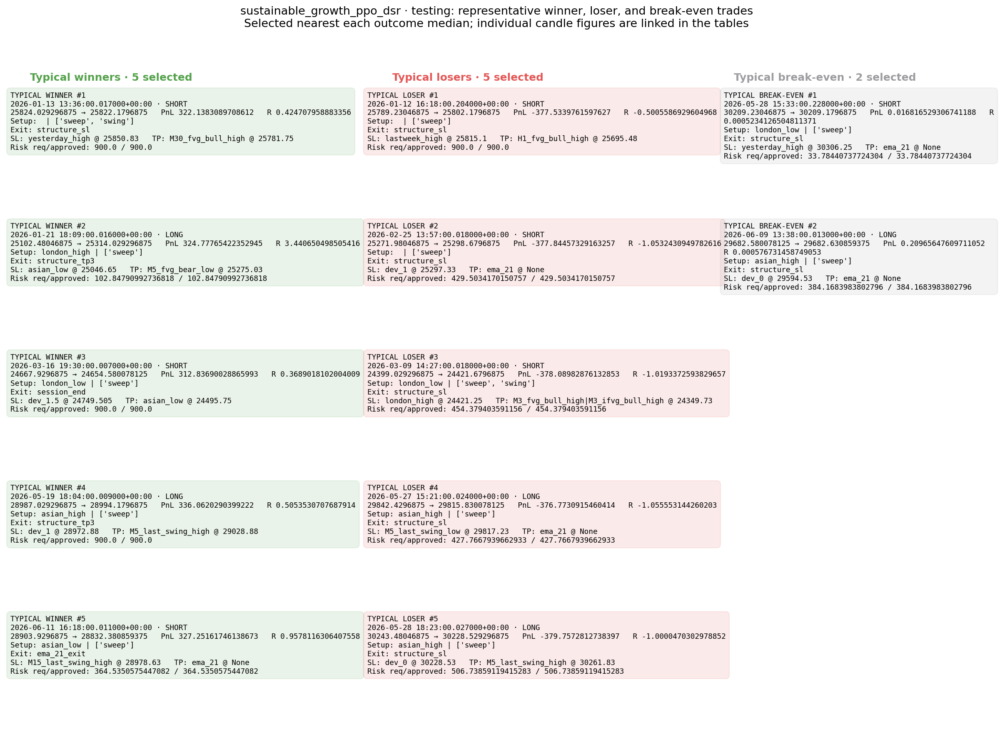

#### Saved evaluation figure: equity figure

#### Saved evaluation figure: drawdown figure

#### Saved evaluation figure: daily pnl figure

#### Saved evaluation figure: sl family figure

#### Saved evaluation figure: tp family figure

#### Saved evaluation figure: stop index figure

#### Saved evaluation figure: target index figure

#### Saved evaluation figure: sl tp rank figure

#### Typical winning trades (5 selected)

| Example | Time | Side | Entry to exit | Net PnL | Realized R | Trading idea | Exit | Stop | Target | Requested / approved risk | Candlestick figure |
|---:|---|---|---:|---:|---:|---|---|---|---|---:|---|
| 1 | 2026-01-13 13:36:00.017000+00:00 | Short | 25824.029 → 25822.180 | 322.138 | 0.425 | level type: ; entry setup types: sweep, swing; manipulation: against; distribution phase: 0.000; session: ny; volatility regime: high; trend regime: flat | structure_sl | yesterday_high @ 25850.830 | M30_fvg_bull_high @ 25781.750 | 900.000 / 900.000 | [open chart](r1_project_results_report_figures/sustainable_growth_ppo_dsr__seed50/testing/orders/trade_0002_20260113_1336_1338_S_p14.5.png) |
| 2 | 2026-01-21 18:09:00.016000+00:00 | Long | 25102.480 → 25314.029 | 324.778 | 3.441 | level type: london_high; entry setup types: sweep; manipulation: against; distribution phase: 0.000; session: ny; volatility regime: high; trend regime: flat | structure_tp3 | asian_low @ 25046.650 | M5_fvg_bear_low @ 25275.030 | 102.848 / 102.848 | [open chart](r1_project_results_report_figures/sustainable_growth_ppo_dsr__seed50/testing/orders/trade_0003_20260121_1809_1830_L_p177.9.png) |
| 3 | 2026-03-16 19:30:00.007000+00:00 | Short | 24667.930 → 24654.580 | 312.837 | 0.369 | level type: london_low; entry setup types: sweep; manipulation: against; distribution phase: 0.000; session: ny; volatility regime: high; trend regime: flat | session_end | dev_1.5 @ 24749.505 | asian_low @ 24495.750 | 900.000 / 900.000 | [open chart](r1_project_results_report_figures/sustainable_growth_ppo_dsr__seed50/testing/orders/trade_0006_20260316_1930_2300_S_p55.3.png) |
| 4 | 2026-05-19 18:04:00.009000+00:00 | Long | 28987.029 → 28994.180 | 336.062 | 0.505 | level type: asian_high; entry setup types: sweep; manipulation: against; distribution phase: 0.000; session: ny; volatility regime: high; trend regime: flat | structure_tp3 | dev_1 @ 28972.880 | M5_last_swing_high @ 29028.880 | 900.000 / 900.000 | [open chart](r1_project_results_report_figures/sustainable_growth_ppo_dsr__seed50/testing/orders/trade_0007_20260519_1804_1805_L_p336.1.png) |
| 5 | 2026-06-11 16:18:00.011000+00:00 | Short | 28903.930 → 28832.381 | 327.252 | 0.958 | level type: asian_low; entry setup types: sweep; manipulation: against; distribution phase: 0.000; session: ny; volatility regime: high; trend regime: flat | ema_21_exit | M15_last_swing_high @ 28978.630 | ema_21 @ Not recorded in run artifacts | 364.535 / 364.535 | [open chart](r1_project_results_report_figures/sustainable_growth_ppo_dsr__seed50/testing/orders/trade_0012_20260611_1618_1925_S_p327.3.png) |

#### Typical losing trades (5 selected)

| Example | Time | Side | Entry to exit | Net PnL | Realized R | Trading idea | Exit | Stop | Target | Requested / approved risk | Candlestick figure |
|---:|---|---|---:|---:|---:|---|---|---|---|---:|---|
| 1 | 2026-01-12 16:18:00.204000+00:00 | Short | 25789.230 → 25802.180 | -377.534 | -0.501 | level type: ; entry setup types: sweep; manipulation: against; distribution phase: 0.000; session: ny; volatility regime: high; trend regime: flat | structure_sl | lastweek_high @ 25815.100 | H1_fvg_bull_high @ 25695.480 | 900.000 / 900.000 | [open chart](r1_project_results_report_figures/sustainable_growth_ppo_dsr__seed50/testing/orders/trade_0001_20260112_1618_1623_S_m377.5.png) |
| 2 | 2026-02-25 13:57:00.018000+00:00 | Short | 25271.980 → 25298.680 | -377.845 | -1.053 | level type: ; entry setup types: sweep; manipulation: none; distribution phase: 1.000; session: ny; volatility regime: high; trend regime: flat | structure_sl | dev_1 @ 25297.330 | ema_21 @ Not recorded in run artifacts | 429.503 / 429.503 | [open chart](r1_project_results_report_figures/sustainable_growth_ppo_dsr__seed50/testing/orders/trade_0004_20260225_1357_1358_S_m377.8.png) |
| 3 | 2026-03-09 14:27:00.018000+00:00 | Short | 24399.029 → 24421.680 | -378.090 | -1.019 | level type: london_low; entry setup types: sweep, swing; manipulation: none; distribution phase: 1.000; session: ny; volatility regime: high; trend regime: flat | structure_sl | london_high @ 24421.250 | M3_fvg_bull_high\|M3_ifvg_bull_high @ 24349.730 | 454.379 / 454.379 | [open chart](r1_project_results_report_figures/sustainable_growth_ppo_dsr__seed50/testing/orders/trade_0005_20260309_1427_1434_S_m378.1.png) |
| 4 | 2026-05-27 15:21:00.024000+00:00 | Long | 29842.430 → 29815.830 | -376.773 | -1.056 | level type: asian_high; entry setup types: sweep; manipulation: against; distribution phase: 0.000; session: ny; volatility regime: high; trend regime: flat | structure_sl | M5_last_swing_low @ 29817.230 | ema_21 @ Not recorded in run artifacts | 427.767 / 427.767 | [open chart](r1_project_results_report_figures/sustainable_growth_ppo_dsr__seed50/testing/orders/trade_0008_20260527_1521_1521_L_m376.8.png) |
| 5 | 2026-05-28 18:23:00.027000+00:00 | Long | 30243.480 → 30228.529 | -379.757 | -1.000 | level type: asian_high; entry setup types: sweep; manipulation: done; distribution phase: 1.000; session: ny; volatility regime: mid; trend regime: flat | structure_sl | dev_0 @ 30228.530 | M5_last_swing_high @ 30261.830 | 506.739 / 506.739 | [open chart](r1_project_results_report_figures/sustainable_growth_ppo_dsr__seed50/testing/orders/trade_0010_20260528_1823_1835_L_m379.8.png) |

#### Typical break-even trades (2 selected)

| Example | Time | Side | Entry to exit | Net PnL | Realized R | Trading idea | Exit | Stop | Target | Requested / approved risk | Candlestick figure |
|---:|---|---|---:|---:|---:|---|---|---|---|---:|---|
| 1 | 2026-05-28 15:33:00.228000+00:00 | Short | 30209.230 → 30209.180 | 0.017 | 0.000523 | level type: london_low; entry setup types: sweep; manipulation: none; distribution phase: 1.000; session: ny; volatility regime: mid; trend regime: flat | structure_sl | yesterday_high @ 30306.250 | ema_21 @ Not recorded in run artifacts | 33.784 / 33.784 | [open chart](r1_project_results_report_figures/sustainable_growth_ppo_dsr__seed50/testing/orders/trade_0009_20260528_1533_1534_S_p0.0.png) |
| 2 | 2026-06-09 13:38:00.013000+00:00 | Long | 29682.580 → 29682.631 | 0.210 | 0.000577 | level type: asian_high; entry setup types: sweep; manipulation: against; distribution phase: 0.000; session: ny; volatility regime: high; trend regime: flat | structure_sl | dev_0 @ 29594.530 | ema_21 @ Not recorded in run artifacts | 384.168 / 384.168 | [open chart](r1_project_results_report_figures/sustainable_growth_ppo_dsr__seed50/testing/orders/trade_0011_20260609_1338_1355_L_p0.2.png) |

#### Winner, loser, and break-even annotations

